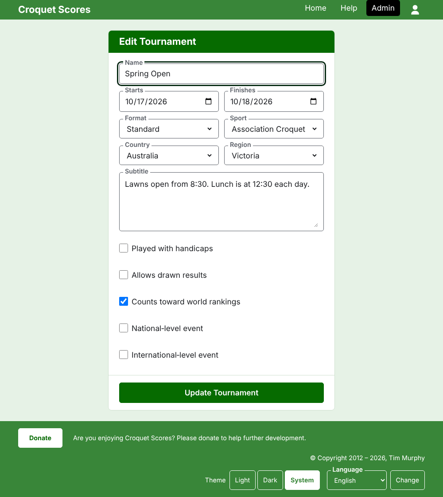
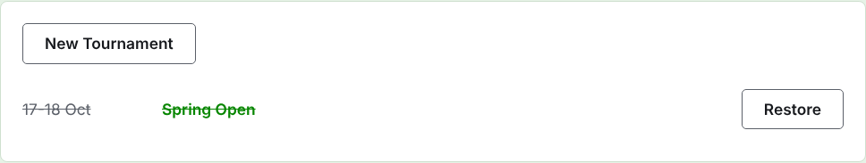

# Hoe om 'n toernooi te verander, te argiveer en te herstel

## Hoe om die toernooi se besonderhede te verander

In die lys toernooie in die administrasie, druk op **Wysig** by die toernooi. Die vorm is dié wat dit geskep het, begin soos die toernooi is. Verander wat verkeerd is en druk op **Dateer toernooi op**.

Sodra die toernooi enige speler of kompetisie bevat, geargiveerdes ingereken, kan sy formaat nie verander word na een wat tussen spanne gespeel word nie, wat in plaas daarvan spanne en toetse het.

'n Toernooi hou sy adres wanneer sy naam reggestel word, sodat 'n skakel wat iemand reeds gestuur het dit steeds vind. Dit skuif net wanneer die jaar waarin dit begin of sy sport verander, en dan lei sy ou adres na die nuwe een. Stoor neem jou na die toernooi waar dit ook al nou gevind word.

Net 'n bestuurder kan 'n toernooi verander. 'n Teller, of enigiemand anders, word so gesê eerder as om die vorm te sien.

## Die lys toernooie

Die administrasie lys een jaar op 'n slag, beginnende met vanjaar, nuutste toernooi eerste. Die jare waarin jy 'n toernooi het, is oortjies in die donkergroen balk, nuutste eerste; waar daar meer is as wat op 'n foon pas, is die oudstes in 'n aftreklys aan die einde van die ry. Die jaar is in die adres, so daar kan na 'n jaar geskakel word.

## Hoe om 'n toernooi te argiveer

**Argiveer** by 'n toernooi in die lys sit dit eenkant. Dit word steeds gelys, deurgehaal en ná die toernooie in gebruik, maar dit bied net **Herstel** aan: sy bladsy in die administrasie, en sy openbare bladsye, is gesluit totdat dit herstel word. Argivering vra nie eers nie, want herstel maak dit ongedaan.

Volgende: [Wat die publiek sien](what-the-public-sees.md).
