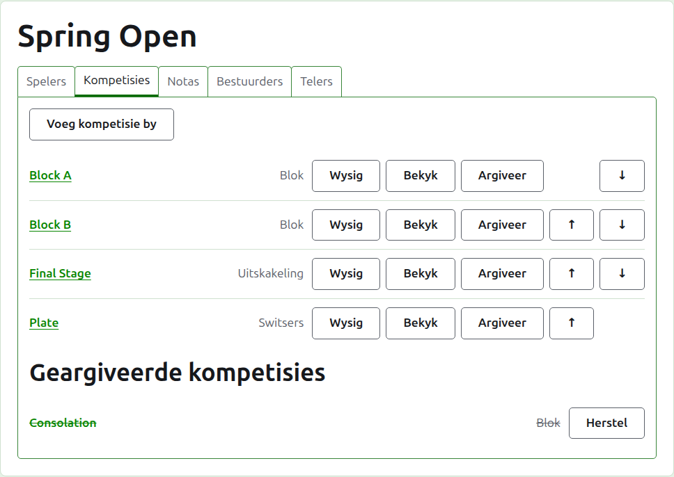
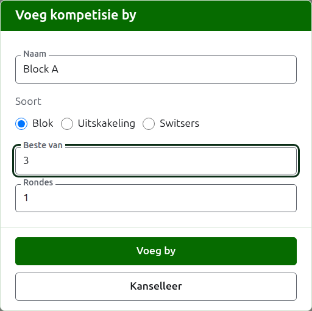
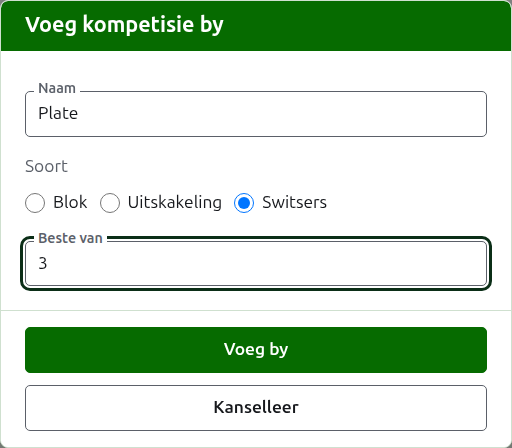
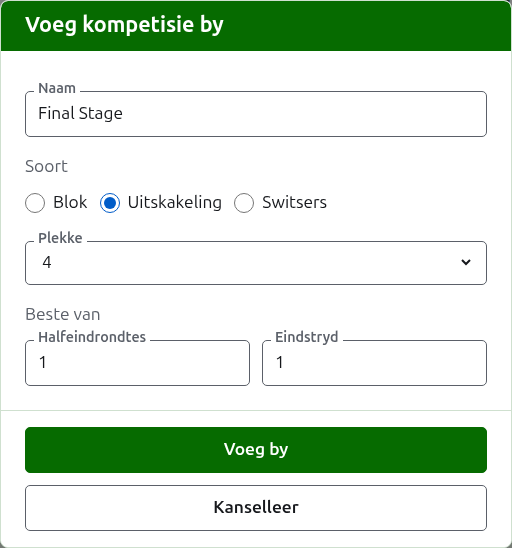

# Kompetisies

Die **Kompetisies**-oortjie van 'n toernooi se bladsy is waar sy kompetisies bygevoeg, in volgorde geplaas en eenkant gesit word. 'n Kompetisie is 'n blok, 'n uitskakeling of 'n Switserse kompetisie. Elkeen het 'n eie bladsy, waar sy spelers ingeskryf word en sy uitslae ingaan.

## Hoe om 'n kompetisie by te voeg {#adding-a-competition}

Druk op **Voeg kompetisie by**, bo die lys. 'n Dialoog maak oor die bladsy oop en vra vir die kompetisie se naam, sy soort, en die vorm wat sy soort het.

**Naam** is waarna die spelers op die toernooi se bladsy soek om hul spelle te vind. Dit is tussen 1 en 254 karakters, en 'n letter alleen is genoeg, want 'n blok word dikwels by een genoem. Twee kompetisies in een toernooi kan nie dieselfde naam hê nie.

**Soort** is 'n blok, 'n uitskakeling of 'n Switserse kompetisie. Die dialoog begin op 'n blok, wat die meeste kompetisies is.

### 'n Blok

'n Blok vra waarvan elke wedstryd die **beste van** is, en in hoeveel **rondtes** dit gespeel word, en hoe sy spelers wat gelyk staan op wedstryde gewen uitmekaar gehou word deur sy **Gelykopbrekers**.

**Beste van** begin op 1. Die beste van 3 word gewen deur wie ook al twee spelle wen. Dit mag 'n ewe getal wees, want in 'n blok word 'n speler gerangskik volgens die spelle wat hulle wen, en 'n wedstryd van twee spelle wat een elk gedeel word, is 'n uitslag soos enige ander.

**Rondtes** is hoeveel keer elke paar spelers in die blok ontmoet, met 'n wedstryd in elke ronde. Dit begin op 1, en 1 is amper altyd wat 'n blok wil hê: elke speler speel elke ander een keer. Verhoog dit net vir 'n blok waarin hulle weer ontmoet, soos 'n dubbele rondte-robyn, waar 2 elke paar twee wedstryde laat speel.

**Gelykopbrekers** is hoe spelers wat dieselfde aandeel van hul wedstryde gewen het, uitmekaar gehou word. Daar is drie maniere, en blokke van een toernooi kan verskillende gebruik, want reglemente verskil. **Netto spelle dan netto hoepels dan wie wie geklop het** is hoe blokke nog altyd gerangskik is, en is waar 'n nuwe blok begin: spelers wat gelyk staan op wedstryde gewen, word uitmekaar gehou deur hul netto spelle, dié wat nog gelyk staan deur hul netto hoepels, en dié wat nog gelyk staan deur wie wie geklop het onder hulle. Waar elke wedstryd 'n enkele spel is, word netto spelle weggelaat. **Wie wie geklop het** kyk net na die wedstryde wat die spelers wat gelyk staan teen mekaar gespeel het. **Ander** is vir reglemente wat die webwerf nie ken nie, en hou niemand uitmekaar nie. Spelers wat nie uitmekaar gehou kan word nie, deel 'n plek, getoon as =2, en die bladsy sê onder die rooster hoe spelers wat gelyk staan uitmekaar gehou word.

### 'n Switserse kompetisie

'n Switserse kompetisie vra net waarvan elke wedstryd die **beste van** is, wat op 1 begin, net soos by 'n blok. Die beste van 3 word gewen deur wie ook al twee spelle wen. Dit mag 'n ewe getal wees, want in 'n Switserse kompetisie word 'n speler gerangskik volgens die spelle wat hulle wen, en 'n wedstryd van twee spelle wat een elk gedeel word, is 'n uitslag soos enige ander.

### 'n Uitskakeling

'n Uitskakeling vra hoeveel **plekke** sy rooster het, en waarvan elke ronde die beste is. Die plekke word aangebied as 2, 4, 8, 16, 32, 64 en 128, want enige ander getal kan nie ronde vir ronde halveer tot by 'n eindstryd nie, en die dialoog begin op 8. Plekke wat oorbly sodra die spelers ingeskryf is, word met byes gevul, wat bygevoeg word waar die spelers is.

'n Rooster het soveel rondes as wat dit neem om sy plekke tot een te halveer, so 'n rooster van 8 plekke het drie rondes. Die dialoog vra waarvan elkeen die beste is, saam onder **Beste van**, in die volgorde waarin hulle gespeel word. Die laaste drie word genoem soos 'n rooster se rondes genoem word, **Kwarteindrondtes**, **Halfeindrondtes** en **Eindstryd**, en enige daarvoor by hul nommer, Ronde 1 eerste. Om meer plekke te kies, voeg rondes aan die begin van die rooster by, en om minder te kies, neem hulle aan die begin weg, sodat wat vir die eindstryd getik is steeds dié van die eindstryd is. Elke ronde is die beste van 'n onewe getal spelle, want 'n uitskakeling se wedstryd moet 'n wenner hê.

### ’n Verloorders-uitskakeling {#losers-knockout}

’n Uitskakeling kan diegene wat ’n rondte verloor na hul eie uitskakeling stuur, ’n verloorders-uitskakeling. Druk onder **Beste-van-getalle** van ’n uitskakeling op **Voeg verloorders-uitskakeling by**. ’n Dialoog vra vir **Verloorders van**, die rondte waarvan die verloorders voortspeel, uit al die rondtes behalwe die eindstryd, en vir **Naam van verloorders-uitskakeling**. Druk **Voeg by** om dit in die lys onder die knoppie te sit, waar **Verwyder** dit weer uithaal. Dit word saam met die uitskakeling bygevoeg, en as een van die twee geweier word, word nie een bygevoeg nie.

’n Verloorders-uitskakeling het ’n plek vir elke wedstryd van daardie rondte, en elke rondte daarvan is die beste van 1, wat **Wysig** kan verander. Sy spelers word ingesit soos die wedstryde van daardie rondte besluit word, in die volgorde van die trekking, so sy **Spelers**-oortjie wys hulle net. As ’n spel reggemaak of eenkant gesit word, word die verloorder weer verskuif of uitgehaal, tensy hy of sy reeds verder gespeel het.

By ’n uitskakeling wat reeds bygevoeg is, wys **Wysig** dieselfde knoppie, en die verloorders-uitskakeling word dadelik bygevoeg. ’n Uitskakeling wie se verloorders deur ’n ander een in gebruik geneem word, kan nie geargiveer word of sy plekke verander kry nie: argiveer eers die verloorders-uitskakeling.

### Hoe dit gespeel en getel word

Elke soort vra dieselfde drie dinge onder sy vorm.

**Met voorgifte gespeel.** Merk dit vir 'n kompetisie wat met voorgifte gespeel word.

**Laat gelykopuitslae toe.** Merk dit waar 'n spel kan eindig sonder dat een van die spelers die wenner is. Die meeste kompetisies laat dit nie toe nie. Waar dit gemerk is, word 'n uitslag wat met gelyke punte en geen merk ingevoer is as gelykop gehou; waar dit nie gemerk is nie, moet 'n spel op gelyke punte sê wie dit gewen het, met 'n merk ná die wenner se punte, soos "6w". 'n Uitskakeling se wedstryd het altyd 'n wenner, so 'n gelykopspel beslis nie een nie.

**Tel vir wêreldranglyste.** Word net gevra waar dit getel kan word: 'n kompetisie in Association Croquet of Golf Croquet wat nie met voorgifte gespeel word nie en nie gelykopuitslae toelaat nie. Dit is om mee te begin gemerk, so ontmerk dit vir 'n kompetisie wat nie moet tel nie.

### Hoe om verskeie op 'n slag by te voeg

Druk op **Voeg by**. Die kompetisie word bygevoeg, die dialoog sê so, en die naam word leeggemaak vir die volgende, met die soort en sy vorm gelaat soos hulle was: kompetisies wat saam bygevoeg word, is meestal eenders, so "Block B" ná "Block A" is net sy naam. Druk op **Kanselleer** om die dialoog toe te maak sodra hulle almal in is.

## Hoe om 'n kompetisie te verander {#changing-a-competition}

**Wysig** maak dieselfde dialoog op die kompetisie oop, met die titel Wysig kompetisie, met sy naam, sy vorm en hoe dit gespeel en getel word soos hulle is. Sy soort word nie gevra nie, want 'n blok word nie 'n uitskakeling gemaak deur dit te verander nie: 'n kompetisie van die verkeerde soort word geargiveer en weer bygevoeg. Druk op **Bewaar** om die verandering te hou en die dialoog toe te maak.

'n Uitskakeling wat 'n spel het, het spelers wat in sy rooster geplaas is, en 'n verandering aan sy plekke sou hulle skuif, so dit word geweier sodra 'n spel ingevoer is. Waarvan sy rondes die beste is, kan steeds verander word.

## Volgorde

Die kompetisies word in die toernooi se volgorde gelys, wat die volgorde is waarin hulle op die openbare bladsye en in die donkergroen balk verskyn. **Op** en **Af** skuif 'n kompetisie een plek.

## Hoe om na 'n kompetisie te gaan

'n Kompetisie se naam, of **Bekyk**, maak sy bladsy oop, waar sy spelers ingeskryf word en sy uitslae ingaan. Die donkergroen balk onder die kopstuk lei ook daarheen, van enige bladsy van die toernooi af.

## Hoe om 'n kompetisie te argiveer

**Argiveer** sit 'n kompetisie eenkant, of dit spelle het of nie, wat daarmee saam gehou word en terugkom wanneer dit herstel word. 'n Geargiveerde kompetisie word onder **Geargiveerde kompetisies** gelys, deurgehaal, bied net **Herstel** aan, en is nie op die openbare bladsye nie. Argivering vra nie eers nie, want herstel maak dit ongedaan.

Volgende: [Hoe om spelers in 'n kompetisie in te skryf](entering-players-in-a-competition.md).
