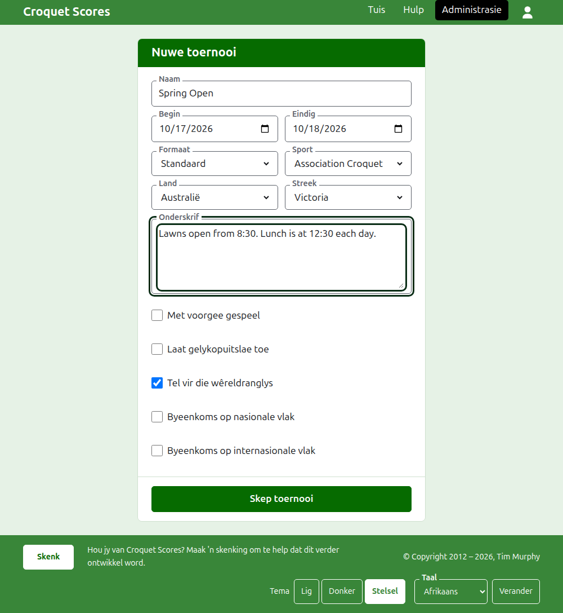

# Hoe om 'n toernooi te skep

Druk op **Nuwe toernooi** bo die lys toernooie in die administrasie. Dit is bo die lys eerder as daaronder, sodat 'n lang lys dit nie van 'n foon se skerm af druk nie.

Die vorm vra vir alles waarmee 'n toernooi begin. 'n Toernooi van die gewone soort is net 'n naam, twee dae en 'n land ver: alles anders word vir jou besluit en kan verander word.

## Wat die vorm vra

**Naam.** Waarna lesers soek om die toernooi te vind, soos "Spring Open". Dit is tussen 3 en 254 karakters. 'n Naam heeltemal in kleinletters, of heeltemal in hoofletters, word geweier, want dit sou soos 'n fout lyk op elke bladsy waarop dit verskyn. Twee toernooie mag dieselfde naam hê, want dieselfde toernooi word elke jaar gespeel.

**Begin** en **Eindig.** Die dae waarop die toernooi duur. 'n Toernooi kan nie eindig voordat dit begin nie, en kan nie later as die einde van volgende jaar begin of eindig nie. 'n Toernooi behoort aan die jaar waarin dit begin, wat ook die jaar in sy adres is, so een wat oor die nuwe jaar strek, word gelys in die jaar waarin dit begin.

**Formaat.** Kies **Standaard** vir 'n toernooi wat tussen spelers gespeel word. Die ander formate is vir toernooie wat tussen spanne gespeel word, wat 'n eie gids het.

**Sport.** Die sporte wat die werf aanbied, in sy volgorde: Association Croquet, Golf Croquet, Amerikaanse 6-hoepel-croquet en Ricochet op Croquet Scores. Gateball Scores vra nie vir 'n sport of 'n formaat nie, want elke toernooi daar is 'n standaardtoernooi van gateball.

**Land** en **Streek.** Waar die toernooi gespeel word. 'n Streek word net gevra waar die land wat jy kies in streke verdeel is, soos Australië se state; 'n land wat sy eie enigste streek is, vra vir geen. 'n Streek hoef nie gekies te word nie, selfs waar een aangebied word.

**Onderskrif.** Wat jy ook al wil hê lesers moet weet wat geen eie veld het nie: waar om te parkeer, wanneer middagete is, wie om te bel. Dit word onder die toernooi se naam op elke openbare bladsy gewys. Dit word in Markdown geskryf, so 'n woord kan vetgedruk gemaak word met sterretjies daarom, en 'n lys met 'n strepie aan die begin van elke reël. Dit kan tot 2000 karakters lank wees, en kan leeg gelaat word.

**Met voorgee gespeel.** Merk dit vir 'n voorgeetoernooi.

**Laat gelykopuitslae toe.** Merk dit waar 'n spel kan eindig sonder dat een van die spelers die wenner is. Die meeste toernooie laat dit nie toe nie. Waar dit gemerk is, word 'n uitslag wat met gelyke punte en geen merk ingevoer is as gelykop gehou; waar dit nie gemerk is nie, moet 'n spel op gelyke punte sê wie dit gewen het, met 'n merk ná die wenner se punte, soos "6w".

**Tel vir die wêreldranglys.** Word net gevra waar dit getel kan word: 'n toernooi van Association Croquet, Golf Croquet of Amerikaanse 6-hoepel-croquet wat nie met voorgee gespeel word nie en nie gelykopuitslae toelaat nie. Dit is om mee te begin gemerk, so ontmerk dit vir 'n toernooi wat nie moet tel nie.

**Byeenkoms op nasionale vlak** en **Byeenkoms op internasionale vlak.** 'n Toernooi kan die een, die ander, of geeneen wees, maar nooit albei nie: om die een te merk, ontmerk die ander.

## Hoe om dit te skep

Druk op **Skep toernooi**. Jy word na die toernooi se bladsy in die administrasie geneem, waarvandaan dit bestuur word, en jy is sy eerste bestuurder. Dit word in die administrasie gelys onder die jaar waarin dit begin.

Die toernooi se openbare adres word uit sy jaar, sy sport en sy naam gemaak, soos `/2026/ac/spring-open`. Dit hou daardie adres wanneer sy naam later reggestel word, sodat 'n skakel wat reeds gestuur is dit steeds vind; dit skuif net wanneer die jaar waarin dit begin, of sy sport, verander.

## As iets geweier word

Wat geweier word, word onder die veld gesê waaroor dit gaan, en wat jy getik het, bly getik. Niks word gehou totdat elke veld aanvaar is nie. Die dinge wat die meeste geweier word, is 'n naam wat heeltemal in kleinletters getik is, 'n einde voor die begin, en 'n land wat nie gekies is nie.

Volgende: [Spelers](players.md).
