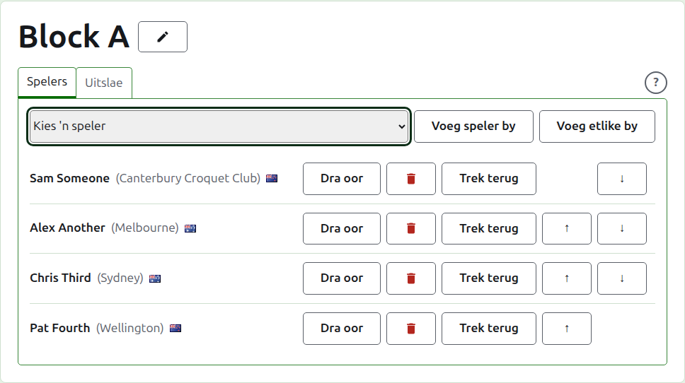
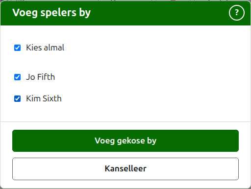
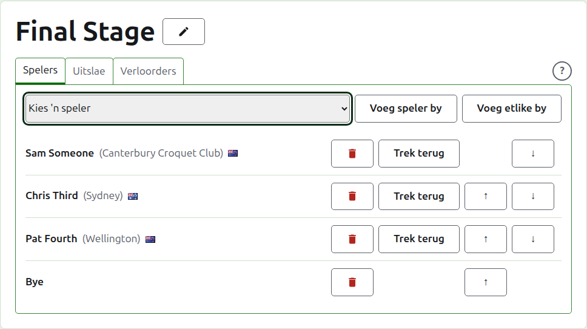
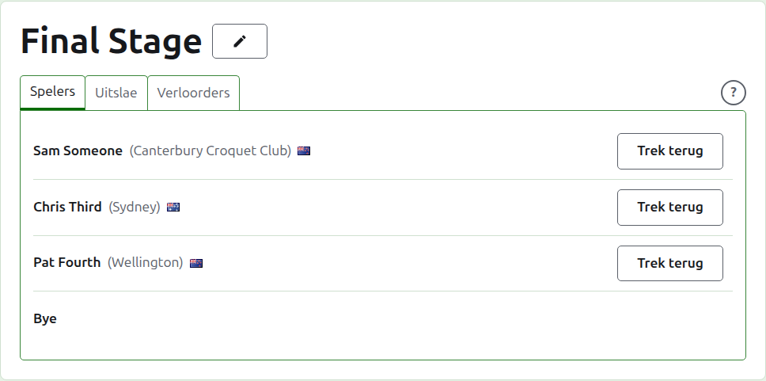
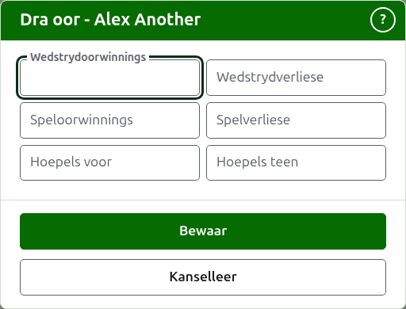
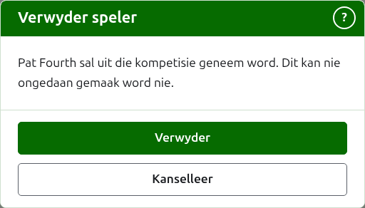
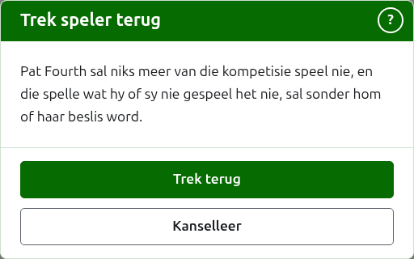
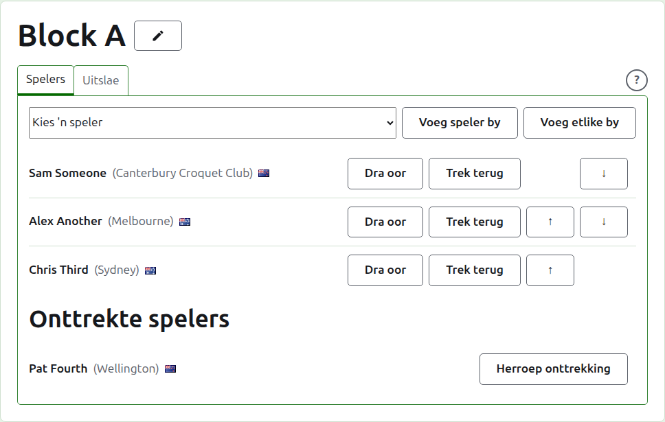

# Hoe om spelers in 'n kompetisie in te skryf

'n Kompetisie se bladsy word oopgemaak vanaf sy naam op die Kompetisies-oortjie, of vanaf die donkergroen balk. Dit het die kompetisie se naam as opskrif, met twee oortjies daaronder: **Spelers** en **Uitslae**. 'n Uitskakeling het 'n derde, **Verloorders**, wat beskryf word onder ['n Verloorders-uitskakeling](competitions.md#losers-knockout). Dit maak op Spelers oop, want die spelers word ingeskryf voordat enigiets gespeel word.

'n Speler in 'n kompetisie is een van die toernooi se spelers, so hulle word ingeskryf deur hulle te kies eerder as om hulle te tik. Alles omtrent hulle behalwe hul plek in die kompetisie, en wat hulle daarin oordra, word op die toernooi se Spelers-oortjie verander.

## Hoe om 'n speler by te voeg

Bo die lys bied 'n aftreklys elke speler van die toernooi aan wat nie reeds in die kompetisie is nie, in die toernooi se volgorde. Kies een en druk op **Voeg speler by**. Die speler word in die toernooi se volgorde tussen dié wat reeds ingeskryf is geplaas, die aftreklys bied hulle nie meer aan nie, en die wyser gaan terug na die aftreklys sodat die volgende vanaf die sleutelbord gekies kan word. Waar elke speler van die toernooi in die kompetisie is, word die aftreklys nie gewys nie en sê die oortjie so.

Geargiveerde spelers van die toernooi word nie aangebied nie.

## Hoe om verskeie spelers by te voeg {#adding-several}

Om 'n kompetisie vinnig op te stel, druk op **Voeg etlike by**, langs **Voeg speler by**. Dit word aangebied waar daar twee of meer spelers is om uit te kies. Dit maak 'n dialoog oop wat elke speler van die toernooi lys wat nie in die kompetisie is nie, in die toernooi se volgorde, elkeen met 'n blokkie om aan te vink. Die blokkie bo die lys vink almal aan.

Vink die spelers aan wat jy wil hê en druk op **Voeg gekose by**. Hulle word almal gelyk ingeskryf en in die toernooi se volgorde geplaas, in watter volgorde jy hulle ook al aangevink het. Druk op **Kanselleer** om die dialoog toe te maak sonder om iemand by te voeg. As jy op **Voeg gekose by** druk terwyl niemand aangevink is nie, gebeur niks.

Soms kan 'n aangevinkte speler nie ingeskryf word nie: iemand anders kan hulle in die kompetisie geplaas het terwyl die dialoog oop was, of 'n uitskakeling kan minder plekke oor hê as die aantal spelers wat aangevink is. Dan word niemand ingeskryf nie. 'n Tweede dialoog lys die spelers wat nie bygevoeg kan word nie, elkeen met die rede, en vra of die res van die aangevinkte spelers bygevoeg moet word. Druk op **Voeg die res by** om dié in te skryf wat kan, of op **Kanselleer** om terug te gaan na die kruisies, wat is soos jy hulle gelaat het, en dit te verander. Waar nie een van die aangevinkte spelers ingeskryf kan word nie, is daar niks om te besluit nie, en die redes word bo die lys gewys.

Die byes van 'n uitskakeling is nie deel hiervan nie. Hulle word een vir een uit die aftreklys bygevoeg, soos [Byes in 'n uitskakeling](#byes-in-a-knockout) beskryf.

## Byes in 'n uitskakeling {#byes-in-a-knockout}

'n Uitskakeling word eers gespeel wanneer elke plek in sy rooster gevul is, en die plekke wat sy spelers oorlaat, word met byes gevul. So in 'n uitskakeling bied die aftreklys eers **Bye** aan, voor die spelers, en hou aan om dit aan te bied hoeveel byes ook al bygevoeg word, want 'n rooster kan verskeie nodig hê.

'n Bye word in die rooster geplaas soos 'n speler: dit kan op en af geskuif en verwyder word, maar dit kan nie onttrek nie, want dit speel niks. 'n Speler wat ingeskryf word in 'n uitskakeling waarvan elke plek gevul is, word geweier, en die oortjie sê so onder die aftreklys.

Die volgorde van 'n uitskakeling se spelers is sy rooster. Die eerste twee plekke ontmoet mekaar in die eerste wedstryd, die volgende twee in die volgende, en so aan. Plaas die spelers in die volgorde waarin die rooster gespeel moet word voordat enige uitslag ingevoer word, want sodra die uitskakeling 'n spel in gebruik het, is sy spelers vas: niemand kan bygevoeg, verwyder of geskuif word nie. 'n Speler kan steeds onttrek.

## 'n Verloorders-uitskakeling se spelers

Die spelers van 'n verloorders-uitskakeling word nie met die hand ingeskryf nie. Hulle word ingesit soos die wedstryde waarvan dit die verloorders neem, besluit word, so sy **Spelers**-oortjie lys hulle net, en sê hoekom.

## Volgorde

Die spelers word in die kompetisie se volgorde gelys, wat die volgorde is waarin 'n uitskakeling getrek word en 'n blok op sy openbare bladsy gelys word. **Op** en **Af** skuif 'n speler een plek.

## Oordrag {#carry-forward}

**Dra oor** sê wat 'n speler in 'n kompetisie inbring uit spel wat dit nie aangeteken het nie: die uitslae van 'n vroeëre stadium, of van spelle wat gespeel is voordat die kompetisie hier aangeteken is. Dit word aangebied in 'n blok en 'n Switserse kompetisie, wat 'n ranglys het waarin dit kan tel, en nie in 'n uitskakeling nie.

Die dialoog vra vir ses tellings: wedstryde gewen en verloor, spelle gewen en verloor, en hoepels vir en teen. Elke telling is opsioneel. 'n Telling wat leeg gelaat word, dra niks oor nie, wat nie dieselfde is as om 0 oor te dra nie, sodat wie dit ook al later verander dit sien soos dit gelaat is. Druk op **Bewaar** om al ses te hou.

## Hoe om 'n speler te verwyder {#removing-a-player}

**Verwyder** haal 'n speler uit wat per ongeluk ingeskryf is. Hulle bly een van die toernooi se spelers, en word weer in die aftreklys aangebied, maar niks van hul plek in die kompetisie word gehou nie, so Verwyder vra eers.

'n Speler wat enige spel in gebruik in die kompetisie het, kan nie verwyder word nie, want die spelle sou dan teen iemand wees wat nie meer daar is nie, en kry nie Verwyder aangebied nie. 'n Speler wie se enigste spelle geargiveer is, kan wel, en hul geargiveerde uitslae gaan saam met hulle.

## Hoe om 'n speler te onttrek {#withdrawing-a-player}

**Trek terug** is vir 'n speler wat niks meer van die kompetisie sal speel nie. Hulle bly daarin, met die spelle wat hulle gespeel het, en word onder **Onttrekte spelers** gelys, ná dié wat nog speel. In 'n uitskakeling gaan hul teenstander in 'n wedstryd wat nog nie beslis is nie, deur.

Trek terug vra eers, want dit verander die uitkoms van die kompetisie: die spelle wat die speler nie gespeel het nie, word sonder hulle beslis.

'n Onttrekte speler bied net **Herroep onttrekking** aan, wat hulle terugsit tussen dié wat speel, ná dié wat gebly het, sonder om te vra.

Volgende: [Uitslae](scores.md).
