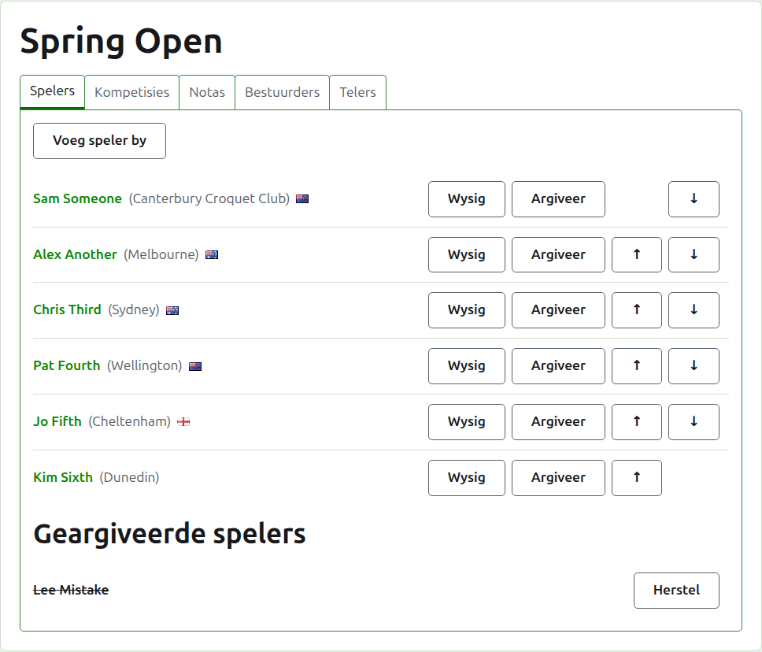
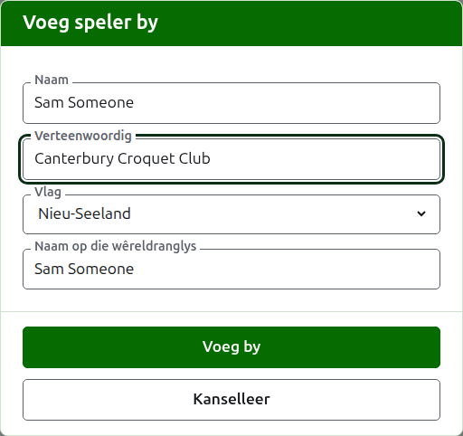
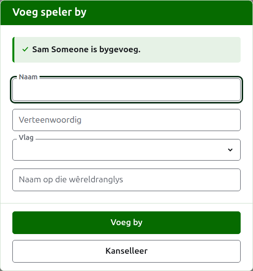
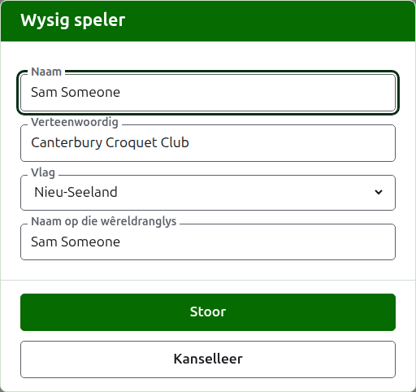
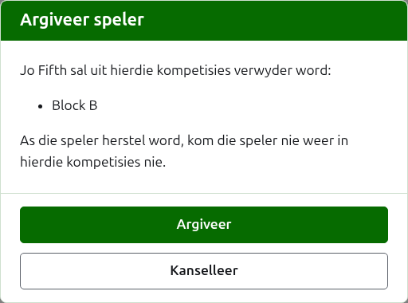

# Spelers

Die **Spelers**-oortjie van 'n toernooi se bladsy is waar sy spelers ingeskryf, reggestel, in volgorde geplaas en eenkant gesit word. Dit is die oortjie waarop die bladsy oopmaak, want om die spelers in te skryf is die eerste ding wat aan 'n toernooi gedoen word.

Spelers word hier een keer ingeskryf, in die toernooi. In watter kompetisies elkeen speel, word daarna gekies, op elke kompetisie se eie bladsy, uit die spelers wat hier ingeskryf is. Kyk by [Hoe om spelers in 'n kompetisie in te skryf](entering-players-in-a-competition.md).



## Hoe om spelers by te voeg {#add-a-player}

Druk op **Voeg speler by**, bo die lys. 'n Dialoog maak oor die bladsy oop.



**Naam** is verpligtend. Dit is die speler se naam soos dit op elke bladsy gewys sal word, tussen 3 en 254 karakters. Twee spelers in een toernooi kan nie dieselfde naam hê nie, hoe dit ook al met hoofletters geskryf is; waar twee spelers werklik 'n naam deel, onderskei hulle in die naam self, soos "Andrew Hobbs (2)".

**Verteenwoordig** is waarvoor die speler speel, geskryf soos 'n leser dit sou sê: 'n klub, 'n streek of 'n land, soos "Canterbury Croquet Club". Dit word tussen hakies ná die naam gewys. Dit kan leeg gelaat word.

**Vlag** is die vlag wat langs die speler se naam gewys word. Dit kan as geen gelaat word, soos by die meeste spelers. Wat 'n speler verteenwoordig en watter vlag hulle voer, word apart gehou, want 'n speler kan vir 'n klub in een land speel en die vlag van 'n ander voer.

**Wêreldranglys-spelernaam** is die naam waaronder die wêreldranglys die speler ken. Dit word net gevra in 'n toernooi van Association Croquet of Golf Croquet, die twee sporte van wie se spelers die wêreldranglys 'n lys hou. Amerikaanse 6-hoepel-croquet se spelers is onder hul eie name aan die ranglys bekend, so dit word nie daar gevra nie, en elke speler se naam op die wêreldranglys is altyd hul naam. Terwyl jy 'n speler byvoeg, volg dit die naam soos jy dit tik, want die meeste spelers is onder hul eie naam aan die ranglys bekend, en dit hou op volg sodra jy daarin tik. Leeg gelaat, word dit as die speler se naam gehou.

Soos jy 'n naam tik, word die spelers wat die wêreldranglys ken en wie se name so begin aangebied, sodat jy 'n naam kan neem soos die ranglys dit spel eerder as om dit uit te tik. Langs die naam op die wêreldranglys sê 'n regmerkie dat die ranglys die naam ken, en 'n vraagteken sê dit ken dit nie: die naam is dalk verkeerd gespel, of die speler is nuut op die ranglys. Dit is net raad. 'n Naam wat die ranglys nie ken nie, word net so geredelik gehou as een wat dit wel ken.

Druk op **Voeg by**. Die speler word bygevoeg, die dialoog sê so, en sy velde word leeggemaak vir die volgende speler, met die wyser terug in die naam. Voeg die hele lys so by, en druk dan op **Kanselleer** om die dialoog toe te maak. Kanselleer hou niks wat nie reeds bygevoeg is nie.



'n Speler word nooit "Bye" genoem nie. 'n Uitskakeling se byes word in die uitskakeling self bygevoeg, waar sy spelers ingeskryf word, so 'n naam waarvan die eerste woord die Engelse "bye" is, word geweier, en die dialoog verduidelik hoekom.

## Voeg verskeie spelers gelyk by {#adding-multiple-players}

Om 'n hele lys ineens by te voeg, druk op **Voeg spelers by**, langs **Voeg speler by**. 'n Dialoog maak oor die bladsy oop met een boks, wat verskeie reëls teks neem. Jy kan die lys uit 'n sigblad kopieer en in die boks plak.

**Die eerste reël noem die velde**, geskei deur kommas of tabs: **Name**, en enige van **Representing**, **Flag**, **Handicap** en **WorldRankingPlayerName**, in enige volgorde. Hierdie name word in Engels getik, watter taal die werf ook al gebruik. **Name** moet een van hulle wees. **Elke reël daarna is 'n speler**, met 'n waarde vir elke veld in dieselfde volgorde, op dieselfde manier geskei. 'n Speler met niks vir 'n veld laat dit leeg, maar hou die komma of tab. Byvoorbeeld, met kommas:

```
Name,Representing,Flag
Sam Someone,Canterbury Croquet Club,New Zealand
Alex Another,,England
```

- **Naam, Verteenwoordig en Wêreldranglys-spelernaam** is aan dieselfde reëls gebonde as wanneer jy een speler byvoeg (kyk by [Hoe om spelers by te voeg](players.md#add-a-player)). 'n Naam is tussen 3 en 254 karakters, is nie reeds in die toernooi nie, hoe dit ook al met hoofletters geskryf is, en is nie "Bye" nie.
- **Vlag** is die naam van die land of plek, in jou taal, soos die lys in die dialoog Voeg speler by dit aanbied, soos Nieu-Seeland.
- **Voorgee** is 'n teken, tot twee syfers en 'n breuk van een syfer, soos 4, +4 of -1.5.
- 'n Speler wat geen **Wêreldranglys-spelernaam** kry nie, staan bekend onder sy naam, soos wanneer hy een vir een bygevoeg word.
- **Kommas of tabs.** Selle wat uit 'n sigblad gekopieer is, word deur tabs geskei, en 'n lys wat met die hand getik is, word gewoonlik deur kommas geskei. Albei werk. As die eerste reël 'n tab bevat, word die hele lys met tabs gelees, en anders met kommas.
- 'n Waarde met die skeidingsteken daarin word in dubbele aanhalingstekens geskryf, soos 'n sigblad dit skryf: "Smith, John" in 'n lys wat deur kommas geskei is. 'n Aanhalingsteken binne 'n waarde word twee keer geskryf.
- By elke waarde word die spasies aan die punte verwyder, en 'n reël met niks op nie word oorgeslaan.
- 'n Lys bevat hoogstens 500 spelers. Voeg die res in 'n ander lys by.

Druk op **Voeg by**. Die hele lys word nagegaan voordat enigiets daarvan bewaar word, so 'n lys met iets verkeerds daarin voeg niemand by nie. Wat verkeerd is, word onder die boks gesê, by die reël waarop dit is, waar die eerste reël as reël 1 getel word. Elke fout word gelys, nie net die eerste een nie, en wat jy getik het bly staan sodat jy dit kan regmaak. Sodra die lys bewaar is, maak die dialoog toe en die Spelers-oortjie lys die nuwe spelers, in die volgorde waarin jy hulle geskryf het. Anders as by **Voeg speler by**, wat oop bly vir die volgende speler, is daar geen volgende nie: die lys was die volgende.

Die **?** in die titelbalk van die dialoog lei hierheen.

## Hoe om 'n speler reg te stel {#correcting-a-player}

Druk op 'n speler se naam, of op hul **Wysig**, om dieselfde dialoog op daardie speler oop te maak, met die titel Wysig speler. Verander wat verkeerd is en druk op **Bewaar**, wat die verandering hou en die dialoog toemaak. 'n Speler wie se naam reggestel word, hou die naam op die wêreldranglys wat hulle gehad het, want die ranglys ken hulle steeds daaronder. In Amerikaanse 6-hoepel-croquet is 'n speler se naam op die wêreldranglys altyd hul naam, so om die naam reg te stel, stel dit ook reg.



'n Speler wat hier reggestel word, word oral reggestel: in elke kompetisie waarin hulle is, en op elke openbare bladsy.

## Hoe om spelers in volgorde te plaas

Die spelers word in die toernooi se volgorde gelys, wat die volgorde is waarin hulle aangebied word wanneer hulle in kompetisies ingeskryf word, en die volgorde waarin 'n uitskakeling getrek word. **Op** en **Af**, die pyltjies aan die einde van elke ry, skuif 'n speler een plek. Die eerste speler kry nie Op aangebied nie en die laaste nie Af nie.

## Hoe om 'n speler te argiveer {#archiving-a-player}

**Argiveer** sit 'n speler eenkant: per ongeluk ingeskryf, of uit die hele toernooi onttrek. 'n Geargiveerde speler word onder **Geargiveerde spelers** gelys, deurgehaal, ná die spelers in gebruik, en bied net **Herstel** aan. 'n Geargiveerde speler is in geen kompetisie en verskyn op geen openbare bladsy nie.

'n Speler wat enige spel gespeel het, kan nie geargiveer word nie, want die spelle sou dan teen iemand wees wat nie meer daar is nie, so so 'n speler kry nie Argiveer aangebied nie. 'n Speler wie se enigste spelle geargiveer is, kan wel.

Om 'n speler te argiveer wat in geen kompetisie is nie, vra nie eers nie, want om hulle te herstel sit alles terug. Om 'n speler te argiveer wat in enige kompetisie is, vra eers, omdat argivering hulle uit elke kompetisie verwyder waarin hulle is, en herstel hulle nie terugsit nie.



Volgende: [Kompetisies](competitions.md).
