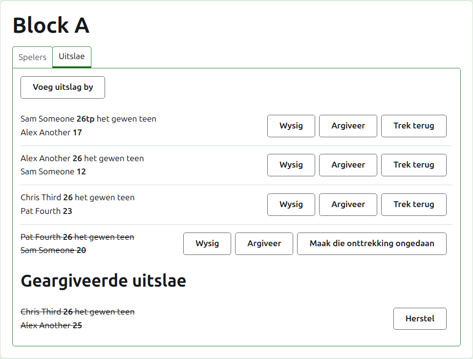
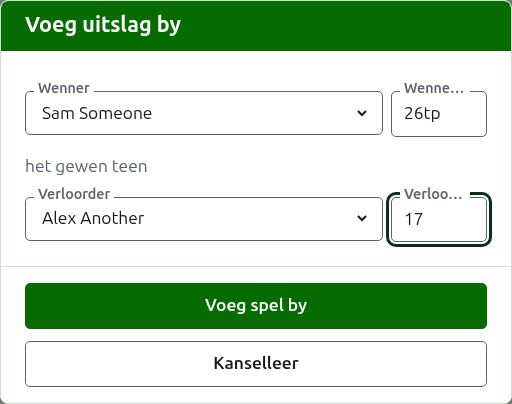
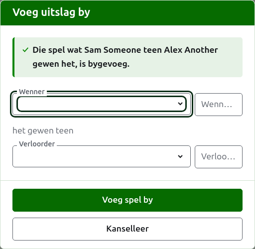
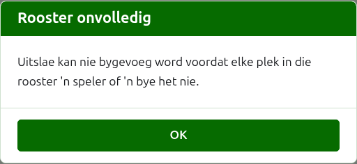
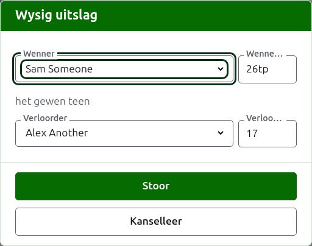

# Uitslae

Die **Uitslae**-oortjie van 'n kompetisie se bladsy is waar sy spelle ingevoer, reggestel en eenkant gesit word. 'n Teller sien net hierdie oortjie, en kan daarop alles doen wat 'n bestuurder kan.

## Hoe om 'n uitslag in te voer

Druk op **Voeg uitslag by**, bo die lys. Die dialoog lees soos 'n uitslag hardop gesê word: die wenner en hul punte, dan "het gewen teen", dan die verloorder en hul punte.

Die wenner en die verloorder word elk gekies uit die kompetisie se spelers wat speel, in die kompetisie se volgorde. Niemand is om mee te begin gekies nie, sodat 'n spel nooit teen 'n speler aangeteken word wat jy nie gekies het nie. In 'n uitskakeling kies die keuse van die wenner as verloorder die een teen wie hulle getrek is, waar jy dit kan sien en 'n ander kan kies.

Punte word getik soos die teller hulle neergeskryf het: die getal punte, en wat ook al daarop volg, wat gehou en gewys word soos getik, soos "26tp" vir 26 hoepels en 'n triple peel. Die getal is die syfers waarmee die punte begin; punte wat nie met 'n syfer begin nie, word geweier.

'n Spel wat op gelyke punte gewen is, soos wanneer dit deur tyd gestop en op 'n ander manier beslis word, sê wie dit gewen het met 'n merk ná die wenner se punte: "6w" het gewen teen "6". Op Croquet Scores is die merke "w", "won" en "winner"; Gateball Scores neem ook "cb" en "so". 'n Wenner se punte moet meer as die verloorder s'n wees, of gemerk wees, tensy die toernooi gelykopuitslae toelaat, in welke geval gelyke punte sonder 'n merk as gelykop gehou word.

Druk op **Voeg spel by**. Die spel word bygevoeg, die dialoog sê watter, en die velde word leeggemaak vir die volgende, want uitslae kom in 'n bondel wat aan die einde van 'n ronde van 'n bord af gelees word. Druk op **Kanselleer** sodra hulle almal in is.

Wat geweier word, word onder die veld gesê waaroor dit gaan: 'n wenner of verloorder wat nie gekies is nie, punte wat nie getik is nie of nie met 'n syfer begin nie, dieselfde speler as albei, 'n verloorder se punte wat as gewen gemerk is, of 'n wenner se punte wat agter die verloorder s'n is. In 'n uitskakeling word twee spelers wat nie getrek is om teen mekaar te speel nie, bo die velde geweier.

## 'n Uitskakeling se rooster moet eers gevul wees

'n Uitskakeling word eers gespeel wanneer elke plek in sy rooster 'n speler of 'n bye het. Tot dan verduidelik Voeg uitslag by hoekom uitslae nie bygevoeg kan word nie, eerder as om die dialoog oop te maak.

## Die lys uitslae

Die uitslae in gebruik word gelys in die volgorde waarin hulle ingevoer is, oudste eerste, sodat die lys lees soos die kompetisie gespeel is. Elkeen sê die wenner en hul punte, dan die verloorder en hulle s'n, en bied **Wysig** en **Argiveer** aan.

## Hoe om 'n uitslag reg te stel

**Wysig** maak dieselfde dialoog op daardie uitslag oop, met die titel Wysig uitslag, met sy spelers gekies en sy punte soos hulle getik is. Druk op **Bewaar** om die regstelling te hou en die dialoog toe te maak.

'n Regstelling behou die uitslag: 'n gewonne spel bly gewonne, en 'n gelykopspel bly gelykop. 'n Spel waarvan die uitslag verkeerd was, word geargiveer en weer ingevoer.

Waar 'n uitslag geargiveer kon word, kan sy spelers sowel as sy punte verander word. In 'n uitskakeling hou 'n uitslag waarvan die wenner reeds in die volgende ronde gespeel het sy spelers, want om te verander wie dit gewen het, sou die volgende spel laat speel deur iemand wat nie daar uitgekom het nie; net sy punte kan reggestel word.

## Hoe om 'n uitslag te argiveer

**Argiveer** sit 'n uitslag eenkant sodat dit vir niks tel nie. Dit word onder **Geargiveerde uitslae** gelys, deurgehaal, en bied net **Herstel** aan. Nie een van die twee vra eers nie, want elkeen maak die ander ongedaan.

In 'n uitskakeling gaan die wenner van 'n wedstryd deur na die volgende ronde, so 'n uitslag van 'n wedstryd waarvan die wenner in die volgende ronde gespeel het, kry nie Argiveer aangebied nie. Die spel in die volgende ronde word eerste geargiveer, en dan kan dié daarvoor geargiveer word. Waar 'n ronde die beste van 3 of 5 is, word elke spel van die wedstryd op dieselfde manier vasgehou. 'n Blok en 'n Switserse kompetisie het geen rondes wat van mekaar afhang nie, so elke uitslag daarin kan geargiveer word.

## Hoe om 'n uitslag te onttrek

'n Speler wat 'n kompetisie verlaat, word gewoonlik daaruit onttrek, op die Spelers-oortjie, en dit is al wat nodig is: hulle speel niks meer nie, en die spelle wat hulle wel gespeel het, bly staan, maar hul spelle tel nie meer vir oorwinnings/verliese en hoepels nie. Om 'n uitslag te onttrek is vir die skaarser geval waar 'n spel wat gespeel is, nie moet tel nie. In die Australiese President's Eights, byvoorbeeld, bly die eerste ronde se uitslae staan wanneer 'n speler onttrek, en net hul spelle in die tweede ronde word uit die berekening gehaal: onttrek daardie spelle.

In 'n blok of 'n Switserse kompetisie word 'n uitslag wat gespeel is maar nie moet tel nie, onttrek eerder as geargiveer. **Trek terug** hou dit tussen die uitslae in gebruik, op sy plek, maar deurgehaal en tel vir niks op die openbare bladsye nie. **Herroep onttrekking** laat dit weer tel. Nie een van die twee vra eers nie. 'n Uitskakeling se uitslae kry nie Trek terug aangebied nie, want daar beslis 'n uitslag meer as net die ranglys.

Volgende: [Notas](notes.md).
