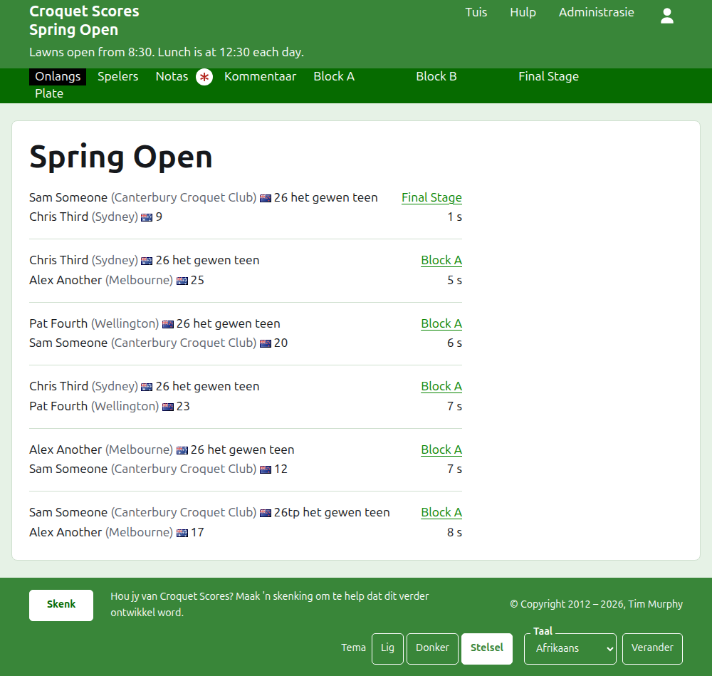
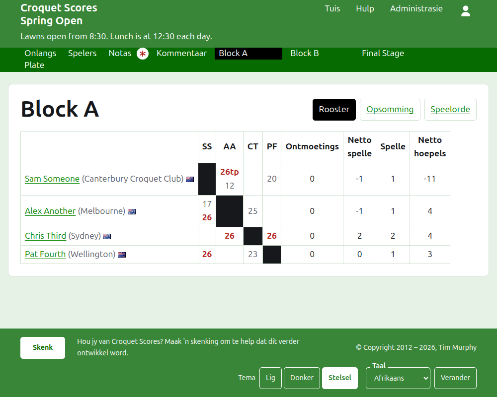
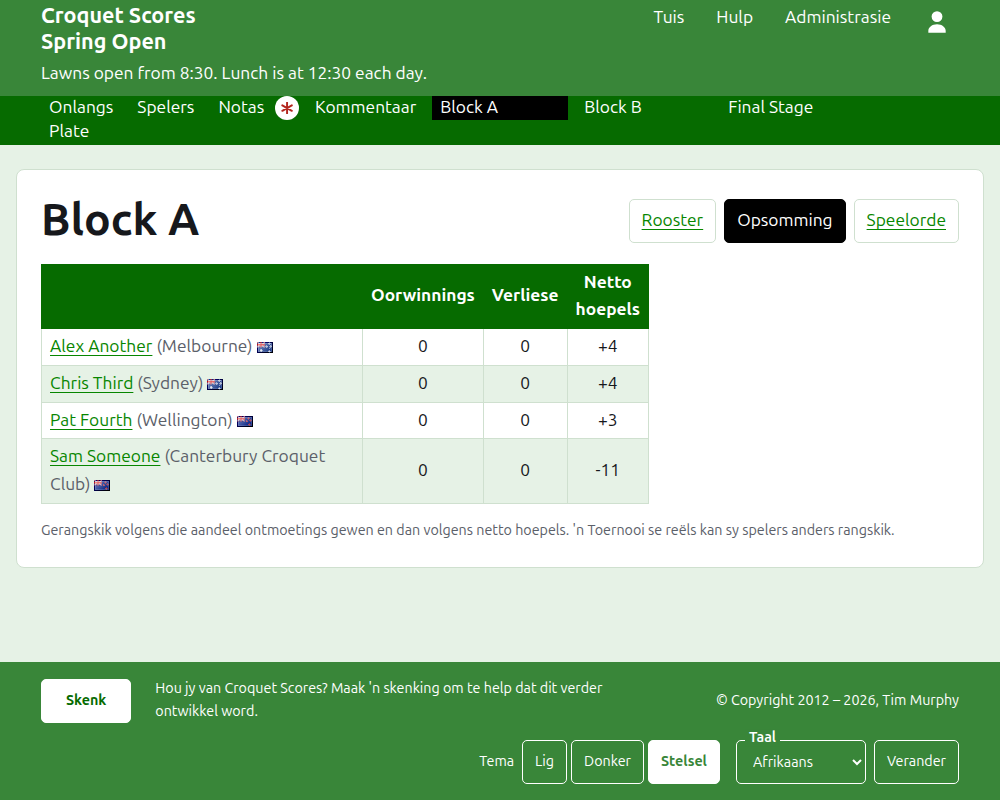
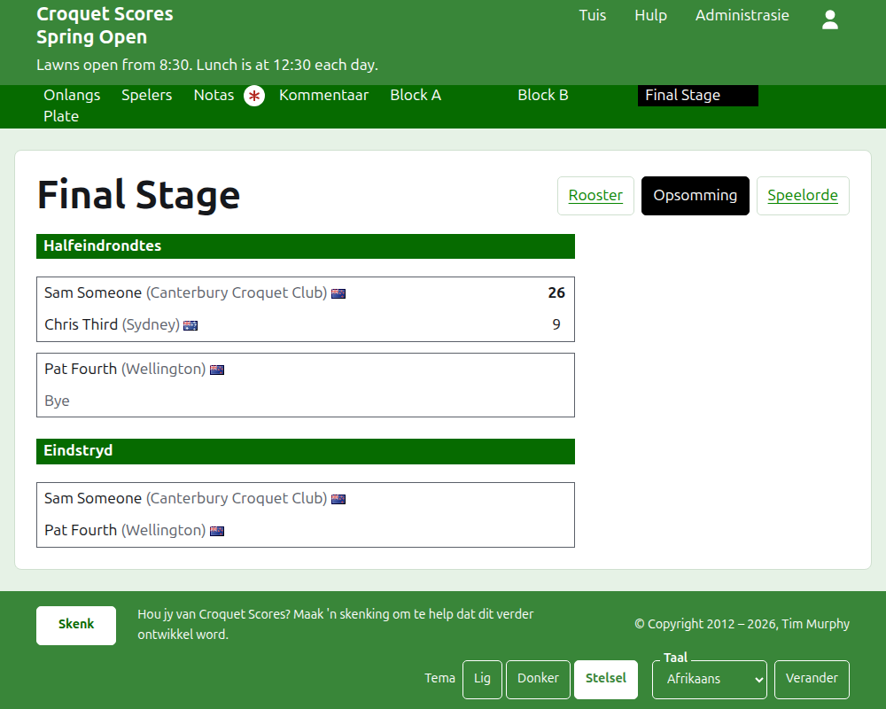
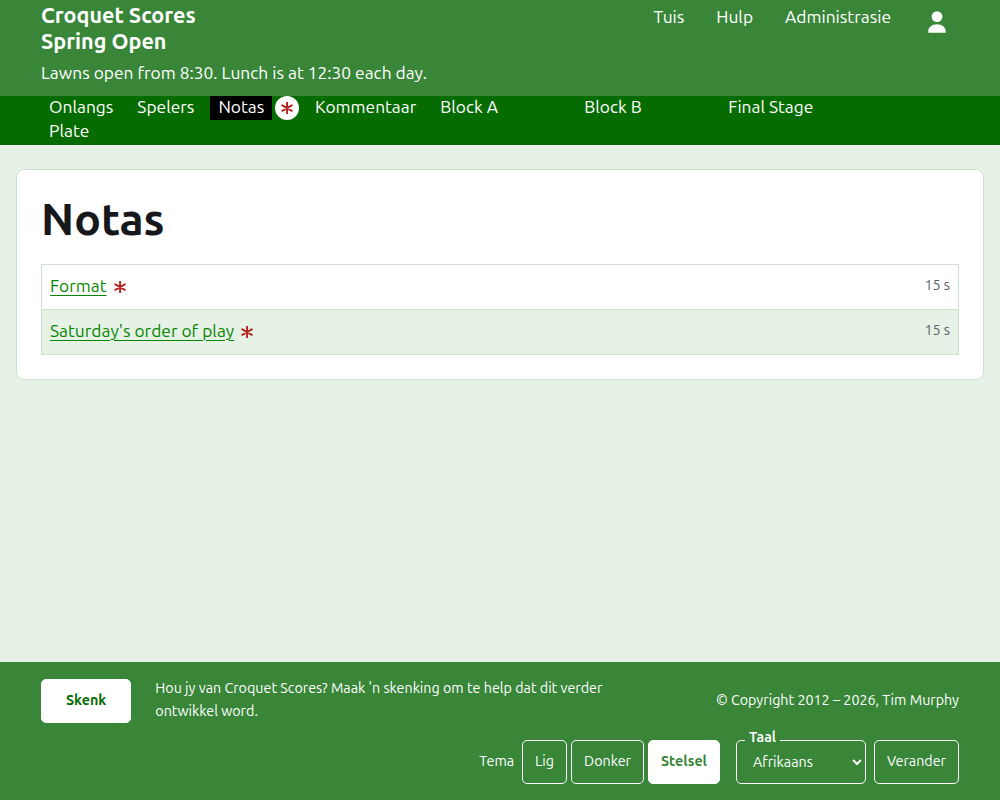

# Wat die publiek sien

Niks word gepubliseer nie: die openbare bladsye word saamgestel uit wat die administrasie bevat, so 'n uitslag wat ingevoer is, is dadelik daarop. Hulle het geen rekening en geen skripte nodig nie, en is vir 'n foon uitgelê.

## Die toernooi se bladsy

Die toernooi se bladsy is by sy jaar, sy sport en sy naam, soos `/2026/ac/spring-open`. Dit het die toernooi se naam as opskrif, met sy onderskrif daaronder. Dit lys elke spel in gebruik, die mees onlangs bygevoegde eerste, sodat 'n leser wat terugkom sien wat sedertdien gebeur het. Elke spel sê die wenner, wat hulle verteenwoordig, hul vlag en hul punte, dan die verloorder en hulle s'n, met die kompetisie waarin dit gespeel is en hoe lank gelede dit bygevoeg is.

Die donkergroen balk bied die toernooi se afdelings aan: **Onlangs**, wat hierdie bladsy is, **Spelers**, **Notas** en **Kommentaar**, dan elke kompetisie in gebruik, in die volgorde waarin die Kompetisies-oortjie hulle het. Notas word met 'n rooi sterretjie gemerk solank daar 'n nota is wat die leser nie gelees het nie.

## 'n Blok

'n Blok se bladsy wys sy uitslae as 'n rooster: 'n ry en 'n kolom vir elke speler in die blok se volgorde, met die spelle tussen twee spelers waar die ry die kolom ontmoet, elkeen gemerk as gewen, verloor of gelykop vir die speler van die ry. Ná die spelers se kolomme kom elke speler se totale. Waar elke wedstryd 'n enkele spel is, is dit oorwinnings en netto hoepels; waar 'n wedstryd die beste van meer as een is, is dit ontmoetings, netto spelle, spelle en netto hoepels. Die laaste kolom, **#** genoem, is elke speler se plek: 1 vir die eerste, en =2 waar spelers nie uitmekaar gehou kan word nie en tweede deel. Waar enige spelers dieselfde aandeel van hul wedstryde gewen het, sê 'n reël onder die rooster hoe hulle uitmekaar gehou word, soos die blok se gelykopbreker dit het (sien Kompetisies).

'n Blok word op drie maniere gewys, aangebied op die reël van sy naam: **Rooster**, **Opsomming** en **Speelvolgorde**. Die opsomming is dié vir 'n foon: die spelers gerangskik, met hul oorwinnings, verliese, netto hoepels en plek. Die speelvolgorde lys elke spel, oudste eerste. 'n Leser wat 'n aansig kies, hou dit vir elke kompetisie totdat hulle 'n ander kies.

'n Onttrekte speler se ry sê so. 'n Onttrekte uitslag word deurgehaal gewys en tel vir niks. 'n Geargiveerde uitslag word nie gewys nie.

## 'n Uitskakeling

'n Uitskakeling se bladsy teken sy rooster ronde vir ronde, 'n kolom vir elke ronde van die eerste tot die eindstryd, met elke wedstryd se twee kante bo mekaar en 'n sel vir elke spel waarvan die wedstryd die beste is. 'n Later ronde se wedstryd staan langs die twee wedstryde tussen wie se wenners dit is. Op 'n foon rol die rooster dwars, met pyltjies na die eindstryd en terug.

## 'n Switserse kompetisie

'n Switserse kompetisie se bladsy rangskik sy spelers in 'n tabel: hul spelle, hul oorwinnings, hul persentasie oorwinnings, en hul uitslae, elkeen gesê as die teenstander en die verskil, soos "+4" vir 'n spel wat met vier gewen is.

## Spelers

Die Spelers-bladsy lys elke speler van die toernooi wat nie geargiveer is nie, in alfabetiese volgorde, met wat hulle verteenwoordig en hul vlag.

## Notas

Die Notas-bladsy lys die toernooi se notas, die mees onlangs geskrewe eerste, elkeen lei na sy eie bladsy en sê hoe lank gelede dit geskryf is. 'n Nota wat die leser nie gelees het nie, word met 'n rooi sterretjie gemerk totdat hulle dit oopmaak.

## Adresse wat skuif

'n Toernooi hou sy adres wanneer sy naam reggestel word. Waar dit skuif, omdat sy jaar of sy sport verander het, lei sy ou adres na die nuwe een, sodat 'n skakel wat van vroeër gehou is steeds werk. 'n Geargiveerde toernooi se bladsye word nie gevind totdat dit herstel is nie.
