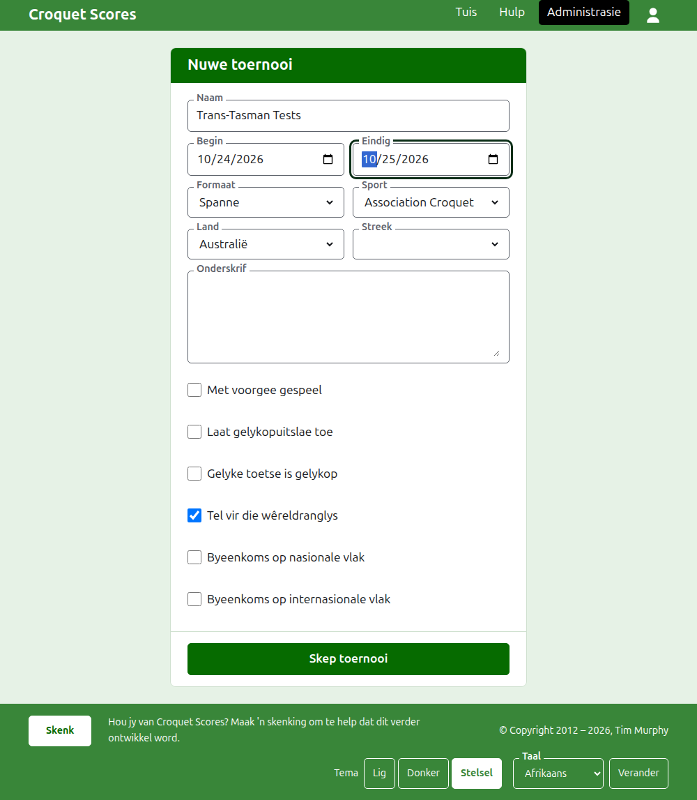
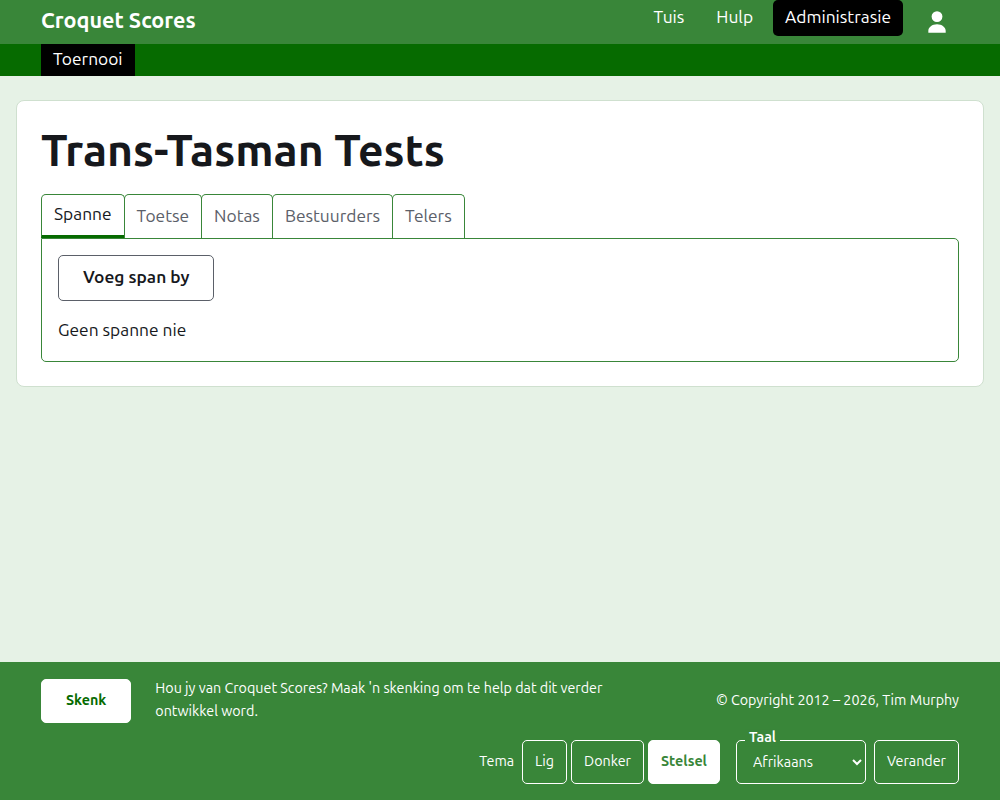

# Hoe om 'n toernooi te skep

Druk op **Nuwe toernooi** bo die lys toernooie in die administrasie. Dit is bo die lys eerder as daaronder, sodat 'n lang lys dit nie van 'n foon se skerm af druk nie.

Die vorm vra vir alles waarmee 'n toernooi begin. Wat hier die meeste saak maak, is die **Formaat**, wat 'n toernooi een tussen spanne maak.

## Wat die vorm vra

**Naam.** Waarna lesers soek om die toernooi te vind, soos "Trans-Tasman Tests". Dit is tussen 3 en 254 karakters. 'n Naam heeltemal in kleinletters, of heeltemal in hoofletters, word geweier, want dit sou soos 'n fout lyk op elke bladsy waarop dit verskyn. Twee toernooie mag dieselfde naam hê, want dieselfde toernooi word elke jaar gespeel.

**Begin** en **Eindig.** Die dae waarop die toernooi duur. Elke toets word binne hulle gespeel, so stel hulle om die hele byeenkoms te dek. 'n Toernooi kan nie eindig voordat dit begin nie, en kan nie later as die einde van volgende jaar begin of eindig nie. 'n Toernooi behoort aan die jaar waarin dit begin, wat ook die jaar in sy adres is.

**Formaat.** Kies een van die formate wat tussen spanne gespeel word:

- **Spanne** is die algemene formaat vir enige byeenkoms tussen spanne.
- **Eire Cup**, **Interstate Shield** en **GC World Team Championship** is bepaalde byeenkomste, elkeen as 'n eie formaat gehou sodat dit bestuur kan word soos daardie byeenkoms bestuur word.

Standaard is die een formaat wat nie tussen spanne gespeel word nie, en is nie wat jy hier wil hê nie. Gateball Scores bied geen formaat aan nie, want elke toernooi daar is 'n standaardtoernooi van gateball; 'n toernooi tussen spanne word op Croquet Scores geskep.

**Sport.** Die sporte wat die werf aanbied, in sy volgorde: Association Croquet, Golf Croquet, Amerikaanse 6-hoepel-croquet en Ricochet.

**Land** en **Streek.** Waar die toernooi gespeel word. 'n Streek word net gevra waar die land wat jy kies in streke verdeel is, soos Australië se state, en hoef selfs dan nie gekies te word nie.

**Onderskrif.** Wat jy ook al wil hê lesers moet weet wat geen eie veld het nie: waar om te parkeer, wanneer middagete is, wie om te bel. Dit word onder die toernooi se naam op elke openbare bladsy gewys. Dit word in Markdown geskryf, so 'n woord kan vetgedruk gemaak word met sterretjies daarom, en 'n lys met 'n strepie aan die begin van elke reël. Dit kan tot 2000 karakters lank wees, en kan leeg gelaat word.

**Met voorgee gespeel.** Merk dit vir 'n voorgeebyeenkoms.

**Laat gelykopuitslae toe.** Merk dit waar 'n spel kan eindig sonder dat een van die spelers die wenner is. Waar dit gemerk is, word 'n uitslag wat met gelyke punte en geen merk ingevoer is as gelykop gehou; waar dit nie gemerk is nie, moet 'n spel op gelyke punte sê wie dit gewen het, met 'n merk ná die wenner se punte, soos "6w".

**Gelyke toetse is gelykop.** Word eers gevra sodra 'n formaat tussen spanne gekies is. 'n Toets word gewen deur die span wat meer van sy wedstryde wen, en een wat gelyk is op wedstryde word deur netto spelle beslis, dan deur netto hoepels, tensy dit gemerk is, in welke geval 'n toets wat gelyk is op wedstryde gelykop is, soos sommige spanbyeenkomste dit het. Dit begin ongemerk vir Spanne, en gemerk vir die GC World Team Championship, wat 'n gelyke toets nog altyd as gelykop beskou het.

**Tel vir die wêreldranglys.** Word net gevra waar dit getel kan word: 'n toernooi van Association Croquet, Golf Croquet of Amerikaanse 6-hoepel-croquet wat nie met voorgee gespeel word nie en nie gelykopuitslae toelaat nie. Dit is om mee te begin gemerk.

**Byeenkoms op nasionale vlak** en **Byeenkoms op internasionale vlak.** 'n Toernooi kan die een, die ander, of geeneen wees, maar nooit albei nie: om die een te merk, ontmerk die ander.

## Hoe om dit te skep

Druk op **Skep toernooi**. Jy word na die toernooi se bladsy in die administrasie geneem, oop op sy Spanne-oortjie, en jy is sy eerste bestuurder. Dit word in die administrasie gelys onder die jaar waarin dit begin.

Die toernooi se openbare adres word uit sy jaar, sy sport en sy naam gemaak, soos `/2026/ac/trans-tasman-tests`. Dit hou daardie adres wanneer sy naam later reggestel word, sodat 'n skakel wat reeds gestuur is dit steeds vind; dit skuif net wanneer die jaar waarin dit begin, of sy sport, verander.

## As iets geweier word

Wat geweier word, word onder die veld gesê waaroor dit gaan, en wat jy getik het, bly getik. Niks word gehou totdat elke veld aanvaar is nie. Die dinge wat die meeste geweier word, is 'n naam wat heeltemal in kleinletters getik is, 'n einde voor die begin, en 'n land wat nie gekies is nie.

Volgende: [Spanne](teams.md).
