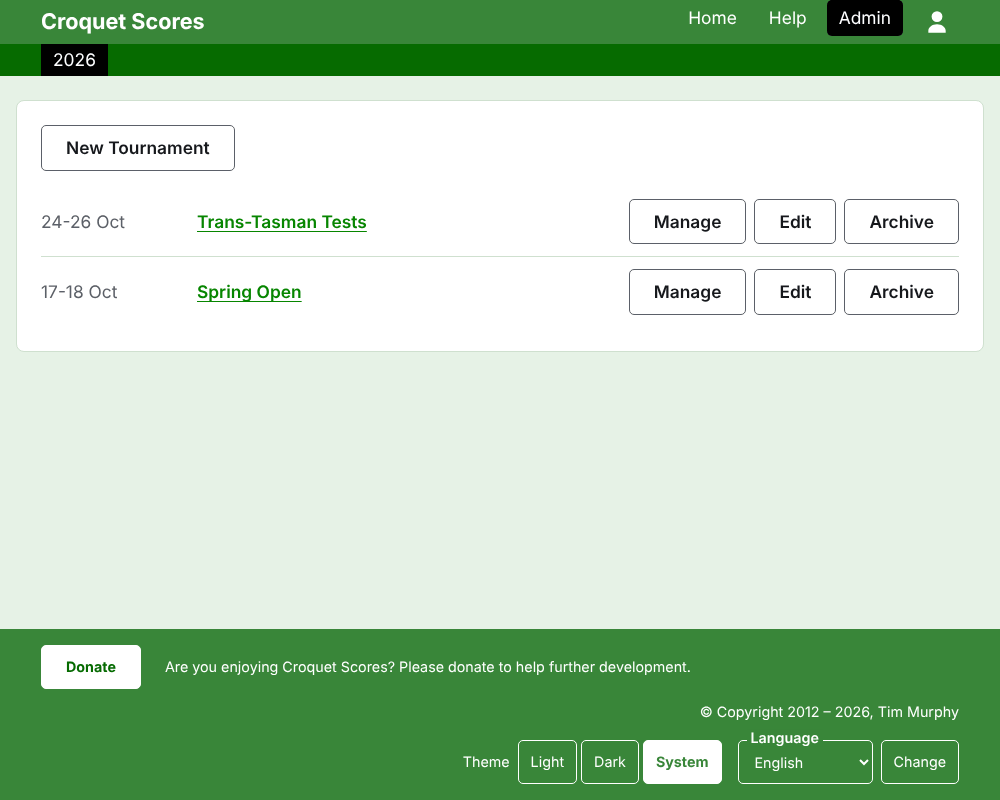
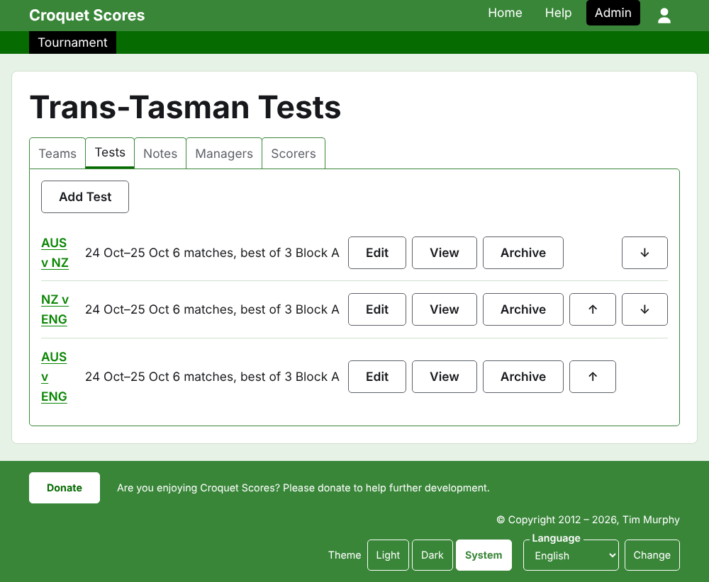

# Hoe om 'n toernooi tussen spanne te bestuur

'n Toernooi tussen spanne is een waar kante mekaar ontmoet, eerder as spelers wat een vir een ingeskryf word: 'n toetsreeks tussen twee lande, 'n interstaatskild, 'n wêreldspankampioenskap. Sy spanne word met hul spelers opgestel, die toetse tussen spanne word bygevoeg, en elke toets se spelle verskyn soos hulle gespeel word. Hierdie gids neem 'n bestuurder van aanmeld tot by 'n toernooi waarvan die uitslae vir die publiek beskikbaar is.

Dit staan op sy eie. Niks daarin hang af van die gids vir 'n standaardtoernooi, wat apart geskryf is.

## Voordat jy begin

Jy het 'n rekening nodig. Klik [hier](/account/register) om 'n rekening te registreer.

Alles wat 'n bestuurder doen, word in die administrasie-afdeling van die werf gedoen. Die openbare bladsye, waar spelers en toeskouers die toernooi volg, word saamgestel uit wat die administrasie bevat, so niks hoef gepubliseer te word nie: 'n uitslag wat ingevoer is, is dadelik op die openbare bladsye.

## Die woorde

'n **Span** is 'n kant, soos Australië, met 'n naam, 'n kortnaam soos "AUS", en 'n vlag. 'n Span het sy eie **spelers**, wat vir hom en vir niemand anders speel nie. 'n **Toets** is 'n kragmeting tussen twee spanne, genoem by hul kortname, soos "AUS v ENG", wat bestaan uit 'n aantal **wedstryde** tussen 'n speler van elke span, elke wedstryd die beste van 'n sekere aantal **spelle**. Toetse kan in **groepe** geplaas word, soos "Block A", waar baie spanne onder mekaar speel.

## Die bladsye in volgorde

1. [Hoe om 'n toernooi te skep](creating-a-tournament.md): sy naam, sy dae, sy sport, sy formaat, en waar dit gespeel word.
2. [Spanne](teams.md): hoe om die spanne by te voeg, met hul kortname en vlae.
3. ['n Span se spelers](team-players.md): hoe om elke span se spelers op die span se eie bladsy in te skryf.
4. [Toetse](tests.md): hoe om die toetse tussen spanne by te voeg, hul dae, hoeveel wedstryde elkeen het, en hul groepe.
5. [Uitslae](scores.md): hoe om 'n toets se spelle in te voer, hulle reg te stel, en dié wat per ongeluk ingevoer is eenkant te sit.
6. [Notas](notes.md): hoe om die spelers te vertel wat hulle moet weet terwyl die toernooi aan die gang is.
7. [Bestuurders en telers](managers-and-scorers.md): hoe om die bestuur van die toernooi te deel, en iemand uitslae te laat invoer sonder dat hulle enigiets anders kan verander.
8. [Hoe om 'n toernooi te verander, te argiveer en te herstel](changing-and-archiving.md): hoe om die toernooi se besonderhede reg te stel, en 'n toernooi eenkant te sit.
9. [Wat die publiek sien](what-the-public-sees.md): die bladsye wat jou spelers volg, en hoe wat jy invoer daarop verskyn.

## Hoe die administrasie uitgelê is

Die voordeur van die administrasie lys die toernooie waarby jy betrokke is, een jaar op 'n slag.

Druk op 'n toernooi se naam, of op **Bestuur**, om sy bladsy oop te maak. Alles wat daar te bestuur is, is in vyf oortjies onder sy naam: **Spanne**, **Toetse**, **Notas**, **Bestuurders** en **Telers**. Die bladsy maak op Spanne oop, want die spanne is die eerste ding wat opgestel word.

Die donkergroen balk onder die kopstuk is om tussen bladsye te beweeg. Op die toernooi se bladsy en op 'n toets se bladsy lei dit na die toernooi, as **Toernooi**, en na elke toets by sy naam. Op 'n span se bladsy lei dit eerder na die toernooi en na elke span by sy kortnaam, want 'n bestuurder op een span se bladsy is besig om spelers span vir span in te skryf. Die bladsy waarop jy is, word in swart gemerk.

## Dinge wat oral geld

**Niks word reguit geskrap nie, behalwe 'n nota.** Spanne, spelers, toetse, uitslae en die toernooi self word geargiveer eerder as geskrap: eenkant gesit, deurgehaal, en onder 'n eie opskrif gelys, met **Herstel** om hulle terug te bring. Argiveer, herstel en op en af skuif vra nooit dat jy bevestig nie, omdat elkeen ongedaan gemaak word deur die ander kant toe te druk. Die dinge wat nie ongedaan gemaak kan word nie, soos om 'n nota te skrap of 'n bestuurder te verwyder, vra eers.

**'n Dialoog oor die bladsy hou niks totdat jy sy knoppie druk nie.** Kanselleer, of die Escape-sleutel, maak dit toe en laat alles soos dit was. Dialoë wat dinge byvoeg, soos Voeg span by en Voeg uitslag by, bly oop nadat elkeen bygevoeg is, sodat 'n lys een na die ander ingetik kan word.

**Wat geweier word, word langs die veld gesê waaroor dit gaan.** Niks wat geweier is, word gehou nie, en wat jy getik het, bly getik, sodat dit reggestel kan word eerder as om weer getik te word.

**Die administrasie werk op 'n foon.** Elke knoppie is groot genoeg om met 'n duim te druk, en niks is breër as die skerm nie.

Volgende: [Hoe om 'n toernooi te skep](creating-a-tournament.md).
