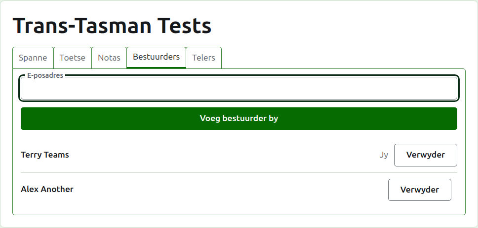
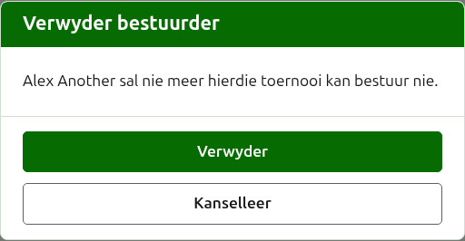
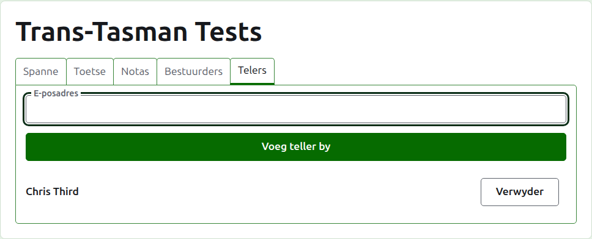
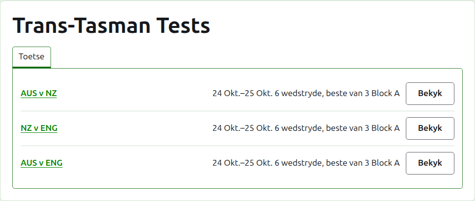

# Bestuurders en telers

'n Toernooi het bestuurders, wat alles kan doen wat daaraan gedoen kan word, en kan telers hê, wat sy uitslae invoer en niks anders nie. Wie ook al die toernooi geskep het, is sy eerste bestuurder.

## Bestuurders

Die **Bestuurders**-oortjie lys wie die toernooi bestuur, in die volgorde waarin hulle bestuurders gemaak is, met jou eie naam as joune gemerk. Dit is waar 'n toernooi gedeel, of oorgegee, word.

Iemand word 'n bestuurder gemaak by hul e-posadres. Tik dit in die veld bo die lys en druk op **Voeg bestuurder by**. Die adres moet aan 'n rekening behoort wat geregistreer en bevestig is; 'n adres sonder een word onder die veld geweier, en die werf sê niks meer daaroor as dit nie. 'n Teller wat 'n bestuurder gemaak word, hou op om 'n teller te wees.

**Verwyder** haal 'n bestuurder af. Niks van 'n verwyderde bestuurder word gehou nie, so Verwyder vra eers; hulle word weer 'n bestuurder gemaak by hul adres as hulle terug gewil word. 'n Toernooi het altyd 'n bestuurder, so die laaste een kry nie Verwyder aangebied nie.

Jy kan jouself afhaal. Die vraag sê dan wat dit beteken: jy verloor jou eie pad terug na die toernooi, en niemand op die bladsy kan dit vir jou ongedaan maak nie. 'n Ander bestuurder kan jou weer een maak.

## Telers

Die **Telers**-oortjie is die Bestuurders-oortjie vir telers, en werk op dieselfde manier: 'n e-posadres en **Voeg teller by** bo die lys, en **Verwyder** op elkeen.

'n Teller sien die toernooi in hul eie lys in die administrasie, met **Uitslae** in die plek van Bestuur, en kry net sy toetse aangebied: geen spanne, notas, bestuurders of telers nie. Hulle kan nie 'n span se bladsy oopmaak nie, want wie vir 'n span speel, is die bestuurders se besluit. Op 'n toets se bladsy kan hulle uitslae invoer, regstel, argiveer, herstel en herrangskik soos 'n bestuurder kan.

'n Bestuurder word nie 'n teller gemaak nie, want 'n bestuurder kan reeds alles doen wat 'n teller kan. 'n Toernooi het geen teller nodig nie, so elke teller kan verwyder word, die laaste een ook.

Volgende: [Hoe om 'n toernooi te verander, te argiveer en te herstel](changing-and-archiving.md).
