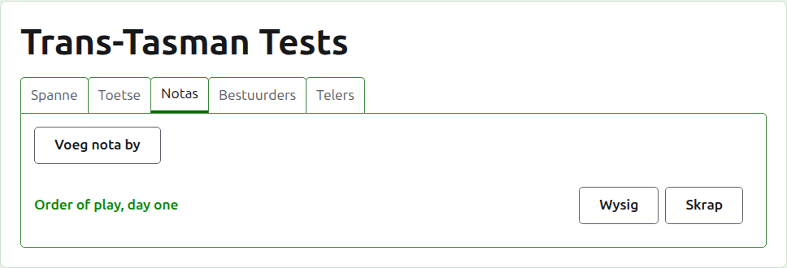
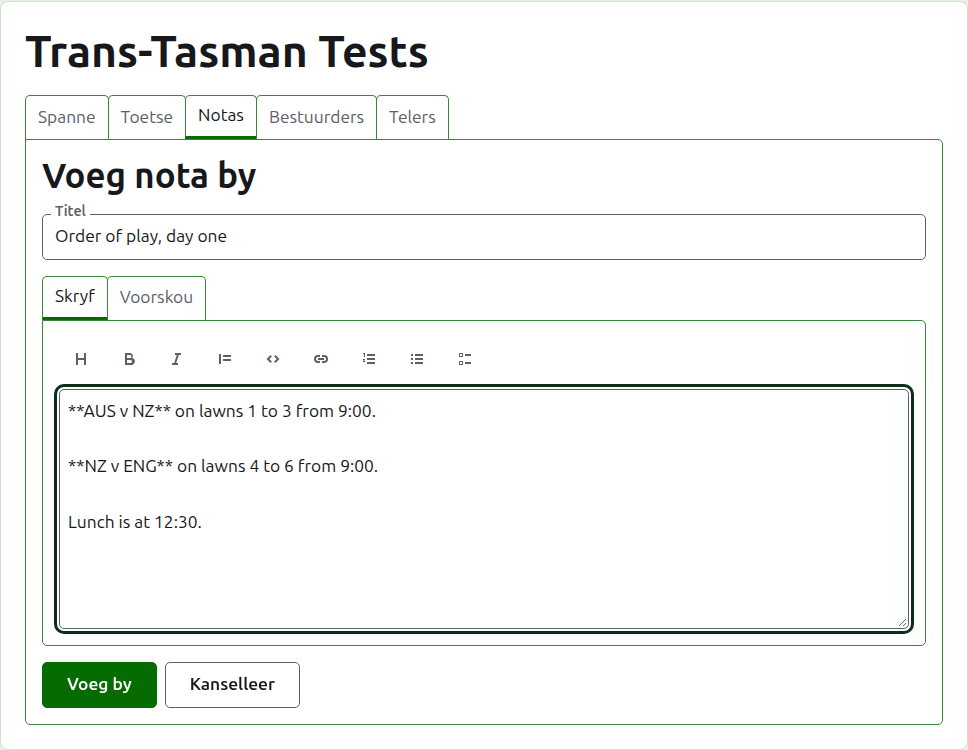
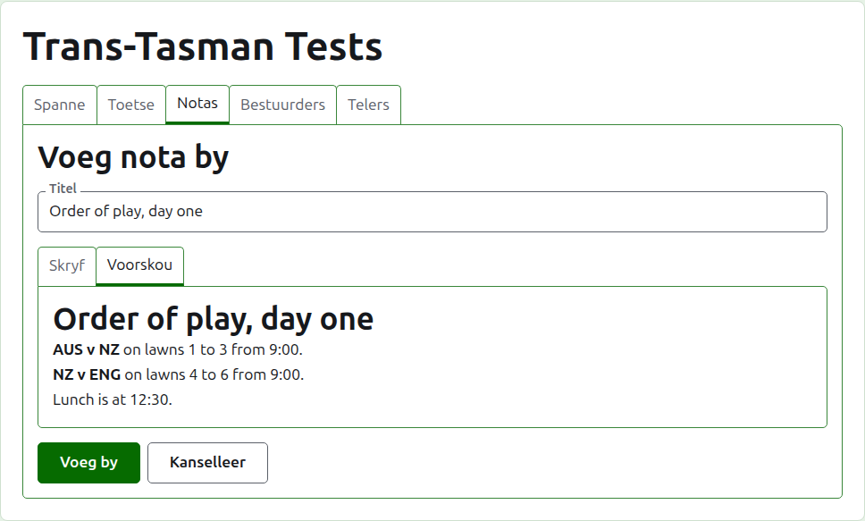
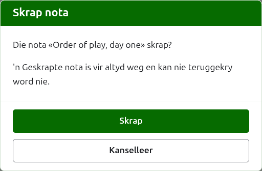

# Notas

Die **Notas**-oortjie van 'n toernooi se bladsy is waar sy bestuurders skryf wat die spelers moet weet terwyl die toernooi aan die gang is: die speelvolgorde, 'n verandering aan die bane, die tyd van middagete. Lesers vind hulle op die toernooi se openbare Notas-bladsy, en 'n nota wat hulle nie gelees het nie, word daar met 'n rooi sterretjie gemerk, wat ook die Notas-afdeling op elke bladsy van die toernooi merk totdat hulle dit oopmaak.

## Hoe om 'n nota te skryf

Druk op **Voeg nota by**, bo die lys. 'n Paneel neem die plek van die lys in, want 'n nota word uitgebreid geskryf en het die ruimte nodig.

**Titel** is verpligtend, en is waaronder die nota gelys word. Dit is gewone teks.

**Beskrywing** word in Markdown geskryf en kan leeg gelaat word waar die titel alles sê wat daar te sê is. Die nutsbalk bo die boks skryf die Markdown vir jou: Opskrif, Vetgedruk, Skuinsgedruk, Aanhaling, Kode, Skakel, Genommerde lys, Lys met kolpunte en Taaklys. Elkeen werk op wat gekies is, of aan die begin van elke gekose reël, of plaas die wyser waar die woorde moet kom.

**Voorskou** wys die nota soos 'n leser dit op sy bladsy sal sien.

Druk op **Voeg by**. Die nota word gehou, die lys kom terug met dit bo-aan, en dit is dadelik op die openbare Notas-bladsy.

## Hoe om 'n nota te wysig

Druk op 'n nota se titel, of op sy **Wysig**, om die paneel op daardie nota oop te maak. Druk op **Bewaar** om die verandering te hou. 'n Nota wat gewysig is sedert 'n leser dit gelees het, word weer vir hulle gemerk.

## Hoe om 'n nota te skrap {#deleting-a-note}

'n Nota wat nie meer geld nie, word geskrap. 'n Geskrapte nota is vir altyd weg, so **Skrap** vra eers.

Volgende: [Bestuurders en telers](managers-and-scorers.md).
