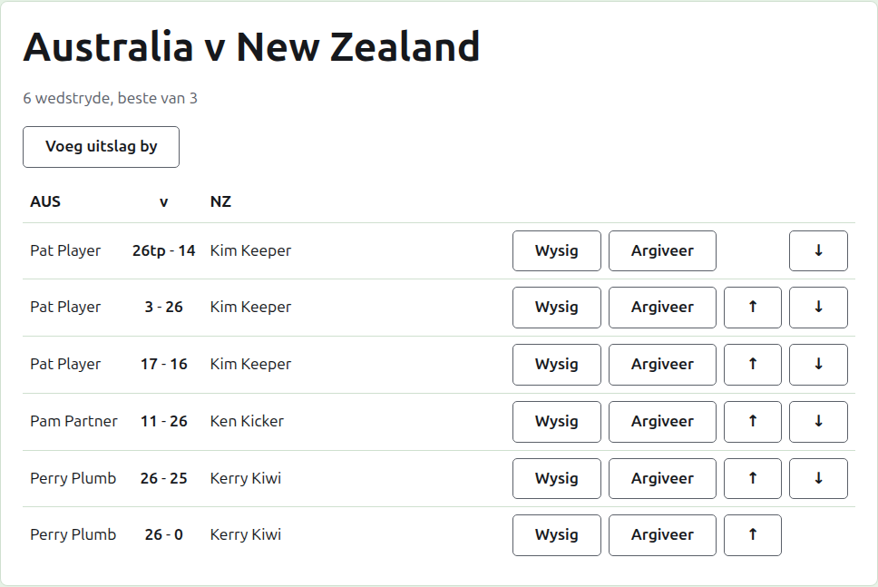
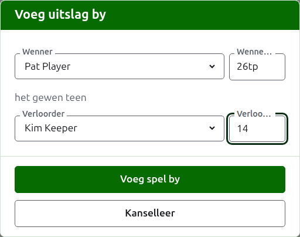

# Uitslae

'n Toets se bladsy word oopgemaak vanaf sy naam op die Toetse-oortjie, of vanaf die donkergroen balk. Dit het sy spanne se volle name as opskrif, soos "Australia v New Zealand", met hoeveel wedstryde dit verwag word om te hê en waarvan elkeen die beste is daaronder. Sy uitslae is die bladsy, sonder oortjies. 'n Bestuurder en 'n teller sien dieselfde bladsy, want 'n teller kan aan 'n uitslag alles doen wat 'n bestuurder kan.

## Hoe die uitslae uiteengesit is

Die uitslae word per span uiteengesit eerder as volgens wie gewen het, in 'n tabel met die eerste span se kortnaam, "v", en die tweede span s'n as opskrif. Elke uitslag is 'n ry: die eerste span se speler, dan albei se punte met die eerste span s'n eerste, soos "26tp - 14", dan die tweede span se speler, wie van hulle ook al gewen het. Die geargiveerde uitslae word daaronder op dieselfde manier uiteengesit.

## Hoe om 'n uitslag in te voer {#entering-a-score}

Druk op **Voeg uitslag by**, bo die lys. Die dialoog lees soos 'n uitslag hardop gesê word: die wenner en hul punte, dan "het gewen teen", dan die verloorder en hul punte.

Die wenner word gekies uit albei spanne se spelers in gebruik, onder elke span se naam, die eerste span se spelers eerste en elke span s'n in die span se volgorde. Niemand is om mee te begin gekies nie. Sodra die wenner gekies is, word die verloorder net uit die ander span aangebied, want 'n spel tussen twee spelers van dieselfde span is nie 'n spel tussen die spanne nie. 'n Geargiveerde speler word nie aangebied nie.

Punte word getik soos die teller hulle neergeskryf het: die getal punte, en wat ook al daarop volg, wat gehou en gewys word soos getik, soos "26tp" vir 26 hoepels en 'n triple peel. Die getal is die syfers waarmee die punte begin; punte wat nie met 'n syfer begin nie, word geweier.

'n Spel wat op gelyke punte gewen is, soos wanneer dit deur tyd gestop en op 'n ander manier beslis word, sê wie dit gewen het met 'n merk ná die wenner se punte: "6w" het gewen teen "6". Die merke is "w", "won" en "winner". 'n Wenner se punte moet meer as die verloorder s'n wees, of gemerk wees, tensy die toernooi gelykopuitslae toelaat, in welke geval gelyke punte sonder 'n merk as gelykop gehou word.

Druk op **Voeg spel by**. Die spel word bygevoeg, die dialoog sê watter, en die velde word leeggemaak vir die volgende, want uitslae kom in 'n bondel wat aan die einde van 'n sessie van 'n bord af gelees word. Druk op **Kanselleer** sodra hulle almal in is.

## Wedstryde

Twee spelers wat mekaar ontmoet, speel 'n wedstryd van die toets se beste van. Die spelle tussen hulle is die spelle van daardie wedstryd, en 'n spel tussen twee spelers wie se wedstryd reeds beslis is, word geweier: een van hulle het meer spelle gewen as wat die ander nog kan wen, of elke spel daarvan is gespeel.

'n Wedstryd het begin wanneer sy twee spelers 'n spel in gebruik het. 'n Toets begin nie meer wedstryde as wat dit verwag word om te hê nie: sodra soveel begin het, word 'n spel tussen twee spelers wat nog nie ontmoet het nie geweier, terwyl nog 'n spel van 'n wedstryd wat reeds begin het, aanvaar word. Waar die toets meer wedstryde moet hê, verander dit op die Toetse-oortjie om hulle te verwag.

## Hoe om 'n uitslag reg te stel {#correcting-a-score}

**Wysig** maak dieselfde dialoog op daardie uitslag oop, met die titel Wysig uitslag, met sy spelers gekies en sy punte soos hulle getik is. Sy spelers kan sowel as sy punte verander word, gekies soos by byvoeging. Druk op **Bewaar** om die regstelling te hou en die dialoog toe te maak. 'n Regstelling behou die uitslag: 'n gewonne spel bly gewonne, en 'n gelykopspel bly gelykop. 'n Spel waarvan die uitslag verkeerd was, word geargiveer en weer ingevoer.

## Hoe om die uitslae in volgorde te plaas

Uitslae kom in watter volgorde hulle ook al ingevoer word, so elke uitslag in gebruik bied **Op** en **Af** aan, wat dit met die uitslag daarnaas omruil, sodat die lys in die volgorde geplaas kan word waarin die spelle gespeel is.

## Hoe om 'n uitslag te argiveer

**Argiveer** sit 'n uitslag eenkant sodat dit vir niks tel nie. Dit word onder **Geargiveerde uitslae** gelys, deurgehaal, en bied net **Herstel** aan. Nie een van die twee vra eers nie, want elkeen maak die ander ongedaan. Elke uitslag in 'n toets kan geargiveer word, want 'n toets het geen rondes wat van mekaar afhang nie.

'n Uitslag waarvan die speler sedertdien geargiveer is, word nie herstel totdat die speler herstel is nie, en die bladsy sê so.

Volgende: [Notas](notes.md).
