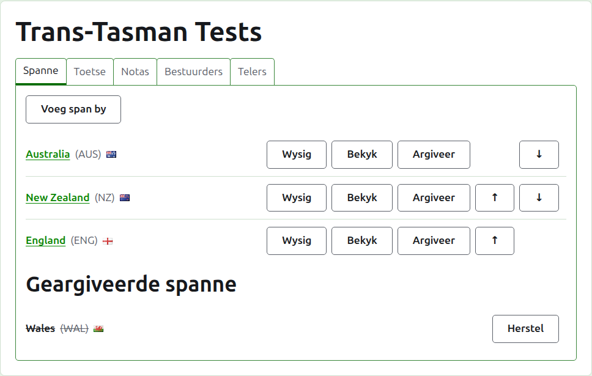
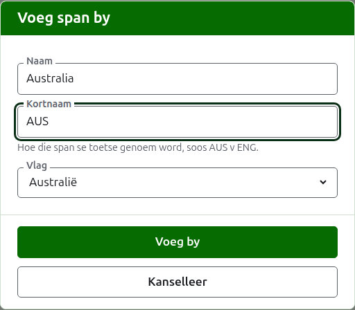
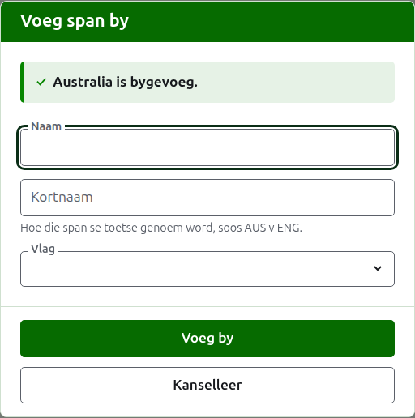
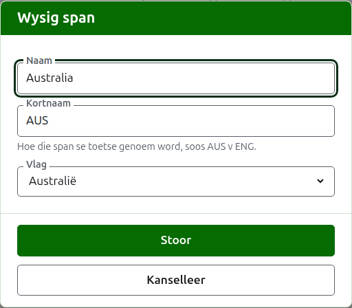

# Spanne

Die **Spanne**-oortjie van 'n toernooi se bladsy is waar sy spanne bygevoeg, reggestel, in volgorde geplaas en eenkant gesit word. Dit is die oortjie waarop die bladsy oopmaak, want die spanne is die eerste ding wat opgestel word. 'n Toets is tussen twee spanne, so minstens twee is nodig voordat enige toets bygevoeg kan word.

## Hoe om 'n span by te voeg

Druk op **Voeg span by**, bo die lys. 'n Dialoog maak oor die bladsy oop.

**Naam** is verpligtend: die span se volle naam, soos "Australia", wat die opskrif van die span se bladsy en van die openbare bladsye se tabelle is. Twee spanne in een toernooi kan nie dieselfde naam hê nie.

**Kortnaam** is ook verpligtend: waarby die span se toetse genoem word, soos "AUS v ENG", en wat die donkergroen balk die span noem. Dit is hoogstens 10 karakters, en nie langer as die naam nie, want 'n kortnaam wat langer is as die naam wat dit verkort, is die twee wat verkeerd om getik is. Twee spanne kan ook nie dieselfde kortnaam hê nie.

**Vlag** word langs die span se naam gewys waar dit ook al verskyn. Dit kan as geen gelaat word, soos vir 'n span van 'n klub of 'n streek.

Druk op **Voeg by**. Die span word bygevoeg, die dialoog sê so, en sy velde word leeggemaak vir die volgende. Voeg die hele lys so by, en druk dan op **Kanselleer** om die dialoog toe te maak. Kanselleer hou niks wat nie reeds bygevoeg is nie.

## Hoe om 'n span reg te stel

Druk op 'n span se **Wysig** om dieselfde dialoog op daardie span oop te maak, met die titel Wysig span. Verander wat verkeerd is en druk op **Stoor**. 'n Span waarvan die kortnaam verander, word oral by die nuwe een genoem, so sy toetse word daarmee saam hernoem.

## Volgorde

Die spanne word in die toernooi se volgorde gelys, wat die volgorde is waarin hulle aangebied word wanneer 'n toets bygevoeg word, die volgorde waarin die donkergroen balk hulle het, en die volgorde waarin die openbare Spelers-bladsy hulle lys. **Op** en **Af**, die pyltjies aan die einde van elke ry, skuif 'n span een plek.

## Hoe om na 'n span te gaan

'n Span se naam, of **Bekyk**, maak die span se eie bladsy oop, waar sy spelers ingeskryf word. Kyk by ['n Span se spelers](team-players.md).

## Hoe om 'n span te argiveer

**Argiveer** sit 'n span eenkant. Sy spelers bly by hom en kom terug wanneer dit herstel word, so argivering vra nie eers nie. 'n Geargiveerde span word onder **Geargiveerde spanne** gelys, deurgehaal, bied net **Herstel** aan, en sy bladsy is gesluit totdat dit herstel word.

'n Span wat in 'n toets in gebruik speel, kan nie geargiveer word nie, want die toets sou dan teen 'n span wees wat nie meer daar is nie, so so 'n span kry nie Argiveer aangebied nie. 'n Span waarvan die enigste toetse geargiveer is, kan wel.

Volgende: ['n Span se spelers](team-players.md).
