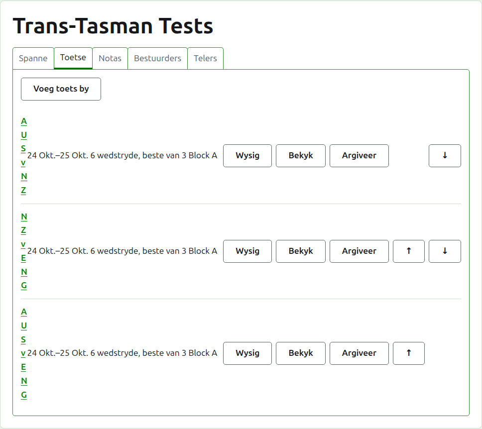
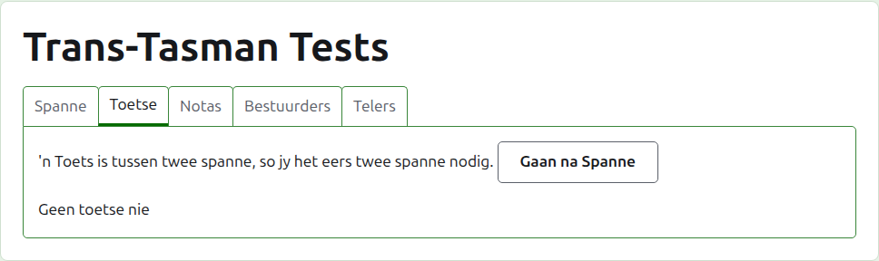
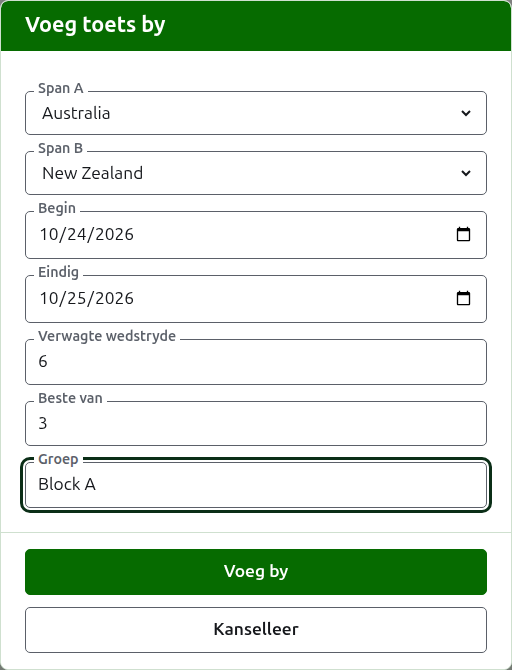
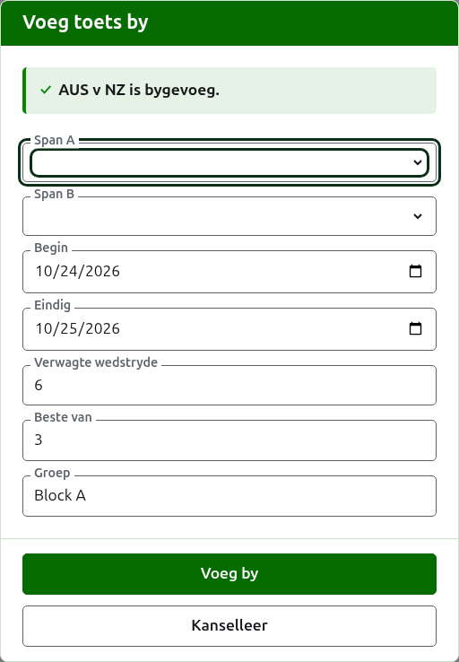
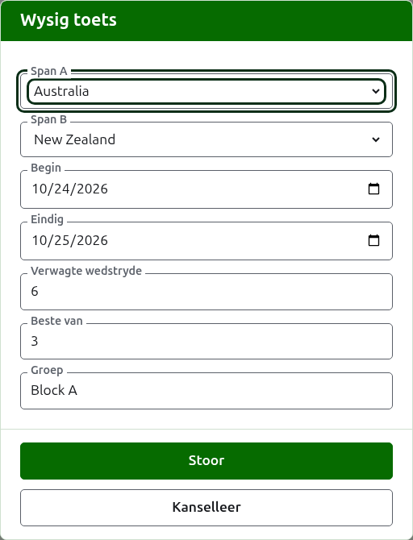

# Toetse

Die **Toetse**-oortjie van 'n toernooi se bladsy is waar die toetse tussen sy spanne bygevoeg, verander, in volgorde geplaas en eenkant gesit word. 'n Toets is een van die toernooi se kompetisies: 'n kragmeting tussen twee spanne, genoem by hul kortname, soos "AUS v NZ", gespeel as 'n aantal wedstryde tussen 'n speler van elke span. Elke toets het 'n eie bladsy, waar sy uitslae ingaan.

Elke toets sê sy naam, die dae waarop dit gespeel word, hoeveel wedstryde dit verwag word om te hê en waarvan elkeen die beste is, soos "6 wedstryde, beste van 3", en sy groep waar dit in een is.

## Eers twee spanne

'n Toets is tussen twee spanne in gebruik, so solank die toernooi minder as twee het, sê die oortjie so waar Voeg toets by sou wees, en lei na die Spanne-oortjie.

## Hoe om 'n toets by te voeg {#adding-a-test}

Druk op **Voeg toets by**, bo die lys. 'n Dialoog maak oor die bladsy oop, en lees in die volgorde waarin 'n toets hardop gesê word.

**Span A** en **Span B** word elk gekies uit die toernooi se spanne in gebruik, by naam, in die toernooi se volgorde. Nie een van die twee is om mee te begin gekies nie, sodat 'n toets nooit bygevoeg word tussen spanne wat jy nie gekies het nie. Span B bied elke span aan behalwe dié wat as Span A gekies is, want 'n span speel nie 'n toets teen homself nie. Span A is die eerste span: sy spelers is links op die toets se bladsy en op die openbare bladsy. 'n Toets het geen eie naam om te tik nie; dit word by sy spanne se kortname genoem.

**Begin** en **Eindig** is die dae waarop die toets gespeel word, wat op die toernooi se eerste dag begin. 'n Toets word binne sy toernooi gespeel, so dae voordat die toernooi begin of nadat dit eindig, word geweier.

**Verwagte wedstryde** is hoeveel wedstryde die toets moet hê, deur die byeenkoms vasgestel voordat dit begin, sodat wie ook al sy uitslae lees kan sien hoe ver dit gevorder het. Dit is 'n heelgetal van 1 af. Dit is ook 'n grens: sodra soveel wedstryde begin het as wat die toets verwag word om te hê, word 'n spel wat nog een sou begin geweier, terwyl die wedstryde wat reeds begin het, uitgespeel word. 'n Toets wat meer moet hê, word verander om hulle te verwag.

**Beste van** is waarvan elke wedstryd die beste is. Dit mag ewe wees, want 'n wedstryd kan gedeel word.

**Met voorgifte gespeel**, **Laat gelykopuitslae toe** en **Tel vir wêreldranglyste** word gevra soos by enige kompetisie. Die laaste word net gevra waar dit getel kan word: 'n toets in Association Croquet of Golf Croquet wat nie met voorgifte gespeel word nie en nie gelykopuitslae toelaat nie. Dit is om mee te begin gemerk.

**Groep** is die groep waarin die toets is, waar die byeenkoms in groepe gespeel word, soos "Block A". Dit is opsioneel: leeg gelaat, is die toets in geen groep nie. Die toetse in 'n groep het 'n eie bladsy op die openbare werf, wat wys hoe die groep se spanne staan. Die **Eire-beker** en die **Interstaatskild** het geen groepe nie, so die dialoog vra nie daar vir een nie.

Druk op **Voeg by**. Die toets word bygevoeg, die dialoog sê watter by sy naam, en die spanne word leeggemaak vir die volgende, met die dae, die verwagte wedstryde, die beste van en die groep gelaat soos hulle was: toetse word 'n ronde op 'n slag bygevoeg, tussen spanne wat op dieselfde dag ontmoet, so die volgende toets van die ronde is net sy twee spanne. Druk op **Kanselleer** sodra hulle almal in is.

## Hoe om 'n toets te verander {#changing-a-test}

**Wysig** maak dieselfde dialoog op die toets oop, met die titel Wysig toets, begin soos die toets is. Druk op **Bewaar** om die verandering te hou.

'n Toets met spelle in gebruik hou sy spanne: die dialoog wys hulle, maar hulle kan nie verander word nie. Die res kan verander word, binne wat gespeel is: minder verwagte wedstryde as die wedstryde wat reeds begin het, word geweier, en so ook 'n beste van wat minder is as die meeste spelle wat enige twee spelers gespeel het.

## Volgorde

Die toetse word in die toernooi se volgorde gelys, wat die volgorde is waarin hulle op die openbare bladsye en in die donkergroen balk verskyn. **Op** en **Af** skuif 'n toets een plek.

## Hoe om na 'n toets te gaan

'n Toets se naam, of **Bekyk**, maak sy bladsy oop, waar sy uitslae ingaan. Die donkergroen balk lei ook daarheen, vanaf die toernooi se bladsy of enige ander toets s'n.

## Hoe om 'n toets te argiveer

**Argiveer** sit 'n toets eenkant, en word deur **Herstel** ongedaan gemaak, so nie een van die twee vra eers nie. 'n Geargiveerde toets word onder **Geargiveerde toetse** gelys, deurgehaal, bied net Herstel aan, en is nie op die openbare bladsye nie.

'n Toets met spelle in gebruik is gespeel, en kan nie geargiveer word totdat sy spelle geargiveer is nie. 'n Toets waarvan die spelle almal geargiveer is, kan wel, want 'n geargiveerde spel tel vir niks. 'n Toets waarvan die span sedertdien geargiveer is, word nie herstel totdat die span herstel is nie, en die oortjie sê so.

Volgende: [Uitslae](scores.md).
