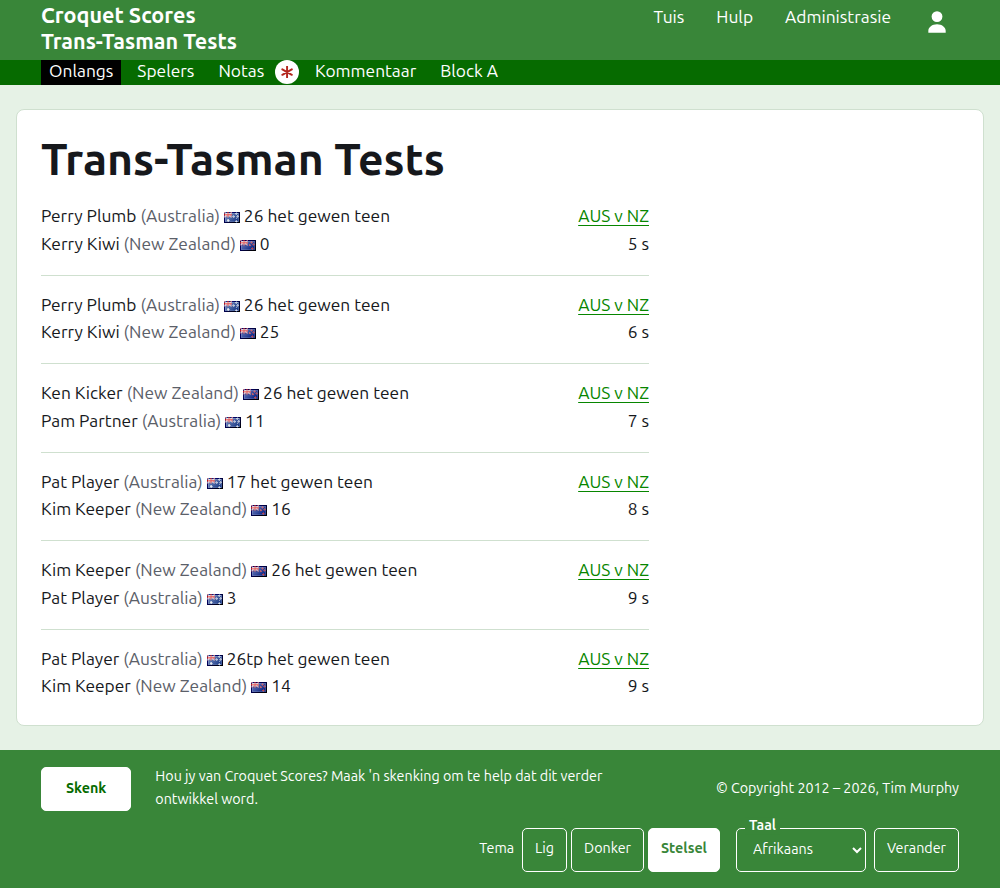
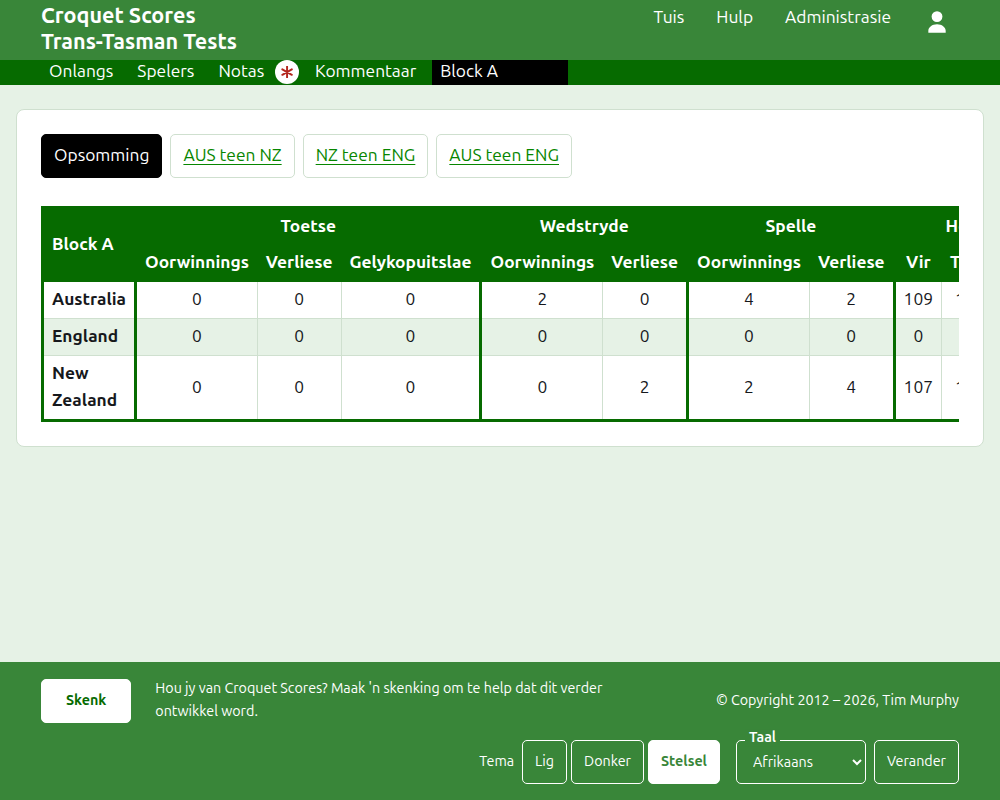
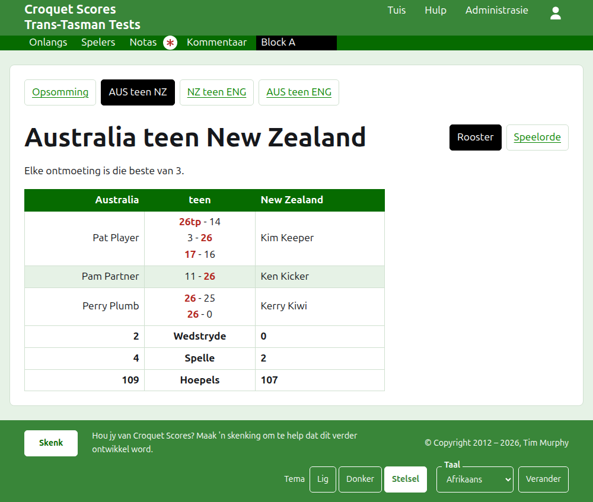
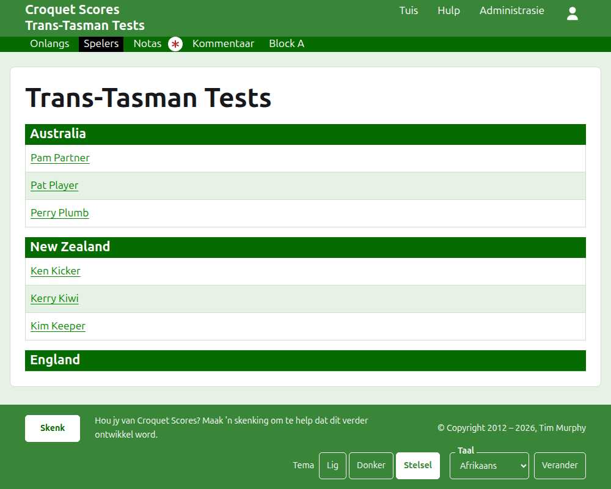

# Wat die publiek sien

Niks word gepubliseer nie: die openbare bladsye word saamgestel uit wat die administrasie bevat, so 'n uitslag wat ingevoer is, is dadelik daarop. Hulle het geen rekening en geen skripte nodig nie, en is vir 'n foon uitgelê.

## Die toernooi se bladsy

Die toernooi se bladsy is by sy jaar, sy sport en sy naam, soos `/2026/ac/trans-tasman-tests`. Dit het die toernooi se naam as opskrif, met sy onderskrif daaronder. Dit lys elke spel in gebruik, die mees onlangs bygevoegde eerste, sodat 'n leser wat terugkom sien wat sedertdien gebeur het. Elke spel sê die wenner, hul span en hul punte, dan die verloorder en hulle s'n, met die toets waarin dit gespeel is en hoe lank gelede dit bygevoeg is.

Die donkergroen balk bied die toernooi se afdelings aan: **Onlangs**, wat hierdie bladsy is, **Opsomming**, **Spelers**, **Notas** en **Kommentaar**, dan die toetse. 'n Toets word gesê as sy spanne se kortname met "teen" tussenin, soos "AUS teen NZ". Toetse in 'n groep word nie een vir een aangebied nie: die groep is een afdeling, genoem soos die groep heet, wat staan waar sy eerste toets sou wees. Notas word met 'n rooi sterretjie gemerk solank daar 'n nota is wat die leser nie gelees het nie.

## Die opsomming

'n Toernooi waarvan die toetse in geen groep is nie, het 'n **Opsomming**: een tabel van elke span, gerangskik, met die toetse wat dit gewen, verloor en gelykop gespeel het, sy spelle gewen en verloor, en sy hoepels vir, teen en netto. Waar enige toets se wedstryde die beste van meer as een is, kom die wedstryde gewen en verloor ná die toetse. Die opsomming is waar 'n leser elke span as 'n geheel soek.

'n Toernooi met 'n toets in 'n groep het geen Opsomming nie. Elke groep se bladsy wys eerder hoe die spanne van daardie groep staan, want een tabel van spanne oor groepe heen wat nooit teen mekaar gespeel het nie, sou niks rangskik nie.

## 'n Groep

'n Groep se bladsy wys hoe die groep se spanne staan, met net die groep se toetse getel, in die tabel wat die opsomming gebruik. Bo die tabel, in 'n eie ry, bied dit **Opsomming** aan, wat hierdie bladsy is, en elkeen van die groep se toetse, wat na die toets se bladsy lei.

## 'n Toets

'n Toets se bladsy het sy spanne se volle name as opskrif, soos "Australia teen New Zealand", en sê waarvan elke wedstryd die beste is. Sy tabel het die twee spanne as opskrif, die eerste links. Elke wedstryd wat gespeel is, is 'n ry, in die volgorde waarin dit begin het, met die eerste span se speler links, die tweede span s'n regs, en die wedstryd se spelle tussen hulle, elkeen die eerste kant se punte en dan die tweede s'n, met die wenner s'n gemerk. Onder die wedstryde is elke span se spelle en hoepels, en, waar elke wedstryd die beste van meer as een is, sy wedstryde gewen, aan sy eie kant.

'n Toets word op twee maniere gewys, aangebied op die reël van sy naam: **Rooster**, wat hierdie tabel is, en **Speelorde**, wat elke spel van die toets lys, oudste eerste. 'n Toets in 'n groep bied sy groep se Opsomming en toetse in 'n ry bo sy opskrif aan, met hierdie toets gemerk.

## Spelers

Die Spelers-bladsy lys die spelers span vir span: elke span onder 'n opskrif met sy naam, in die toernooi se volgorde van sy spanne, en sy spelers daaronder in alfabetiese volgorde.

## Notas

Die Notas-bladsy lys die toernooi se notas, die mees onlangs geskrewe eerste, elkeen lei na sy eie bladsy en sê hoe lank gelede dit geskryf is. 'n Nota wat die leser nie gelees het nie, word met 'n rooi sterretjie gemerk totdat hulle dit oopmaak.

## Adresse wat skuif

'n Toernooi hou sy adres wanneer sy naam reggestel word. Waar dit skuif, omdat sy jaar of sy sport verander het, lei sy ou adres na die nuwe een, sodat 'n skakel wat van vroeër gehou is steeds werk. 'n Geargiveerde toernooi se bladsye word nie gevind totdat dit herstel is nie.
