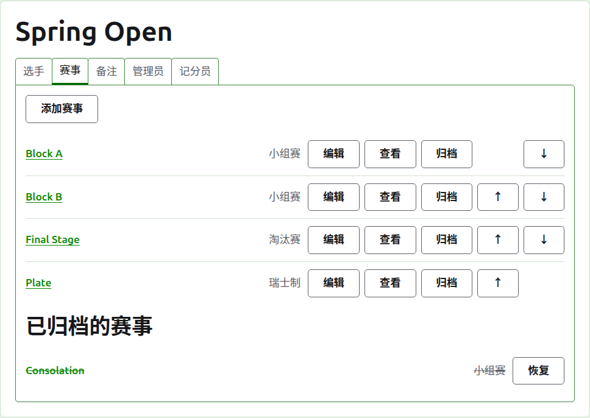
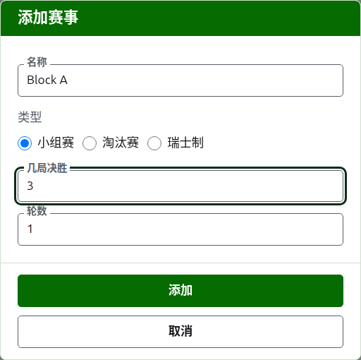
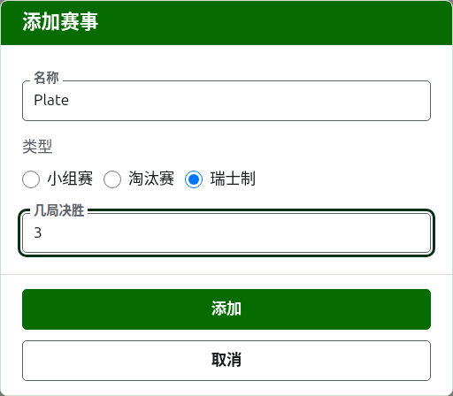
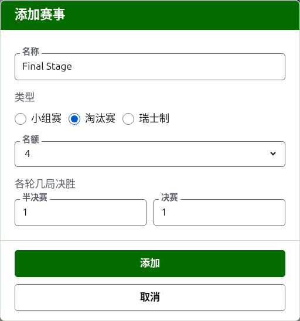

# 项目

赛事页面的**项目**标签页是添加、排序和搁置项目的地方。项目是小组赛、淘汰赛或瑞士制。每个项目都有自己的页面，选手在那里录入，成绩也在那里填写。

## 添加项目 {#adding-a-competition}

按列表上方的**添加项目**。一个对话框覆在页面上打开，询问项目的名称、类型，以及该类型的形制。

**名称**是选手在赛事页面上寻找自己比赛时所看的东西。长度在 1 到 254 个字符之间，单独一个字母也可以，因为小组赛常常只用一个字母来称呼。同一个赛事中的两个项目不能同名。

**类型**是小组赛、淘汰赛或瑞士制。对话框一开始停在小组赛上，因为大多数项目都是小组赛。

### 小组赛

小组赛询问每场比赛是**几局制**，以及**轮数**，也就是分几轮进行。

**几局制**一开始是 1。三局决胜由先赢两局的人获胜。它可以是偶数，因为在小组赛中，选手按赢得的局数排名，两局各赢一局的比赛和其他结果一样是一个结果。

**轮数**是小组中每一对选手相遇的次数，每一轮各打一场比赛。它一开始是 1，小组赛几乎总是用 1：每位选手与其他每位选手各打一次。只有在选手要再次相遇的小组中才需要调高，比如双循环赛，其中 2 让每一对选手打两场比赛。

### 瑞士制

瑞士制只询问每场比赛是**几局制**，一开始是 1，和小组赛一样。三局决胜由先赢两局的人获胜。它可以是偶数，因为在瑞士制中，选手按赢得的局数排名，两局各赢一局的比赛和其他结果一样是一个结果。

### 淘汰赛

淘汰赛询问它的抽签有多少个**名额**，以及每一轮是几局制。名额提供 2、4、8、16、32、64 和 128，因为其他任何数字都无法一轮轮减半直到决赛，对话框一开始停在 8。选手录入之后剩下的名额用轮空填满，轮空在录入选手的地方添加。

抽签有多少轮，取决于把名额减半到一个需要多少次，所以 8 个名额的抽签有三轮。对话框在**各轮几局制**下一起询问每一轮是几局制，按比赛的先后顺序排列。最后三轮按人们谈论抽签轮次的叫法命名：**四分之一决赛**、**半决赛**和**决赛**，它们之前的轮次按编号命名，第 1 轮在先。选择更多名额会在抽签开头增加轮次，选择更少则从开头减去，所以为决赛输入的内容仍然属于决赛。每一轮都是奇数局决胜，因为淘汰赛的比赛必须有一个胜者。

### 败者淘汰赛 {#losers-knockout}

淘汰赛可以把输掉某一轮的选手送入他们自己的淘汰赛，也就是败者淘汰赛。在淘汰赛的**各轮几局制**下方，按**添加败者淘汰赛**。对话框会询问**败者来自**，即让败者继续比赛的轮次，可从除决赛外的所有轮次中选择，以及**败者淘汰赛名称**。按**添加**把它放进按钮下方的列表，按**移除**可再把它取出。它会在淘汰赛添加时一并添加，两者之一被拒绝，就都不会添加。

败者淘汰赛为该轮的每场比赛设一个名额，它的每一轮都是一局定胜负，可用**编辑**更改。它的选手随该轮比赛决出胜负而依抽签顺序放入，所以它的**选手**标签页只显示他们。若某局被更正或搁置，败者会被移动或再次移出，除非他们已经继续比赛。

对已添加的淘汰赛，**编辑**会显示同一个按钮，败者淘汰赛会立即添加。败者被另一个正在使用的淘汰赛接收的淘汰赛，不能归档，也不能更改名额：请先归档败者淘汰赛。

### 怎样进行和计算

每种类型在形制之下都询问同样的三件事。

**使用差点。**让分的项目请勾选此项。

**允许平局。**当一局可以在双方都不是胜者的情况下结束时勾选此项。大多数项目不允许。勾选时，录入的得分相等且没有标记的成绩会作为平局保存；未勾选时，得分相等的一局必须在胜者得分后面加上标记来说明谁赢了，比如“6w”。淘汰赛的每场比赛总有胜者，所以平局的一局并不能决出一场比赛。

**计入世界排名。**只在可以计入时才询问：协会槌球或高尔夫槌球中既不使用差点也不允许平局的项目。它一开始是勾选的，所以不计入的项目请取消勾选。

### 一次添加多个

按**添加**。项目被添加，对话框说明了这一点，名称清空以便录入下一个，类型及其形制保持不变：一起添加的项目大多相似，所以“Block A”之后的“Block B”只需要改名称。全部录入之后按**取消**关闭对话框。

## 更改项目 {#changing-a-competition}

**编辑**在该项目上打开同一个对话框，标题为“编辑项目”，名称、形制以及怎样进行和计算都是现有的。不会询问它的类型，因为小组赛不是靠更改就能变成淘汰赛的：类型错了的项目应归档后重新添加。按**保存**保存更改并关闭对话框。

有了一局的淘汰赛，选手已排入抽签，更改名额会移动他们，所以一旦录入了一局，更改名额就会被拒绝。它各轮的几局制仍然可以更改。

## 顺序

项目按赛事的顺序列出，这也是它们在公开页面和深绿色条上出现的顺序。**上移**和**下移**把项目移动一位。

## 前往项目

项目的名称或**查看**打开它的页面，选手在那里录入，成绩也在那里填写。页眉下方的深绿色条也通向那里，从赛事的任何页面都可以。

## 归档项目

**归档**把项目搁置一旁，无论它有没有局，局会随它一起保留，并在它恢复时回来。已归档的项目列在**已归档的项目**下，加上删除线，只提供**恢复**，并且不在公开页面上。归档不会先询问，因为恢复可以撤销它。

下一页：[把选手录入项目](entering-players-in-a-competition.md)。
