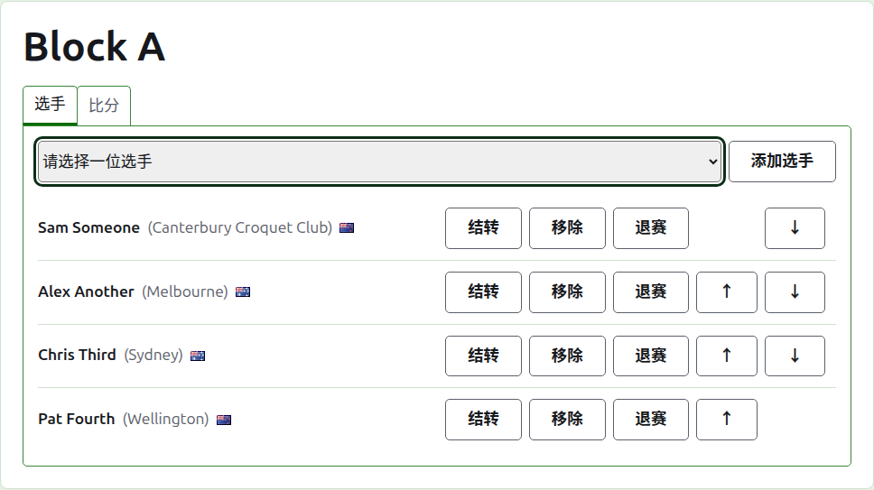
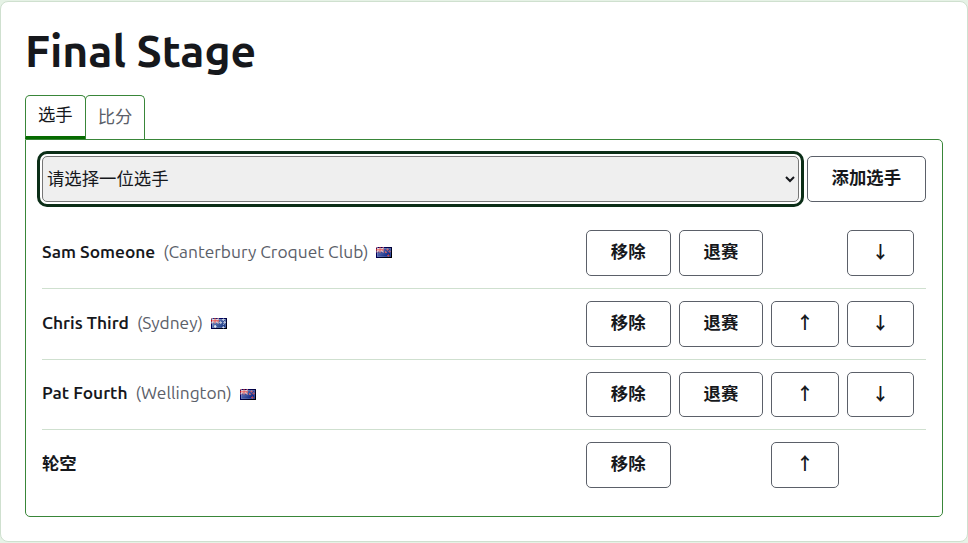
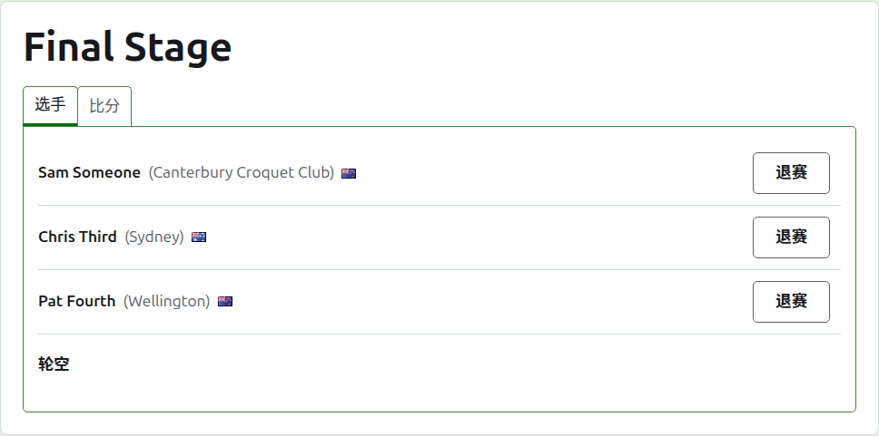
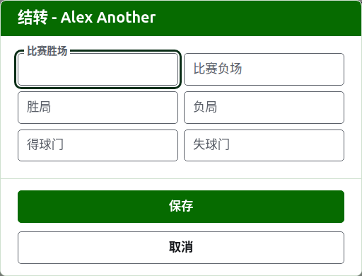
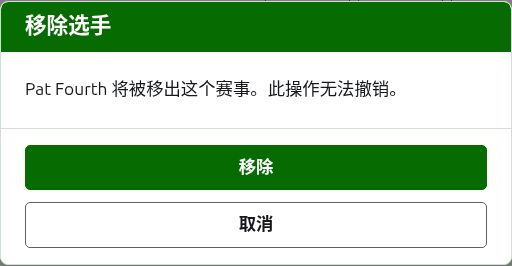
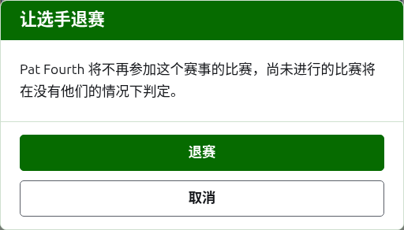
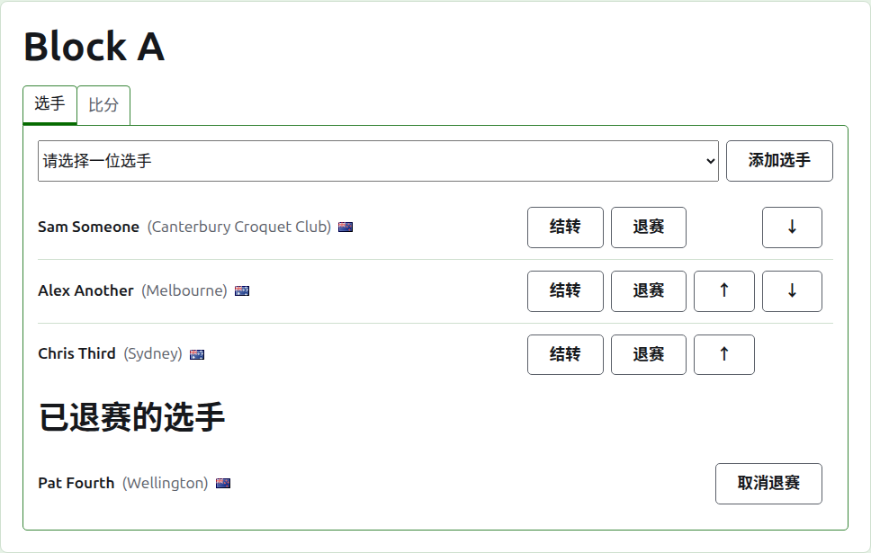

# 把选手录入项目

项目的页面从“项目”标签页上它的名称打开，或者从深绿色条打开。页面以项目名称为标题，下方有两个标签页：**选手**和**成绩**。它打开时停在“选手”上，因为选手要在任何比赛进行之前录入。

项目中的选手是赛事的选手之一，所以是通过选择而不是通过输入来录入的。除了他们在项目中的位置和带入项目的结转之外，关于他们的一切都在赛事的“选手”标签页上更改。

## 添加选手

列表上方的下拉列表按赛事的顺序提供赛事中尚未进入该项目的每位选手。选择一位并按**添加选手**。选手按赛事的顺序排入已录入的选手之中，下拉列表不再提供他们，光标回到下拉列表，以便用键盘选择下一位。当赛事的每位选手都已在项目中时，不显示下拉列表，标签页会说明这一点。

赛事中已归档的选手不会被提供。

## 淘汰赛中的轮空

淘汰赛只有在抽签的每个名额都填满之后才能进行，选手剩下的名额用轮空填满。所以在淘汰赛中，下拉列表先提供**Bye**，再提供选手，并且无论添加了多少个轮空都继续提供它，因为一次抽签可能需要好几个。

轮空像选手一样排入抽签：它可以上移下移和移除，但不能退赛，因为它不打任何比赛。在每个名额都已填满的淘汰赛中录入选手会被拒绝，标签页会在下拉列表下方说明。

淘汰赛选手的顺序就是它的抽签。前两个名额在第一场比赛中相遇，接下来两个在下一场相遇，依此类推。在录入任何成绩之前，把选手排成抽签要进行的顺序，因为一旦淘汰赛有了正在使用的一局，它的选手就固定了：谁都不能被添加、移除或移动。选手仍然可以退赛。

## 顺序

选手按项目的顺序列出，这也是淘汰赛抽签的顺序，以及小组赛在公开页面上列出的顺序。**上移**和**下移**把选手移动一位。

## 结转

**结转**说明选手从没有在此记分的比赛中带入项目的内容：更早阶段的成绩，或者在该项目在这里记分之前进行的比赛。它在小组赛和瑞士制中提供，因为它们有可以计入的排名，而在淘汰赛中不提供。

对话框询问六个数字：比赛胜场和负场、胜局和负局、得球门和失球门。每个数字都是可选的。留空的数字不结转任何东西，这和结转 0 不一样，这样之后更改它的人看到的就是它被留下时的样子。按**保存**保存全部六个。

## 移除选手

**移除**取出误录的选手。他们仍然是赛事的选手，并会再次出现在下拉列表中，但他们在项目中的位置不会保留任何东西，所以“移除”会先询问。

在项目中有任何正在使用的局的选手不能移除，因为那样一来那些局就成了与一个已不存在的人打的，所以不会提供“移除”。只有已归档的局的选手可以移除，他们已归档的成绩随他们一起离开。

## 让选手退赛

**退赛**用于不再参加该项目余下比赛的选手。他们留在项目中，连同已经打过的局，列在**已退赛的选手**下，排在仍在比赛的选手之后。在淘汰赛中，他们在尚未决出胜负的比赛中的对手晋级。

退赛会先询问，因为它改变项目的结果：该选手没有打的局在没有他们的情况下决定。

已退赛的选手只提供**取消退赛**，它把他们放回正在比赛的选手之中，排在留下的选手之后，不会询问。

下一页：[成绩](scores.md)。
