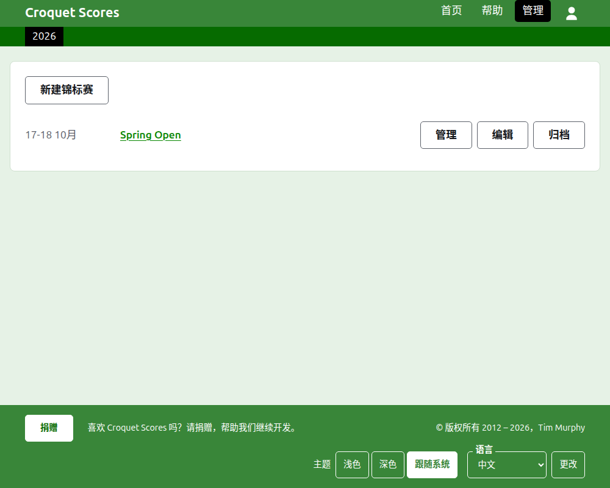
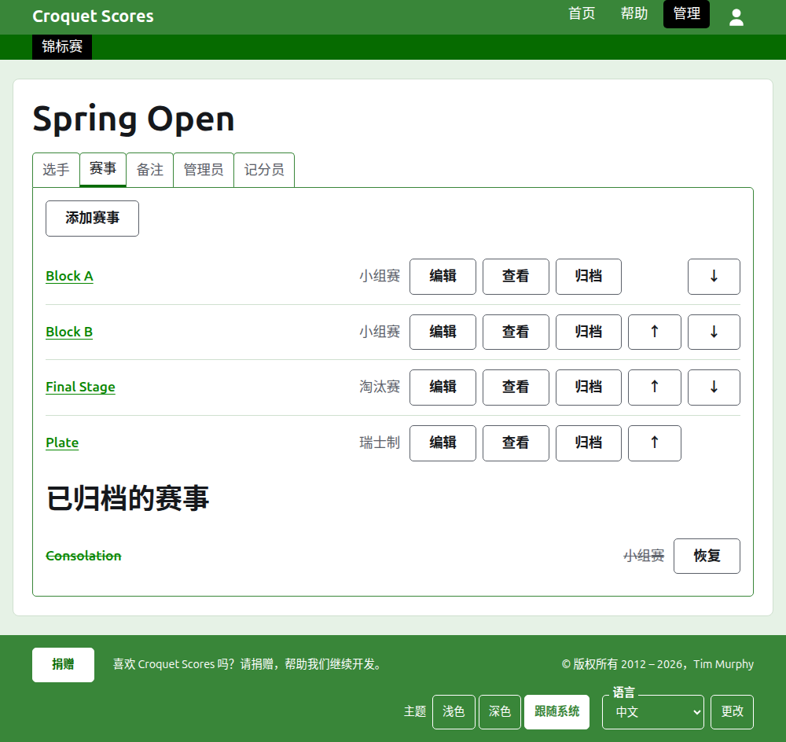

# 运作标准锦标赛

标准锦标赛是由逐个录入的选手之间进行的锦标赛：俱乐部周末赛、公开赛、冠军赛。它的选手被录入到小组赛、淘汰赛和瑞士制中，比分随着比赛的进行逐一发布。这份指南带领管理员从登录开始，直到锦标赛的成绩向公众开放。

它自成一体。其中没有任何内容依赖于团体锦标赛的指南，那份指南是另外写的。

## 开始之前

你需要一个账户。点击[这里](/account/register)注册账户。

管理员所做的一切都在网站的管理后台中进行。选手和观众关注锦标赛的公开页面，取自管理后台所保存的内容，所以不需要另行发布：录入一个比分，它立刻就出现在公开页面上。

## 各页的顺序

1. [创建锦标赛](creating-a-tournament.md)：它的名称、日期、项目、举办地点，以及它计入什么。
2. [选手](players.md)：录入锦标赛的选手，更正他们，以及把误录的选手搁置一旁。
3. [赛事](competitions.md)：添加小组赛、淘汰赛和瑞士制，并排好顺序。
4. [把选手录入赛事](entering-players-in-a-competition.md)：每个赛事由谁参加、淘汰赛中的轮空、结转、移除和退赛。
5. [比分](scores.md)：录入结果，更正它们，以及把误录的结果搁置一旁。
6. [备注](notes.md)：在锦标赛进行期间告诉选手他们需要知道的事。
7. [管理员和记分员](managers-and-scorers.md)：分担锦标赛的运作，以及让某人只能录入比分而不能更改其他任何东西。
8. [排名](rankings.md)：发送给世界排名的文件，以及留给你填写的部分。
9. [更改、归档和恢复锦标赛](changing-and-archiving.md)：更正锦标赛的详情，以及把锦标赛搁置一旁。
10. [公众看到什么](what-the-public-sees.md)：你的选手关注的页面，以及你录入的内容如何在那里显示。

## 管理后台的布局

管理后台的首页列出你参与的锦标赛，一次显示一年。

按锦标赛的名称或**管理**，打开它的页面。所有要运作的东西都在它名称下方的六个标签页里：**选手**、**赛事**、**备注**、**管理员**、**记分员**和**排名**。页面打开时停在“选手”上，因为选手是最先录入的东西。

页眉下方的深绿色条用于在页面之间移动。它以**锦标赛**通向锦标赛本身，并以名称通向它的每个赛事，这样你就能从锦标赛去到某个赛事、在赛事之间来回，而不必回到“赛事”标签页。你所在的页面以黑色标出。

## 处处适用的规则

**除备注以外，没有任何东西会被直接删除。**选手、赛事、比分和锦标赛本身都是归档而不是删除：搁置一旁，加上删除线，列在一个单独的标题下，并带有**恢复**以把它们找回来。归档、恢复以及上移下移从不要求你确认，因为每一个都可以通过反向操作撤销。无法撤销的事，比如把选手从赛事中移除或删除备注，会先询问。

**覆在页面上的对话框在你按下它的按钮之前不会保存任何东西。**取消，或 Escape 键，会关闭它并让一切保持原样。添加东西的对话框，比如“添加选手”和“添加比分”，在每添加一项之后仍保持打开，这样可以一项接一项地录入整份名单。

**被拒绝的内容会在相关字段旁边说明。**被拒绝的内容不会保存，而你输入的内容仍然保留，这样可以直接改正而不必重新输入。

**管理后台可以在手机上使用。**每个按钮都足够大，可以用拇指按下，并且没有任何东西比屏幕更宽。

下一页：[创建锦标赛](creating-a-tournament.md)。
