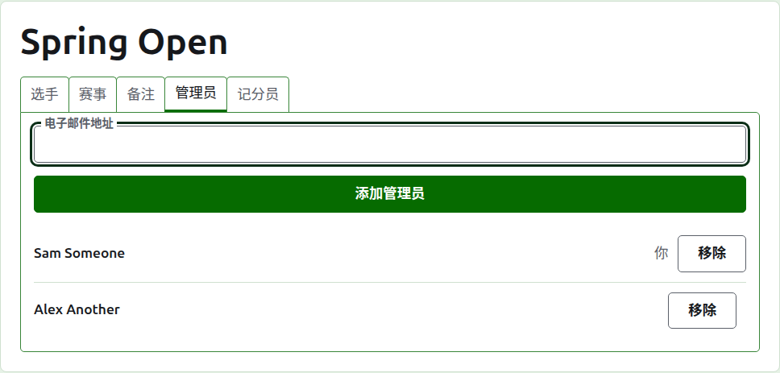
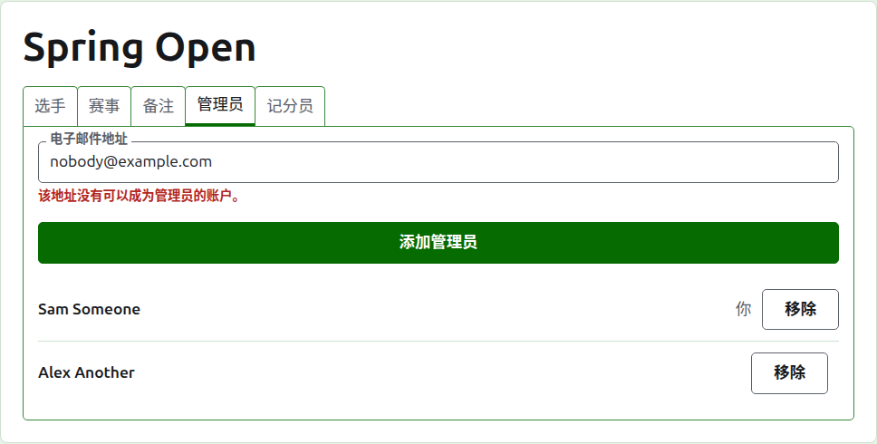
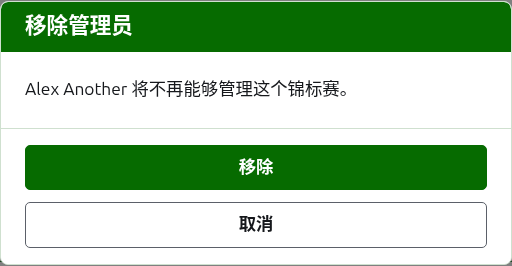
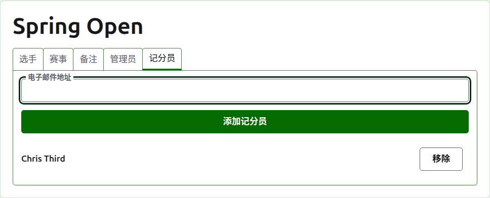
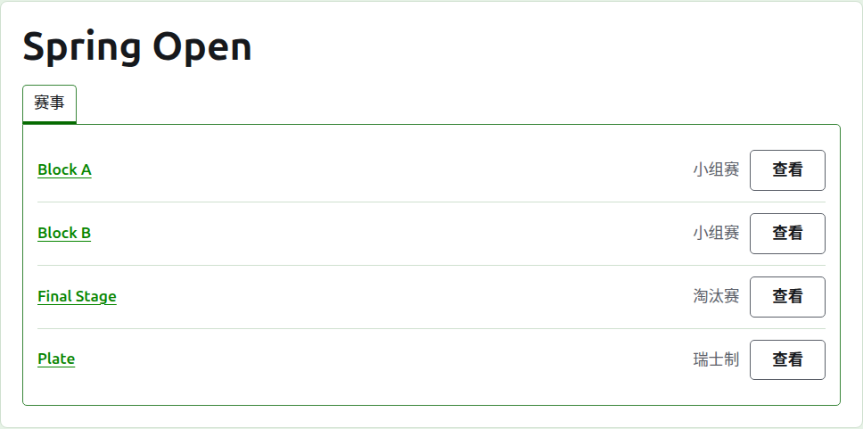

# 管理者和记分员

赛事有管理者，他们可以做对赛事能做的一切；还可以有记分员，他们录入成绩，别的什么都不做。创建赛事的人是它的第一位管理者。

## 管理者

**管理者**标签页按被设为管理者的先后顺序列出谁在运作这个赛事，您自己的姓名标为您的。赛事在这里被分享，或者移交。

某人通过电子邮件地址被设为管理者。把地址输入列表上方的字段并按**添加管理者**。该地址必须属于一个已注册并已确认的账户；没有账户的地址会在字段下方被拒绝，网站对此不会多说。被设为管理者的记分员不再是记分员。

**移除**撤掉一位管理者。被移除的管理者不保留任何东西，所以“移除”会先询问；如果想要他们回来，用他们的地址再次设为管理者。赛事总有一位管理者，所以最后一位不提供“移除”。

您可以撤掉自己。这时问题会说明这意味着什么：您失去自己回到这个赛事的途径，页面上没有人能为您撤销。另一位管理者可以再次把您设为管理者。

## 记分员

**记分员**标签页是记分员版的“管理者”标签页，用法相同：列表上方是电子邮件地址和**添加记分员**，每一位上有**移除**。

记分员在管理后台自己的列表中看到这个赛事，以**成绩**取代“管理”，并且只向他们提供它的项目：没有选手、通知、管理者、记分员或排名。在项目页面上他们只看到“成绩”标签页，在那里他们可以像管理者一样录入、更正、归档和恢复成绩。谁参加项目由管理者决定。

管理者不会被设为记分员，因为管理者已经能做记分员能做的一切。赛事不需要记分员，所以每位记分员都可以移除，包括最后一位。

下一页：[排名](rankings.md)。
