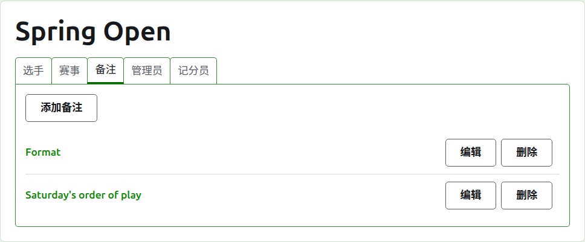
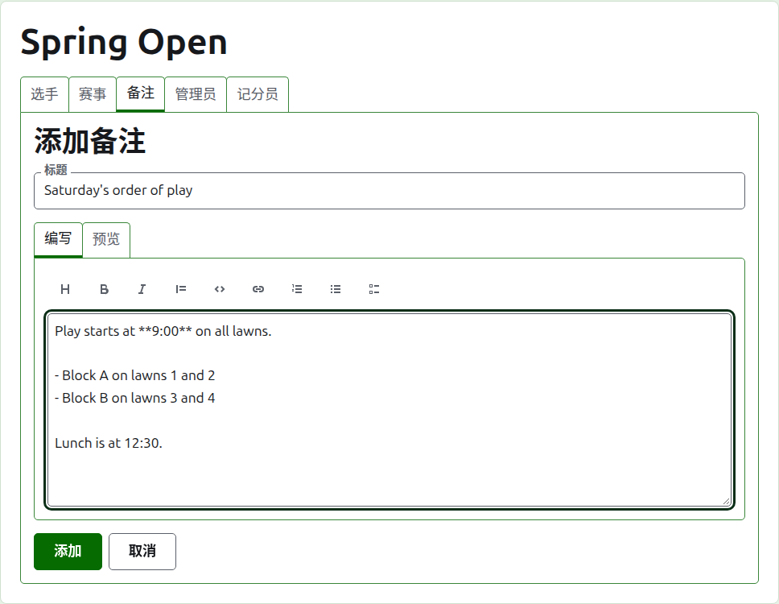
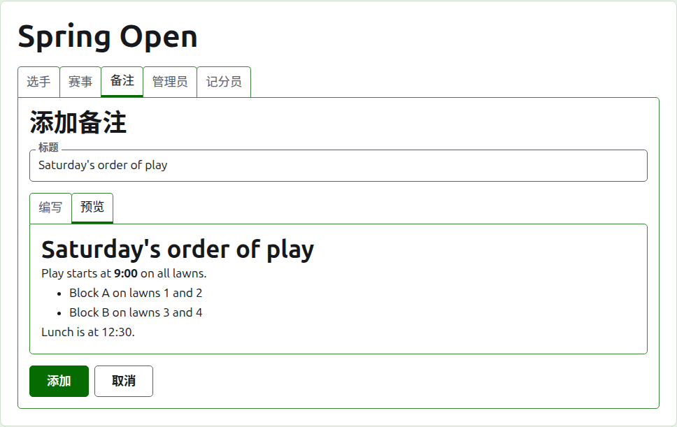
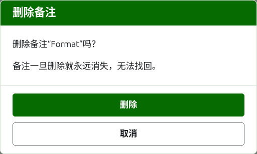

# 通知

赛事页面的**通知**标签页是管理者在赛事进行期间写下选手需要知道的事的地方：赛制、比赛顺序的变动、午饭时间。读者在赛事的公开“通知”页面上找到它们，他们尚未阅读的通知在那里以红色星号标出，在他们打开之前，赛事每个页面上的“通知”栏目也以红色星号标出。

## 撰写通知

按列表上方的**添加通知**。一个面板取代列表的位置，因为通知写起来篇幅较长，需要空间。

**标题**是必填的，通知按它列出。它是纯文本。

**说明**以 Markdown 书写，当标题已经说完要说的一切时可以留空。文本框上方的工具栏为您书写 Markdown：标题、粗体、斜体、引用、代码、链接、编号列表、项目符号列表和任务列表。每个工具作用于选中的内容，或者选中的每一行的开头，或者把光标放到该填词的位置。

**预览**按读者在通知页面上看到的样子显示通知。

按**添加**。通知被保存，列表回来并把它放在最上面，它立刻就出现在公开的“通知”页面上。

## 编辑通知

按通知的标题或其**编辑**，在该通知上打开面板。按**保存**保存更改。读者读过之后又被编辑的通知会再次为他们标出。

## 删除通知

不再适用的通知就删除。删除的通知一去不返，所以**删除**会先询问。

下一页：[管理者和记分员](managers-and-scorers.md)。
