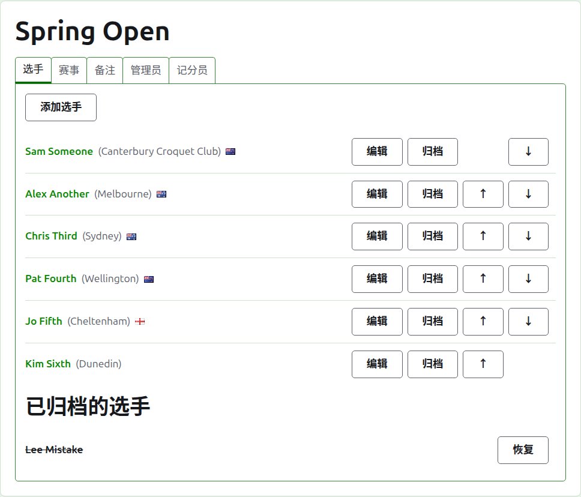
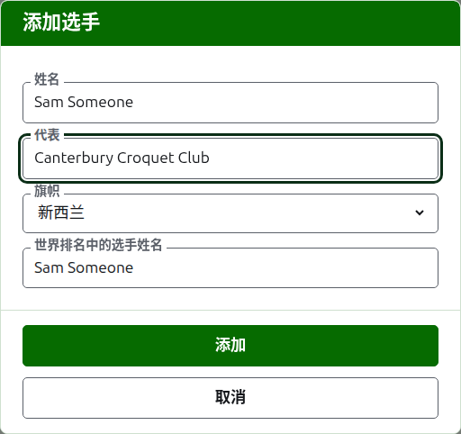
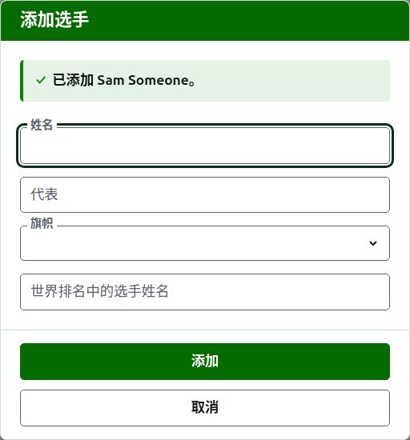
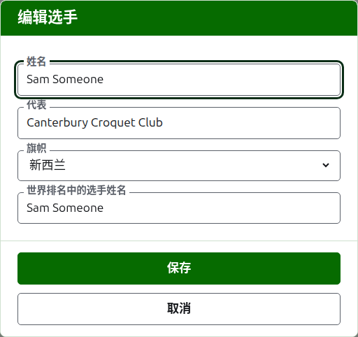
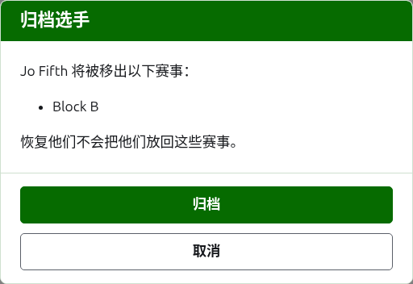

# 选手

锦标赛页面的**选手**标签页是录入、更正、排序和搁置选手的地方。它是页面打开时所停的标签页，因为录入选手是对一个锦标赛所做的第一件事。

选手在这里录入一次，进入锦标赛。每位选手参加哪些赛事是之后在每个赛事自己的页面上，从这里录入的选手中选择的。见[把选手录入赛事](entering-players-in-a-competition.md)。

## 添加选手

按列表上方的**添加选手**。一个对话框覆在页面上打开。

**姓名**是必填的。它是选手在每个页面上显示的姓名，长度在 3 到 254 个字符之间。同一个锦标赛中的两位选手不能同名，无论大小写如何；如果两位选手确实同名，就在姓名本身里把他们区分开，如“Andrew Hobbs (2)”。

**代表**是选手所代表的对象，按读者的说法书写：一个俱乐部、一个地区或一个国家，如“Canterbury Croquet Club”。它显示在姓名后面的括号里。可以留空。

**旗帜**是显示在选手姓名旁边的旗帜。可以保留为无，大多数选手都是如此。选手代表什么和他们举什么旗帜是分开保存的，因为一位选手可以为一个国家的俱乐部效力，却举另一个国家的旗帜。

**世界排名中的选手姓名**是世界排名所知的该选手的姓名。只在协会槌球或高尔夫槌球的锦标赛中询问，这是世界排名备有选手名单的两个项目。美式六门槌球的选手在排名中就是以本名为人所知，所以那里不询问，每位选手的世界排名姓名始终就是他的姓名。在你添加选手时，它会跟随你输入的姓名，因为大多数选手在排名中就是以本名为人所知的，而一旦你在其中输入，它就不再跟随。留空时，保存为选手的姓名。

当你输入姓名时，会提供世界排名所知的、姓名以此开头的选手，这样你可以直接取用排名中的拼法而不必打完。在世界排名姓名旁边，一个对勾表示排名知道这个姓名，一个问号表示不知道：姓名可能拼错了，或者该选手是排名中的新人。这只是提示。排名不知道的姓名和知道的姓名一样会被保存。

按**添加**。选手被添加，对话框说明了这一点，各字段清空以便录入下一位选手，光标回到姓名处。用这种方式添加完整份名单，然后按**取消**关闭对话框。取消不会保存任何尚未添加的内容。

选手绝不能叫“Bye”。淘汰赛的轮空在淘汰赛自身录入选手的地方添加，所以第一个词是英文“bye”的姓名会被拒绝，对话框会说明原因。

## 更正选手

按选手的姓名或其**编辑**，在该选手上打开同一个对话框，标题为“编辑选手”。改正错误之处并按**保存**，这会保存更改并关闭对话框。姓名被更正的选手保留原有的世界排名姓名，因为排名仍然以此知道他们。在美式六门槌球中，选手的世界排名姓名始终就是他的姓名，所以更正姓名也就更正了它。

在这里更正的选手处处都被更正：在他们参加的每个赛事中，以及在每个公开页面上。

## 给选手排序

选手按锦标赛的顺序列出，这也是他们被录入赛事时提供的顺序，以及淘汰赛抽签的顺序。每行末尾的箭头**上移**和**下移**，把选手移动一位。第一位选手没有“上移”，最后一位没有“下移”。

## 归档选手

**归档**把选手搁置一旁：误录的，或者退出整个锦标赛的。已归档的选手列在**已归档的选手**下，加上删除线，排在正在使用的选手之后，并且只提供**恢复**。已归档的选手不在任何赛事中，也不出现在任何公开页面上。

打过任何一局的选手不能归档，因为那样一来那些局就成了与一个已不存在的人打的，所以这样的选手没有“归档”。只有已归档的局的选手可以归档。

归档一位不在任何赛事中的选手不会先询问，因为恢复他们就能把一切放回原处。归档一位在某个赛事中的选手会先询问，因为归档会把他们从所参加的每个赛事中移除，而恢复他们并不会把他们放回去。

下一页：[赛事](competitions.md)。
