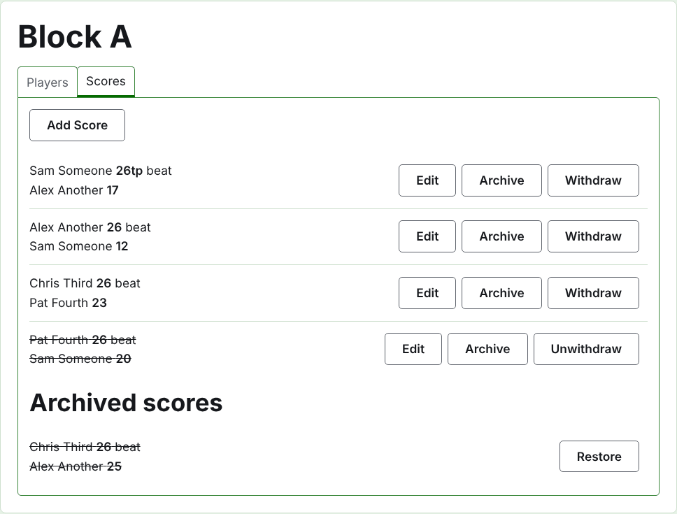
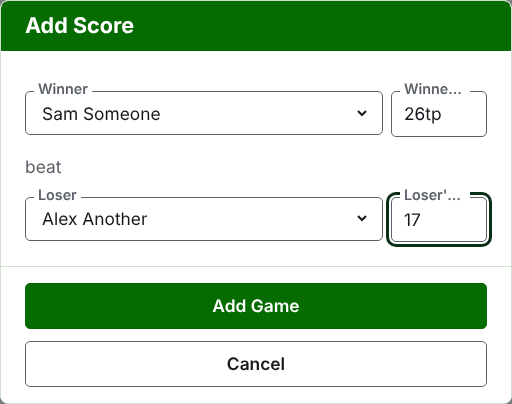
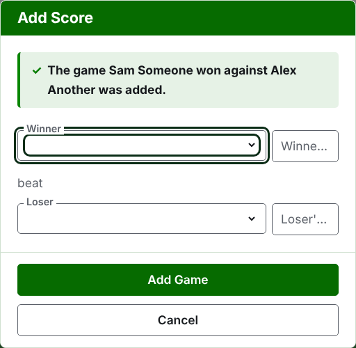
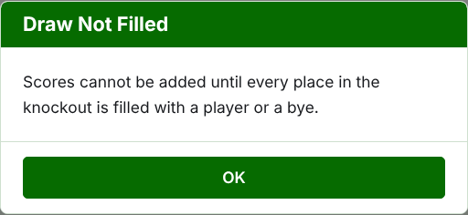
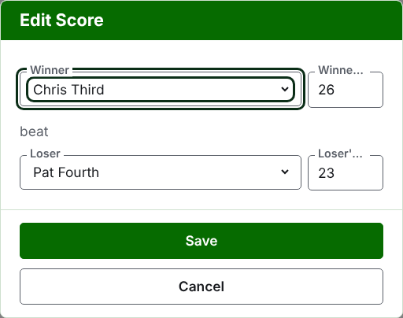

# 比分

赛事页面的**比分**标签页是录入、更正和搁置各局的地方。记分员只看到这个标签页，并且可以在上面做管理员能做的一切。

## 录入比分

按列表上方的**添加比分**。对话框读起来就像口头报结果：胜者及其得分，然后是“击败”，然后是负者及其得分。

胜者和负者各从赛事中正在比赛的选手里按赛事的顺序选择。一开始谁都没有被选中，这样一局绝不会记在你没有选择的选手头上。在淘汰赛中，选择胜者就选定了抽签中与之对阵的人作为负者，你可以看到并换成另一位。

比分按记分员记下的样子输入：它的分数，以及后面跟着的任何内容，后者会按输入的样子保存并显示，如“26tp”表示 26 个球门加一个三重剥夺。数字是比分开头的那些数位；不以数位开头的比分会被拒绝。

得分相等而获胜的一局，比如因时间到而中止、以其他方式决出胜负的，通过胜者得分后面的标记说明谁赢了：“6w”击败“6”。在 Croquet Scores 上，标记是“w”、“won”和“winner”；Gateball Scores 还接受“cb”和“so”。胜者的得分必须高于负者，或者带有标记，除非锦标赛允许平局，这时得分相等且没有标记的比分作为平局保存。

按**添加这一局**。这一局被添加，对话框说明是哪一局，各字段清空以便录入下一局，因为比分是在一轮结束时从记分板上成批读下来的。全部录入之后按**取消**。

被拒绝的内容会在相关字段下方说明：没有选择胜者或负者、没有输入比分或比分不以数位开头、同一位选手既是胜者又是负者、负者的得分带有获胜标记，或者胜者的得分低于负者。在淘汰赛中，两位没有被抽到对阵的选手会在字段上方被拒绝。

## 淘汰赛的抽签必须先排满

淘汰赛只有在抽签的每个名额都有一位选手或一个轮空时才能进行。在那之前，“添加比分”会说明为什么不能添加比分，而不是打开对话框。

## 比分列表

正在使用的比分按录入的顺序列出，最早的在先，这样列表读起来就是赛事进行的过程。每一条说明胜者及其得分，然后是负者及其得分，并提供**编辑**和**归档**。

## 更正比分

**编辑**在该比分上打开同一个对话框，标题为“编辑比分”，选手已选中，比分按输入时的样子显示。按**保存**保存更正并关闭对话框。

更正保持结果不变：赢了的一局仍然是赢，平局仍然是平局。结果错了的一局应归档后重新录入。

在可以归档比分的地方，它的选手和得分都可以更改。在淘汰赛中，胜者已经在下一轮比赛过的比分保留它的选手，因为更改谁赢了会让下一局变成由一个没有打到那里的人打的；只有它的得分可以更正。

## 归档比分

**归档**把比分搁置一旁，使它不计入任何东西。它列在**已归档的比分**下，加上删除线，只提供**恢复**。两者都不会先询问，因为每一个都可以撤销另一个。

在淘汰赛中，一场比赛的胜者进入下一轮，所以胜者已在下一轮比赛过的比分不提供“归档”。先归档下一轮的那一局，然后它之前的局才可以归档。当一轮是三局或五局决胜时，该场比赛的每一局都按同样的方式处理。小组赛和瑞士制没有相互依赖的轮次，所以其中的每个比分都可以归档。

## 作废比分

离开赛事的选手通常在“选手”标签页上退赛，这就足够了：他们不再比赛，他们打过的局仍然成立，但不再计入胜负和球门。作废比分用于更少见的情况：已经打过的一局不应计入。例如在澳大利亚 President's Eights 中，选手退赛时第一轮的成绩仍然成立，只有他们第二轮的局被排除在计算之外：就作废那些局。

在小组赛或瑞士制中，打过但不应计入的比分是作废而不是归档。**作废**把它保留在正在使用的比分之中，留在原位，但加上删除线，并且在公开页面上不计入任何东西。**取消作废**让它重新计入。两者都不会先询问。淘汰赛的比分不提供“作废”，因为在那里比分决定的不只是排名。

下一页：[备注](notes.md)。
