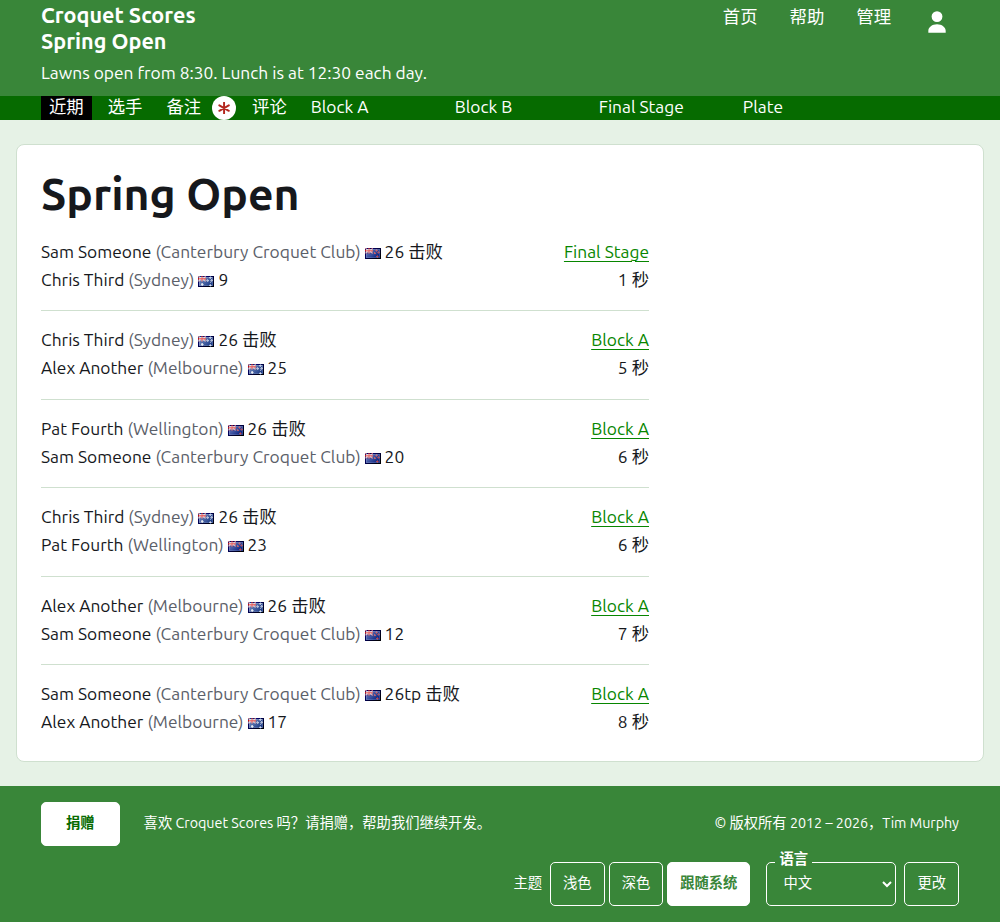
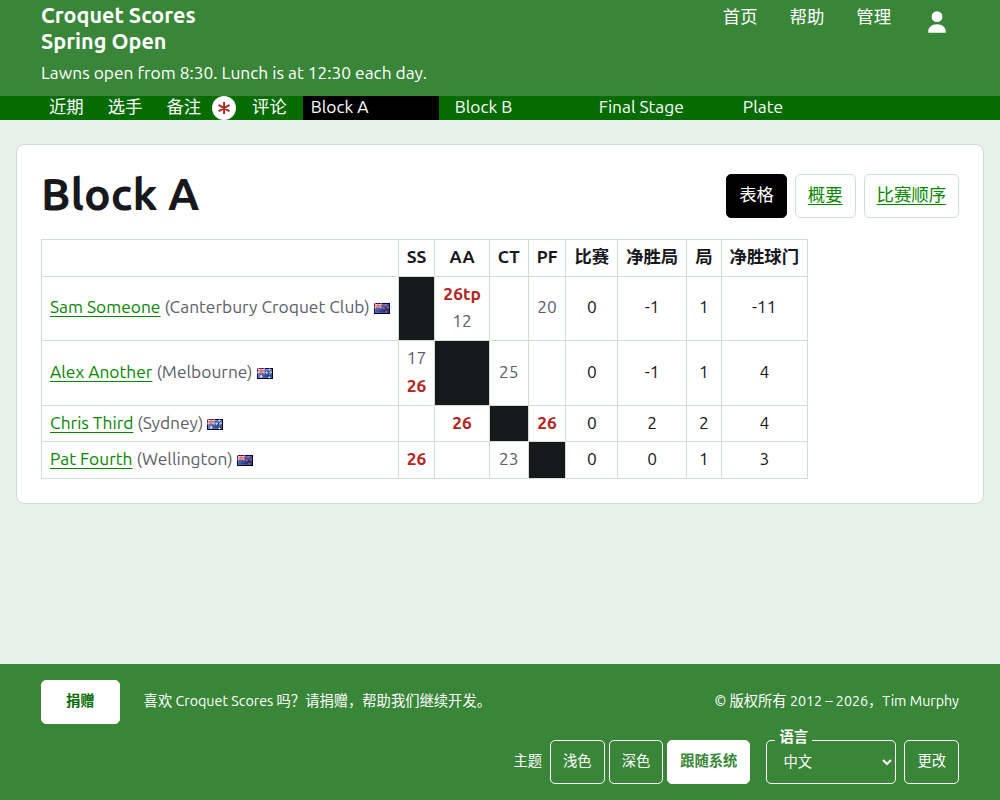
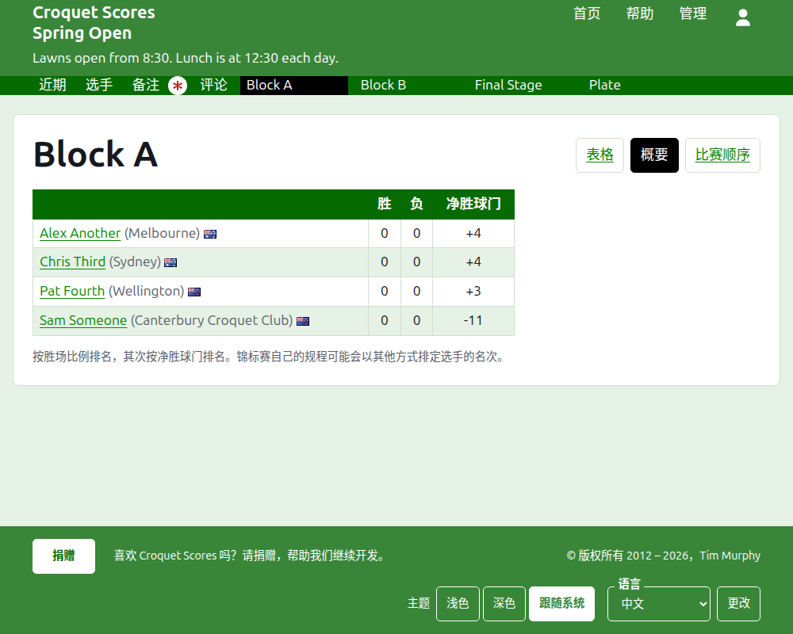
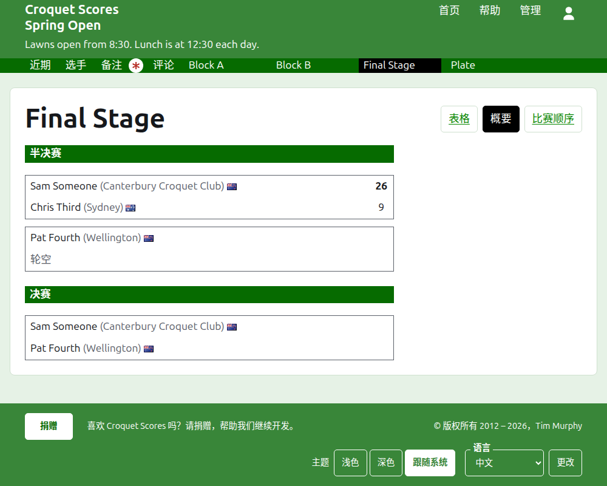
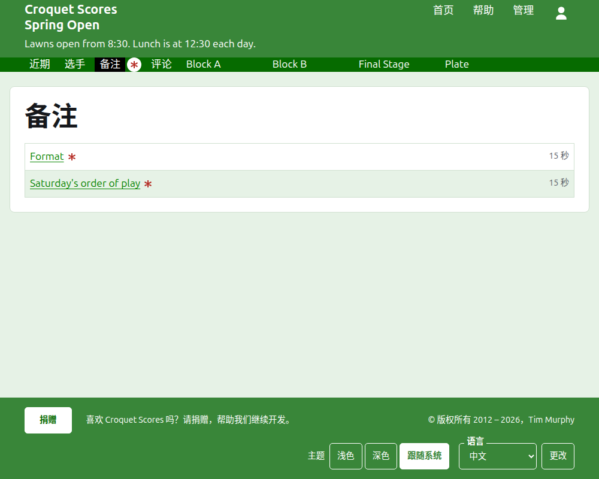

# 公众看到什么

没有什么需要发布：公开页面取自管理后台所保存的内容，所以录入的成绩立刻就出现在上面。它们不需要账户，也不需要脚本，并且是为手机排版的。

## 赛事的页面

赛事的页面位于它的年份、运动和名称之下，如 `/2026/ac/spring-open`。它以赛事的名称为标题，副标题在下方。它列出正在使用的每一局，最近添加的在先，这样再次回来的读者能看到此后发生了什么。每一局说明胜者、他们代表什么、他们的旗帜和得分，然后是负者及其得分，连同进行该局的项目以及它是多久以前添加的。

深绿色条提供赛事的各个栏目：**最新**，也就是本页，**选手**、**通知**和**评论**，然后是正在使用的每个项目，按“项目”标签页上的顺序。当有读者尚未阅读的通知时，“通知”以红色星号标出。

## 小组赛

小组赛的页面以网格显示它的成绩：按小组赛的顺序为每位选手安排一行和一列，两位选手之间的局位于行与列相交处，每一局对行上的选手标为胜、负或平。选手的各列之后是每位选手的总计。当每场比赛只有一局时，总计是胜局数和净胜球门；当一场比赛是多局决胜时，总计是比赛、净胜局、局和净胜球门。

小组赛有三种显示方式，在它名称所在的那一行提供：**表格**、**汇总**和**比赛顺序**。概要是适合手机的那种：选手按名次排列，带有他们的胜、负和净胜球门。比赛顺序列出每一局，最早的在先。读者选择一种视图之后，每个项目都保持这种视图，直到他们选择另一种。

已退赛选手的那一行会说明这一点。已撤销的成绩加删除线显示，并且不计入任何东西。已归档的成绩不显示。

## 淘汰赛

淘汰赛的页面逐轮画出它的抽签，从第一轮到决赛每轮一列，每场比赛的两方上下排列，比赛是几局制就有几个格子。后一轮的比赛立于两场比赛旁边，它就在这两场比赛的胜者之间进行。在手机上，抽签横向滚动，带有去往决赛和返回的箭头。

## 瑞士制

瑞士制的页面以一张表格给选手排名：他们的局数、胜局数、胜率，以及他们的成绩，每个成绩以对手和分差表示，如“+4”表示赢四分的一局。

## 选手

“选手”页面按字母顺序列出赛事中未归档的每位选手，连同他们代表什么和他们的旗帜。

## 通知

“通知”页面列出赛事的通知，最近写的在先，每条通向它自己的页面，并说明它是多久以前写的。读者尚未阅读的通知以红色星号标出，直到他们打开它。

## 会移动的地址

赛事在名称被更正时保留它的地址。当它因为年份或运动改变而移动时，旧地址会引向新地址，这样以前保存的链接仍然有效。已归档赛事的页面找不到，直到它被恢复。
