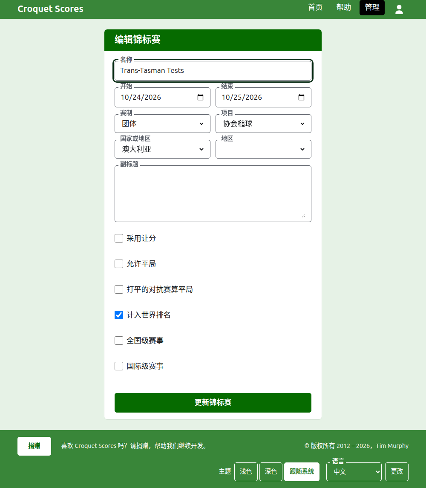

# 更改、归档和恢复赛事

## 更改赛事的详情

在管理后台的赛事列表中，按赛事上的**编辑**。表单就是创建它的那份，以赛事现有的内容开始。改正错误之处并按**更新赛事**。

当某场对抗赛需要用到赛事日期之外的一天时，可以在这里把赛事的日期放宽，因为对抗赛在它的赛事之内进行。一种团体赛制可以改为另一种，因为赛事在每种团体赛制中保存的东西相同。一旦赛事有了任何队伍或对抗赛，已归档的也算，它就不能再改为标准赛制，标准赛制有的是选手和项目。

赛事在名称被更正时保留它的地址，这样别人已经发出去的链接仍然能找到它。只有当它开始的年份或运动改变时它才会移动，这时旧地址会引向新地址。保存后您会被带到赛事现在所在的地方。

只有管理者可以更改赛事。记分员或其他任何人会被告知这一点，而不是看到表单。

## 赛事列表

管理后台一次列出一年，从今年开始，最新的赛事在先。您有赛事的年份是深绿色条上的标签页，最新的在先；当手机上放不下那么多时，最早的几年放在这一行末尾的下拉列表里。年份在地址中，所以可以链接到某一年。

## 归档赛事

列表中赛事上的**归档**把它搁置一旁。它仍然列出，加上删除线，排在正在使用的赛事之后，但只提供**恢复**：它在管理后台中的页面和它的公开页面都关闭，直到它被恢复。归档不会先询问，因为恢复可以撤销它。

下一页：[公众看到什么](what-the-public-sees.md)。
