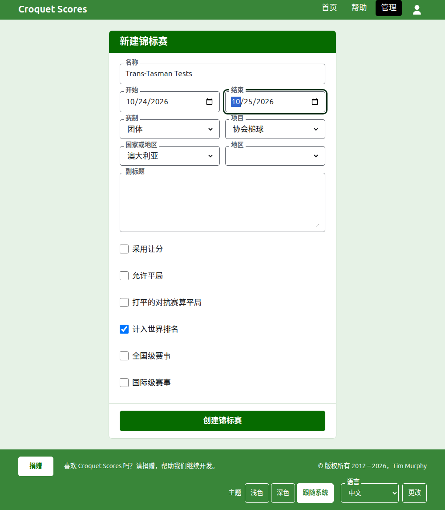
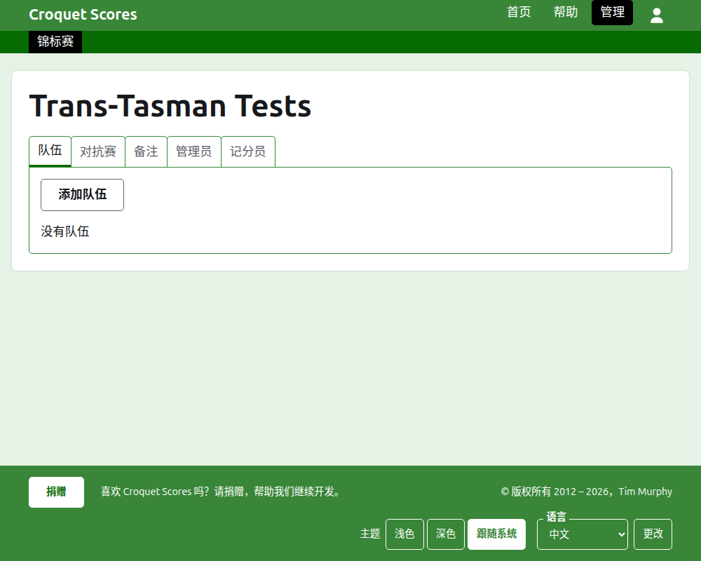

# 创建赛事

在管理后台的赛事列表上方按**新建赛事**。它放在列表上方而不是下方，这样很长的列表也不会把它推出手机屏幕之外。

表单询问赛事开始时所需的一切。这里最要紧的是**赛制**，正是它使一个赛事成为团体赛事。

## 表单询问什么

**名称。**读者用来找到赛事的东西，比如“Trans-Tasman Tests”。长度在 3 到 254 个字符之间。全部小写或全部大写的名称会被拒绝，因为它在显示的每个页面上都会看起来像一个错误。两个赛事可以同名，因为同一个赛事每年都会举办。

**开始**和**结束。**赛事进行的日期。每场对抗赛都在这段日期之内进行，所以要把它们设得覆盖整个赛事。赛事不能在开始之前结束，也不能在明年年底之后开始或结束。赛事属于它开始的那一年，这也是它地址中的年份。

**赛制。**选择团体赛制之一：

- **团体赛**是任何队伍间赛事的通用赛制。
- **爱尔兰杯**、**州际盾杯**和**高尔夫槌球世界团体锦标赛**是特定的赛事，各自作为一种单独的赛制保存，以便按该赛事的运作方式来运作。

标准赛制是唯一不属于团体的赛制，不是您在这里想要的。Gateball Scores 不提供赛制，因为那里的每个赛事都是门球的标准赛事；团体赛事在 Croquet Scores 上创建。

**运动。**网站提供的运动，按它的顺序：协会槌球、高尔夫槌球、美式六门槌球和 回弹槌球。

**国家**和**地区。**赛事的举办地。只有当您选择的国家划分为地区时才会询问地区，比如澳大利亚的各州，即使这时也可以不选。

**副标题。**任何您想让读者知道、却没有专属字段的内容：在哪里停车、几点吃午饭、找谁联系。它显示在每个公开页面上赛事名称的下方。它以 Markdown 书写，所以在一个词两边加上星号可以把它变成粗体，每行开头加一个短横线可以做成列表。最多 2000 个字符，可以留空。

它的各场对抗赛怎样进行和计算，是否使用差点、是否允许平局，以及是否计入世界排名，由每场对抗赛在添加时自己说明。

**国家级赛事**和**国际级赛事。**赛事可以是其中之一，或者两者都不是，但绝不能两者都是：勾选一个会取消另一个的勾选。

## 创建它

按**创建赛事**。您会被带到赛事在管理后台中的页面，停在它的“队伍”标签页上，而您是它的第一位管理者。它列在管理后台中它开始的那一年下。

赛事的公开地址由它的年份、运动和名称组成，如 `/2026/ac/trans-tasman-tests`。之后更正名称时它保留这个地址，这样已经发出去的链接仍然能找到它；只有当它开始的年份或运动改变时它才会移动。

## 如果有内容被拒绝

被拒绝的内容会在相关字段下方说明，而您输入的内容仍然保留。在每个字段都被接受之前，不会保存任何东西。最常被拒绝的是全部小写的名称、早于开始日期的结束日期，以及没有选择国家。

下一页：[队伍](teams.md)。
