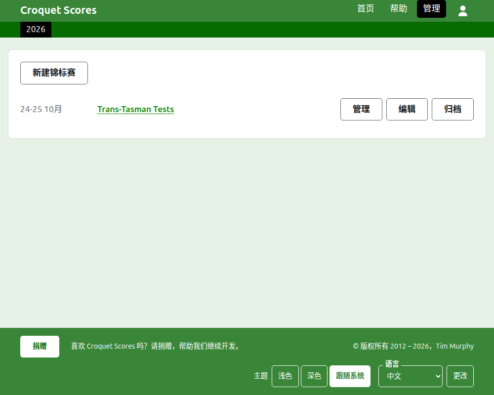
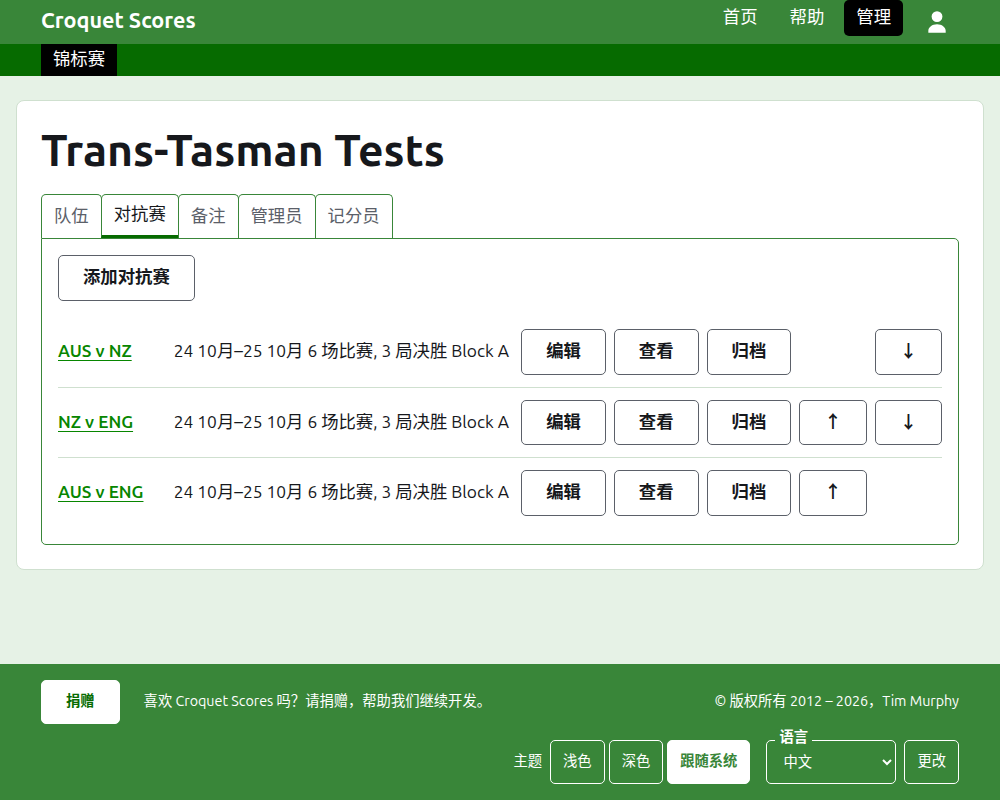

# 运作团体赛事

团体赛事是队伍之间相遇、而不是逐个录入选手的赛事：两国之间的系列对抗赛、州际盾杯、高尔夫槌球世界团体锦标赛。先设置好它的队伍及其选手，再添加队伍之间的对抗赛，每场对抗赛的各局随着比赛的进行逐一发布。这份指南带领管理者从登录开始，直到赛事的成绩向公众开放。

它自成一体。其中没有任何内容依赖于标准赛事的指南，那份指南是另外写的。

## 开始之前

您需要一个账户。点击[这里](/account/register)注册账户。

管理者所做的一切都在网站的管理后台中进行。选手和观众关注赛事的公开页面，取自管理后台所保存的内容，所以不需要另行发布：录入一个成绩，它立刻就出现在公开页面上。

## 用词

**队伍**是一方，比如 Australia，有名称、简称（如“AUS”）和旗帜。队伍有自己的**选手**，他们为这支队伍效力，不为别的队伍效力。**对抗赛**是两支队伍之间的较量，以它们的简称来称呼，如“AUS v ENG”，由双方各出一位选手的若干场**比赛**组成，每场比赛按若干**局**来决胜负。对抗赛可以放入**分组**，如“Block A”，用于多支队伍互相比赛的情况。

## 各页的顺序

1. [创建赛事](creating-a-tournament.md)：它的名称、日期、运动、赛制，以及举办地点。
2. [队伍](teams.md)：添加队伍，连同它们的简称和旗帜。
3. [队伍的选手](team-players.md)：在每支队伍自己的页面上录入它的选手。
4. [对抗赛](tests.md)：添加队伍之间的对抗赛、它们的日期、每场有多少场比赛，以及它们的分组。
5. [成绩](scores.md)：录入对抗赛的各局，更正它们，以及把误录的搁置一旁。
6. [通知](notes.md)：在赛事进行期间告诉选手他们需要知道的事。
7. [管理者和记分员](managers-and-scorers.md)：分担赛事的运作，以及让某人只能录入成绩而不能更改其他任何东西。
8. [排名](rankings.md)：发送给世界排名的文件，以及留给您填写的部分。
9. [更改、归档和恢复赛事](changing-and-archiving.md)：更正赛事的详情，以及把赛事搁置一旁。
10. [公众看到什么](what-the-public-sees.md)：您的选手关注的页面，以及您录入的内容如何在那里显示。

## 管理后台的布局

管理后台的首页列出您参与的赛事，一次显示一年。

按赛事的名称或**管理**，打开它的页面。所有要运作的东西都在它名称下方的六个标签页里：**队伍**、**对抗赛**、**通知**、**管理者**、**记分员**和**排名**。页面打开时停在“队伍”上，因为队伍是最先设置的东西。

页眉下方的深绿色条用于在页面之间移动。在赛事的页面和对抗赛的页面上，它以**赛事**通向赛事本身，并以名称通向每场对抗赛。在队伍的页面上，它改为通向赛事和以简称通向每支队伍，因为管理者在一支队伍的页面上时正在逐队录入选手。您所在的页面以黑色标出。

## 处处适用的规则

**除通知以外，没有任何东西会被直接删除。**队伍、选手、对抗赛、成绩和赛事本身都是归档而不是删除：搁置一旁，加上删除线，列在一个单独的标题下，并带有**恢复**以把它们找回来。归档、恢复以及上移下移从不要求您确认，因为每一个都可以通过反向操作撤销。无法撤销的事，比如删除通知或移除管理者，会先询问。

**覆在页面上的对话框在您按下它的按钮之前不会保存任何东西。**取消，或 Escape 键，会关闭它并让一切保持原样。添加东西的对话框，比如“添加队伍”和“添加成绩”，在每添加一项之后仍保持打开，这样可以一项接一项地录入整份名单。

**被拒绝的内容会在相关字段旁边说明。**被拒绝的内容不会保存，而您输入的内容仍然保留，这样可以直接改正而不必重新输入。

**管理后台可以在手机上使用。**每个按钮都足够大，可以用拇指按下，并且没有任何东西比屏幕更宽。

下一页：[创建赛事](creating-a-tournament.md)。
