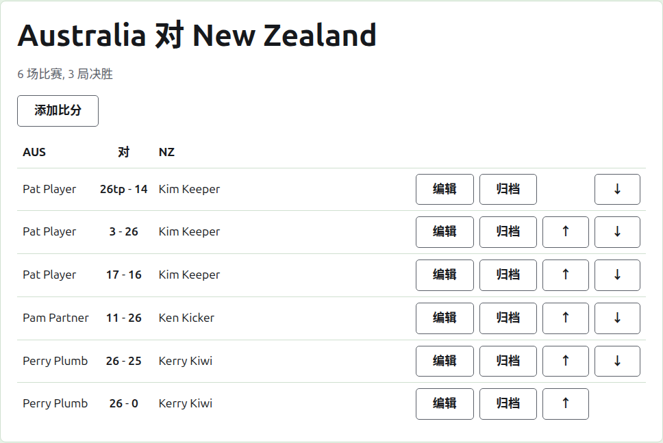
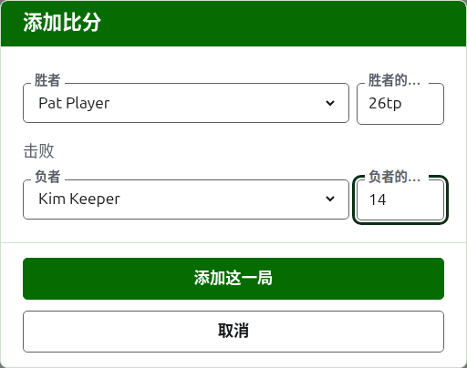

# 比分

对抗赛的页面从“对抗赛”标签页上它的名称打开，或者从深绿色条打开。页面以两支队伍的全名为标题，如“Australia v New Zealand”，下方是它预计有多少场比赛以及每场是几局决胜。它的比分就是页面，没有标签页。管理员和记分员看到同一个页面，因为记分员可以对比分做管理员能做的一切。

## 比分如何排列

比分按队伍而不是按谁赢了来排列，表格的表头是第一队的简称、“v”和第二队的简称。每个比分是一行：第一队的选手，然后是两个得分，第一队的在前，如“26tp - 14”，然后是第二队的选手，无论他们中谁赢了。已归档的比分以同样的方式排列在下方。

## 录入比分

按列表上方的**添加比分**。对话框读起来就像口头报结果：胜者及其得分，然后是“击败”，然后是负者及其得分。

胜者从两支队伍正在使用的选手中选择，列在各队名称之下，第一队的选手在前，每队的选手按队伍的顺序排列。一开始谁都没有被选中。选定胜者之后，负者只从另一支队伍提供，因为同一队两位选手之间的一局不是队伍之间的一局。已归档的选手不会被提供。

比分按记分员记下的样子输入：它的分数，以及后面跟着的任何内容，后者会按输入的样子保存并显示，如“26tp”表示 26 个球门加一个三重剥夺。数字是比分开头的那些数位；不以数位开头的比分会被拒绝。

得分相等而获胜的一局，比如因时间到而中止、以其他方式决出胜负的，通过胜者得分后面的标记说明谁赢了：“6w”击败“6”。标记是“w”、“won”和“winner”。胜者的得分必须高于负者，或者带有标记，除非锦标赛允许平局，这时得分相等且没有标记的比分作为平局保存。

按**添加这一局**。这一局被添加，对话框说明是哪一局，各字段清空以便录入下一局，因为比分是在一个时段结束时从记分板上成批读下来的。全部录入之后按**取消**。

## 比赛

两位相遇的选手打一场对抗赛规定局数决胜的比赛。他们之间的各局就是那场比赛的局，而两位选手的比赛已经决出胜负之后再录入他们之间的一局会被拒绝：其中一位赢的局数已经超过另一位还可能赢的局数，或者它的每一局都已经打完。

当两位选手有了一局正在使用的局，比赛就算开始。对抗赛开始的比赛不会多于它预计的场数：一旦开始了那么多场，两位尚未相遇的选手之间的一局就会被拒绝，而已开始的比赛的另一局会被接受。当对抗赛要有更多比赛时，在“对抗赛”标签页上更改它的预计场数。

## 更正比分

**编辑**在该比分上打开同一个对话框，标题为“编辑比分”，选手已选中，比分按输入时的样子显示。它的选手和得分都可以更改，选择方式与添加时相同。按**保存**保存更正并关闭对话框。更正保持结果不变：赢了的一局仍然是赢，平局仍然是平局。结果错了的一局应归档后重新录入。

## 给比分排序

比分按录入的顺序进来，所以每个正在使用的比分都提供**上移**和**下移**，把它和相邻的比分互换位置，这样列表可以排成各局进行的顺序。

## 归档比分

**归档**把比分搁置一旁，使它不计入任何东西。它列在**已归档的比分**下，加上删除线，只提供**恢复**。两者都不会先询问，因为每一个都可以撤销另一个。对抗赛中的每个比分都可以归档，因为对抗赛没有相互依赖的轮次。

选手此后被归档的比分，在选手恢复之前不能恢复，页面会说明这一点。

下一页：[备注](notes.md)。
