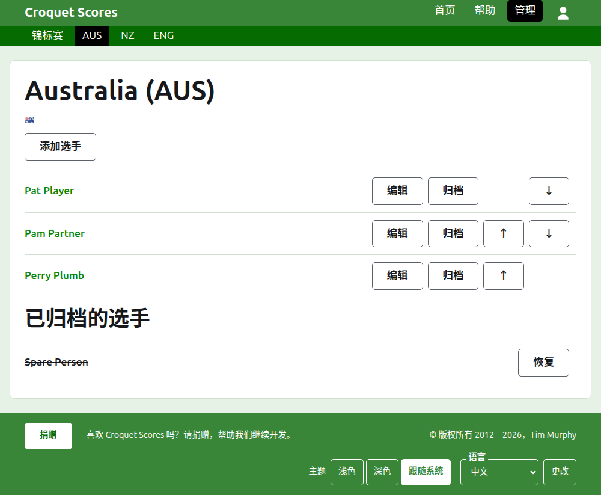
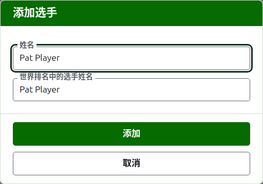

# 队伍的选手

队伍的页面从“队伍”标签页上它的名称或其**查看**打开。页面以队伍的名称为标题，简称在括号里，连同它的旗帜，这样走错队伍的管理员立刻就能看出来。它只有一样东西要显示，就是队伍的选手，所以列表就是页面。

队伍页面上的深绿色条通向锦标赛，并以简称通向正在使用的每支队伍，这样可以逐队录入选手，而不必回到“队伍”标签页。

队伍中的选手只属于那支队伍，代表那支队伍，举队伍的旗帜而不是自己的旗帜。同一个人为两支队伍效力，或者参加两个锦标赛，在每一处都是一位单独的选手。

## 添加选手

按列表上方的**添加选手**。一个对话框覆在页面上打开。

**姓名**是必填的，长度在 3 到 254 个字符之间。同一支队伍中的两位选手不能同名，无论大小写如何；另一支队伍中的选手可以同名。

**世界排名中的选手姓名**是世界排名所知的该选手的姓名。只在协会槌球或高尔夫槌球的锦标赛中询问，这是两个有世界排名的项目。在你添加选手时，它会跟随你输入的姓名，而一旦你在其中输入，它就不再跟随。留空时，保存为选手的姓名。当你输入时，会提供世界排名所知的、姓名以此开头的选手，在世界排名姓名旁边，一个对勾表示排名知道这个姓名，一个问号表示不知道。这只是提示：排名不知道的姓名和知道的姓名一样会被保存。

选手绝不能叫“Bye”：第一个词是英文“bye”的姓名会被拒绝。

按**添加**。选手被添加，对话框说明了这一点，各字段清空以便录入下一位，光标回到姓名处。用这种方式添加完整支队伍，然后按**取消**关闭对话框。

## 更正选手

按选手的姓名或其**编辑**，在该选手上打开同一个对话框，标题为“编辑选手”。按**保存**保存更改。姓名被更正的选手保留原有的世界排名姓名。

## 顺序

选手按队伍的顺序列出，这也是录入对抗赛比分时提供他们的顺序。**上移**和**下移**把选手在队伍内移动一位。

## 归档选手

**归档**把选手搁置一旁：误录的，或者不再在队中的。已归档的选手列在**已归档的选手**下，加上删除线，排在正在使用的选手之后，并且只提供**恢复**。归档从不先询问，因为队伍中的选手没有录入别的任何地方，恢复他们就能把一切放回原处。

在对抗赛中打过任何正在使用的局的选手不能归档，因为那样一来那些局就成了与一个已不存在的人打的，所以这样的选手没有“归档”。只有已归档的局的选手可以归档。

下一页：[对抗赛](tests.md)。
