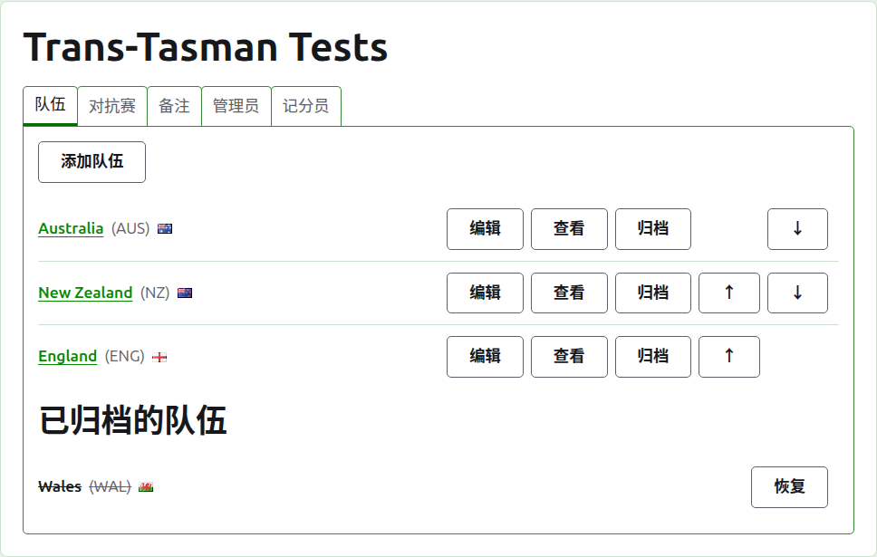
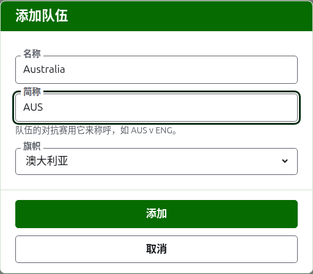
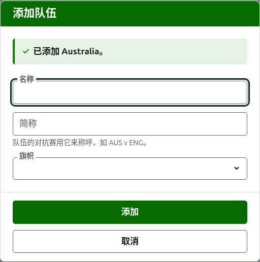
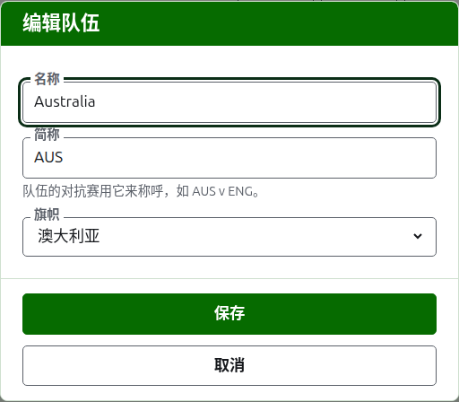

# 队伍

赛事页面的**队伍**标签页是添加、更正、排序和搁置队伍的地方。它是页面打开时所停的标签页，因为队伍是最先设置的东西。对抗赛在两支队伍之间进行，所以在添加任何对抗赛之前至少需要两支队伍。

## 添加队伍 {#adding-a-team}

按列表上方的**添加队伍**。一个对话框覆在页面上打开。

**名称**是必填的：队伍的全名，如“Australia”，它是队伍页面和公开页面各表格的标题。同一个赛事中的两支队伍不能同名。

**简称**也是必填的：队伍的对抗赛以它来称呼，如“AUS v ENG”，深绿色条也以它称呼队伍。最多 10 个字符，并且不能比名称长，因为比它所缩写的名称还长的简称，是两者输入时填反了。两支队伍的简称也不能相同。

**旗帜**显示在队伍名称出现的每个地方的旁边。可以保留为无，比如俱乐部或地区的队伍。

按**添加**。队伍被添加，对话框说明了这一点，各字段清空以便录入下一支。用这种方式添加完整份名单，然后按**取消**关闭对话框。取消不会保存任何尚未添加的内容。

## 更正队伍 {#correcting-a-team}

按队伍的**编辑**，在该队伍上打开同一个对话框，标题为“编辑队伍”。改正错误之处并按**保存**。简称改变的队伍处处都以新简称称呼，所以它的对抗赛也随之改名。

## 顺序

队伍按赛事的顺序列出，这也是添加对抗赛时提供它们的顺序、深绿色条排列它们的顺序，以及公开“选手”页面列出它们的顺序。每行末尾的箭头**上移**和**下移**，把队伍移动一位。

## 前往队伍

队伍的名称或**查看**打开队伍自己的页面，选手在那里录入。见[队伍的选手](team-players.md)。

## 归档队伍

**归档**把队伍搁置一旁。它的选手随它一起保留，并在它恢复时回来，所以归档不会先询问。已归档的队伍列在**已归档的队伍**下，加上删除线，只提供**恢复**，它的页面关闭，直到它被恢复。

参加正在使用的对抗赛的队伍不能归档，因为那样一来那场对抗赛就成了与一支已不存在的队伍打的，所以这样的队伍没有“归档”。只有已归档的对抗赛的队伍可以归档。

下一页：[队伍的选手](team-players.md)。
