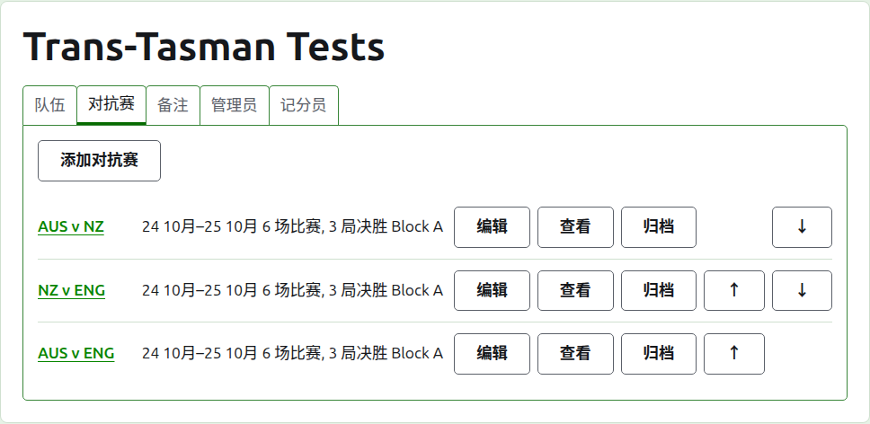
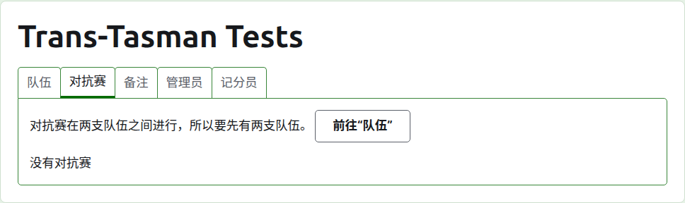
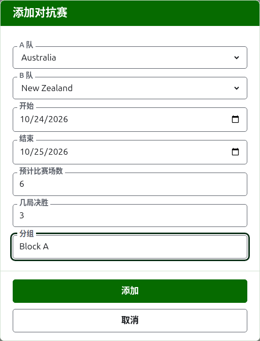
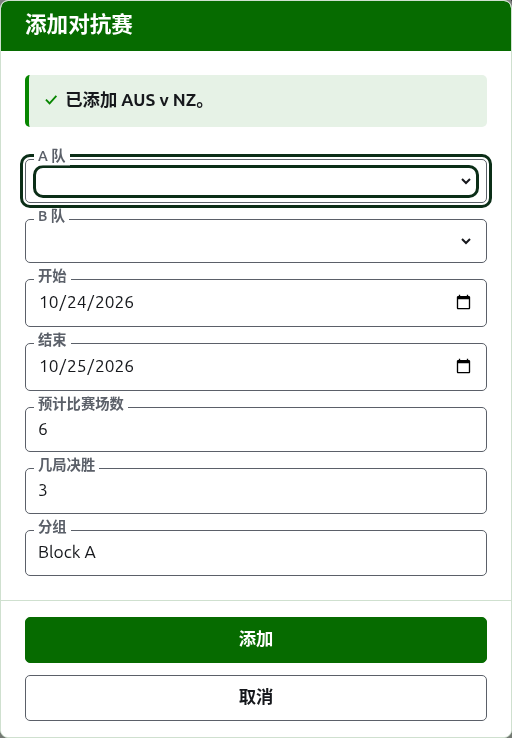
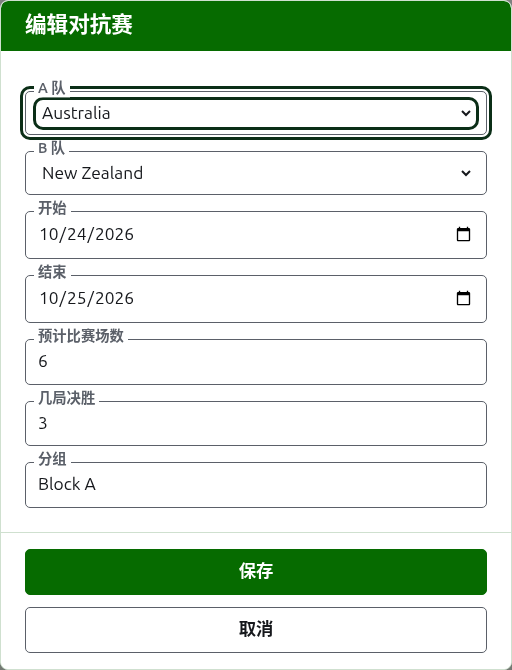

# 对抗赛

赛事页面的**对抗赛**标签页是添加、更改、排序和搁置队伍之间对抗赛的地方。对抗赛是赛事的项目之一：两支队伍之间的较量，以它们的简称来称呼，如“AUS v NZ”，以双方各出一位选手的若干场比赛进行。每场对抗赛都有自己的页面，成绩在那里填写。

每场对抗赛说明它的名称、进行的日期、预计有多少场比赛以及每场是几局制，如“6 场比赛，3 局决胜”，还有它所在的分组（如果有）。

## 先要有两支队伍

对抗赛在两支正在使用的队伍之间进行，所以当赛事的队伍不到两支时，标签页会在“添加对抗赛”本来的位置说明这一点，并引向“队伍”标签页。

## 添加对抗赛

按列表上方的**添加对抗赛**。一个对话框覆在页面上打开，按口头说一场对抗赛的顺序排列。

**A 队**和**B 队**各从赛事中正在使用的队伍里按名称、按赛事的顺序选择。一开始两者都没有被选中，这样绝不会在您没有选择的队伍之间添加对抗赛。B 队提供除被选为 A 队之外的每支队伍，因为一支队伍不会和自己打对抗赛。A 队是第一队：它的选手在对抗赛页面和公开页面上位于左侧。对抗赛没有自己的名称可输入；它以两支队伍的简称来称呼。

**开始**和**结束**是对抗赛进行的日期，一开始是赛事的第一天。对抗赛在它的赛事之内进行，所以赛事开始之前或结束之后的日期会被拒绝。

**预计场次**是对抗赛要有多少场比赛，由赛事在开始之前定下，这样读它成绩的人能看出进行到了哪里。它是从 1 起的整数。它也是一个上限：一旦开始的比赛数达到对抗赛预计的场数，会开始另一场比赛的一局就被拒绝，而已经开始的比赛可以打完。要有更多比赛的对抗赛就更改它的预计场数。

**几局制**是每场比赛是几局制。它可以是偶数，因为一场比赛可以打平。

**使用差点**、**允许平局**和**计入世界排名**的询问方式与任何项目相同。最后一项只在可以计入时才询问：协会槌球或高尔夫槌球中既不使用差点也不允许平局的对抗赛。它一开始是勾选的。

**分组**是对抗赛所在的分组，用于赛事分组进行的情况，如“Block A”。它是可选的：留空时，对抗赛不属于任何分组。同一分组的对抗赛在公开网站上有自己的页面，显示该分组各队伍的排名。 **爱尔兰杯** 和 **州际盾杯** 没有分组，所以这两种赛制的对话框不会询问分组。

按**添加**。对抗赛被添加，对话框以名称说明是哪一场，队伍清空以便录入下一场，日期、预计场次、几局制和分组保持不变：对抗赛是一轮一轮添加的，在同一天相遇的队伍之间，所以这一轮的下一场对抗赛只需要选它的两支队伍。全部录入之后按**取消**。

## 更改对抗赛

**编辑**在该对抗赛上打开同一个对话框，标题为“编辑对抗赛”，以对抗赛现有的内容开始。按**保存**保存更改。

有正在使用的局的对抗赛保留它的队伍：对话框显示它们，但不能更改。其余的可以更改，但不能超出已经打过的范围：少于已开始比赛数的预计场次会被拒绝，少于任何两位选手已打过的最多局数的几局制也会被拒绝。

## 顺序

对抗赛按赛事的顺序列出，这也是它们在公开页面和深绿色条上出现的顺序。**上移**和**下移**把对抗赛移动一位。

## 前往对抗赛

对抗赛的名称或**查看**打开它的页面，成绩在那里填写。深绿色条也通向那里，从赛事的页面或任何其他对抗赛的页面都可以。

## 归档对抗赛

**归档**把对抗赛搁置一旁，并由**恢复**撤销，所以两者都不会先询问。已归档的对抗赛列在**已归档的对抗赛**下，加上删除线，只提供“恢复”，并且不在公开页面上。

有正在使用的局的对抗赛已经进行过，在它的局归档之前不能归档。局全部已归档的对抗赛可以归档，因为已归档的局不计入任何东西。队伍此后被归档的对抗赛，在队伍恢复之前不能恢复，标签页会说明这一点。

下一页：[成绩](scores.md)。
