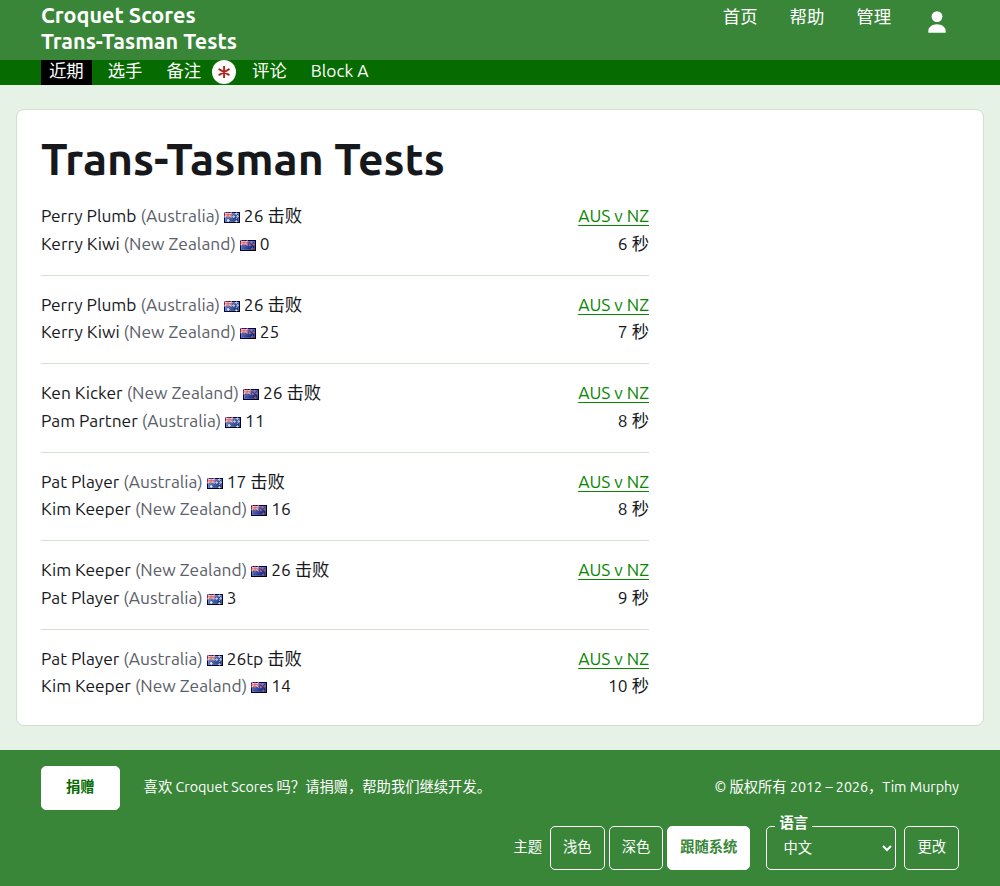
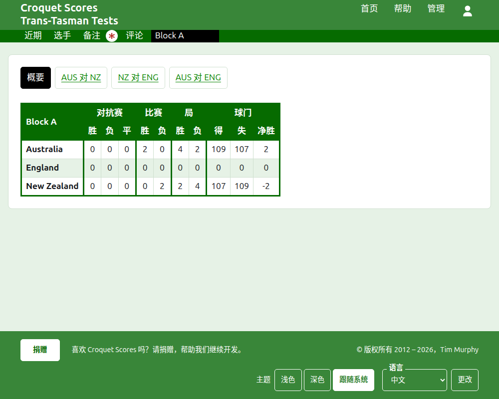
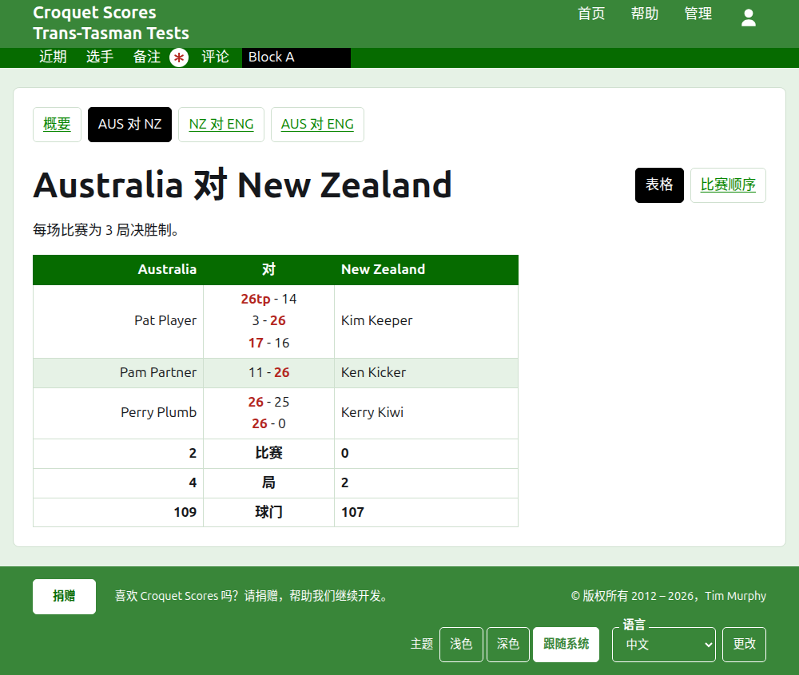
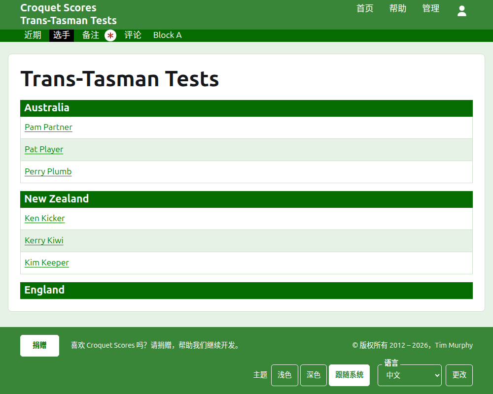

# 公众看到什么

没有什么需要发布：公开页面取自管理后台所保存的内容，所以录入的比分立刻就出现在上面。它们不需要账户，也不需要脚本，并且是为手机排版的。

## 锦标赛的页面

锦标赛的页面位于它的年份、项目和名称之下，如 `/2026/ac/trans-tasman-tests`。它以锦标赛的名称为标题，副标题在下方。它列出正在使用的每一局，最近添加的在先，这样再次回来的读者能看到此后发生了什么。每一局说明胜者、他们的队伍和得分，然后是负者及其得分，连同进行该局的对抗赛以及它是多久以前添加的。

深绿色条提供锦标赛的各个栏目：**近期**，也就是本页，**概要**、**选手**、**备注**和**评论**，然后是各场对抗赛。对抗赛以两支队伍的简称表示，中间是“对”，如“AUS 对 NZ”。同一分组的对抗赛不逐场提供：分组是一个栏目，以分组的名称命名，立于它第一场对抗赛本来的位置。当有读者尚未阅读的备注时，“备注”以红色星号标出。

## 概要

对抗赛都不在任何分组中的锦标赛有一个**概要**：一张包含每支队伍的表格，按名次排列，带有它赢、输和打平的对抗赛数、它赢和输的局数，以及它的得球门、失球门和净胜球门。当任何对抗赛的比赛是多局决胜时，赢和输的比赛数排在对抗赛数之后。概要是读者查看每支队伍整体表现的地方。

有对抗赛在分组中的锦标赛没有概要。取而代之，每个分组的页面显示该分组各队伍的排名，因为把从未交手的各分组队伍放在一张表里排名不出任何东西。

## 分组

分组的页面显示该分组各队伍的排名，只计算该分组的对抗赛，用的是概要所用的表格。表格上方单独一行提供**概要**，也就是本页，以及该分组的每场对抗赛，通向对抗赛的页面。

## 对抗赛

对抗赛的页面以两支队伍的全名为标题，如“Australia 对 New Zealand”，并说明每场比赛是几局决胜。它的表格以两支队伍为表头，第一队在左侧。打过的每场比赛是一行，按开始的顺序排列，第一队的选手在左，第二队的选手在右，比赛的各局在两者之间，每一局先是第一方的得分再是第二方的，胜者的得分标出。各场比赛的下方是每支队伍的局数和球门数，当每场比赛是多局决胜时，还有它赢得的比赛数，各在自己一侧。

对抗赛有两种显示方式，在它名称所在的那一行提供：**表格**，也就是这张表，以及**比赛顺序**，它列出对抗赛的每一局，最早的在先。分组中的对抗赛在它标题上方的一行提供该分组的概要和各场对抗赛，当前这场被标出。

## 选手

“选手”页面逐队列出选手：每支队伍在以它名称为标题的部分下，按锦标赛中队伍的顺序排列，它的选手按字母顺序列在下方。

## 备注

“备注”页面列出锦标赛的备注，最近写的在先，每条通向它自己的页面，并说明它是多久以前写的。读者尚未阅读的备注以红色星号标出，直到他们打开它。

## 会移动的地址

锦标赛在名称被更正时保留它的地址。当它因为年份或项目改变而移动时，旧地址会引向新地址，这样以前保存的链接仍然有效。已归档锦标赛的页面找不到，直到它被恢复。
