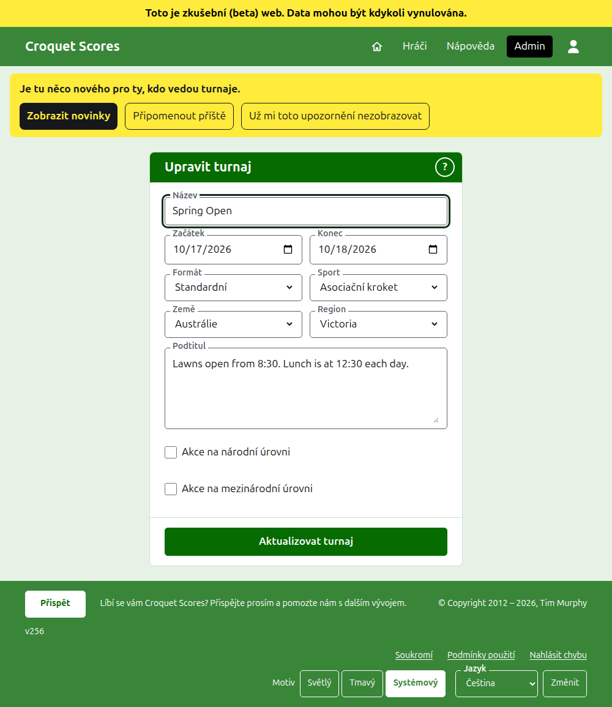
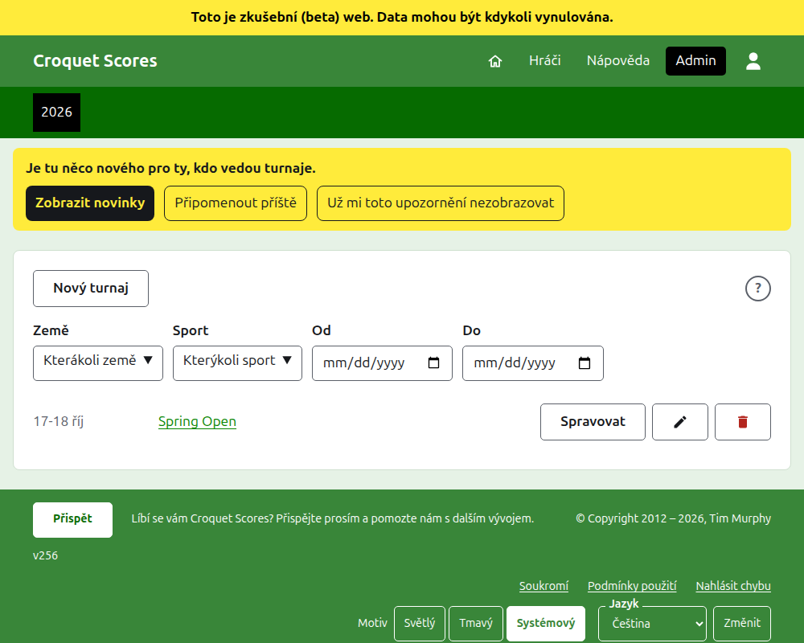
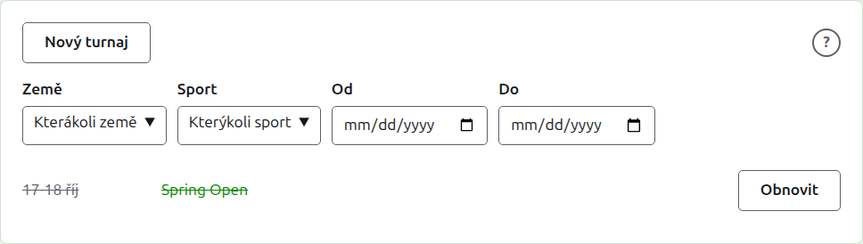

# Změna, archivace a obnovení turnaje

## Změna údajů turnaje

V seznamu turnajů v adminu stiskněte u turnaje **Upravit**. Formulář je ten, který ho vytvořil, vyplněný tak, jak turnaj je. Změňte, co je špatně, a stiskněte **Aktualizovat turnaj**.

Jakmile turnaj obsahuje jakéhokoli hráče nebo soutěž, včetně archivovaných, jeho formát nelze změnit na formát hraný týmy, který má místo nich týmy a testy.

Turnaj si ponechává svou adresu, když se jeho název opraví, aby ho odkaz, který už někdo poslal, stále našel. Přesune se, jen když se změní rok, ve kterém začíná, nebo jeho sport, a pak jeho stará adresa vede na novou. Uložení vás zavede na turnaj, kdekoli se nyní nachází.

Turnaj může změnit jen organizátor. Zapisovateli nebo komukoli jinému se to řekne místo zobrazení formuláře.

## Seznam turnajů

Admin vypisuje vždy jeden rok, počínaje letošním, nejnovější turnaj první. Roky, ve kterých máte turnaj, jsou karty v tmavě zelené liště, nejnovější první; je-li jich víc, než se vejde na telefon, nejstarší jsou v rozbalovacím seznamu na konci řady. Rok je v adrese, takže na rok lze odkazovat.

Nad seznamem **Země**, **Region**, **Sport**, **Od** a **Do** seznam zužují, jakmile se zvolí, bez tlačítka ke stisknutí. Nabízejí se jen volby, které by něco vypsaly, a region se nabízí, jakmile je zvolena země. **Od** a **Do** jsou dny: seznam jsou turnaje, které začínají od jednoho do druhého, včetně obou, a aby se seznam zúžil podle dnů, musí být zvoleny oba. Co je zvoleno, je v adrese, takže na zúžený seznam lze odkazovat; zvolením jiného roku se vymaže. Rok s více než sto turnaji se vypisuje po sto na stranu, s **Předchozí** a **Další** pod seznamem. Národní nebo mezinárodní turnaj je tučně po celé délce svého řádku.

## Archivace turnaje

**Archivovat** u turnaje v seznamu ho odloží stranou. Je stále vypsán, přeškrtnutý a za používanými turnaji, ale nabízí jen **Obnovit**: jeho stránka v adminu a jeho veřejné stránky jsou uzavřeny, dokud se neobnoví. Archivace se nejprve neptá, protože ji obnovení vrací.

Další: [Co vidí veřejnost](what-the-public-sees.md).
