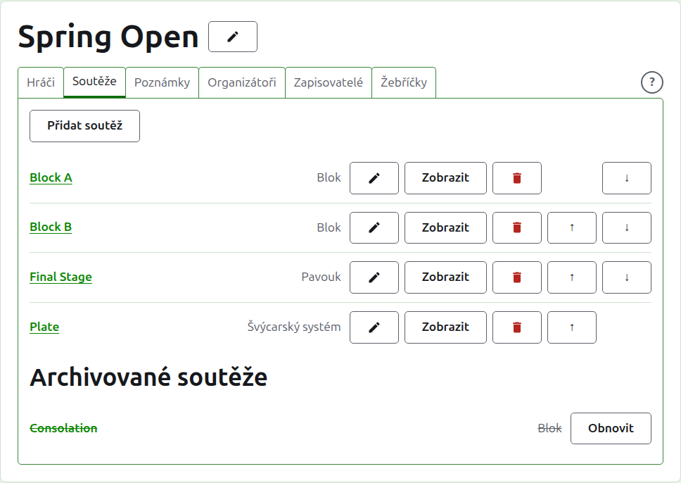
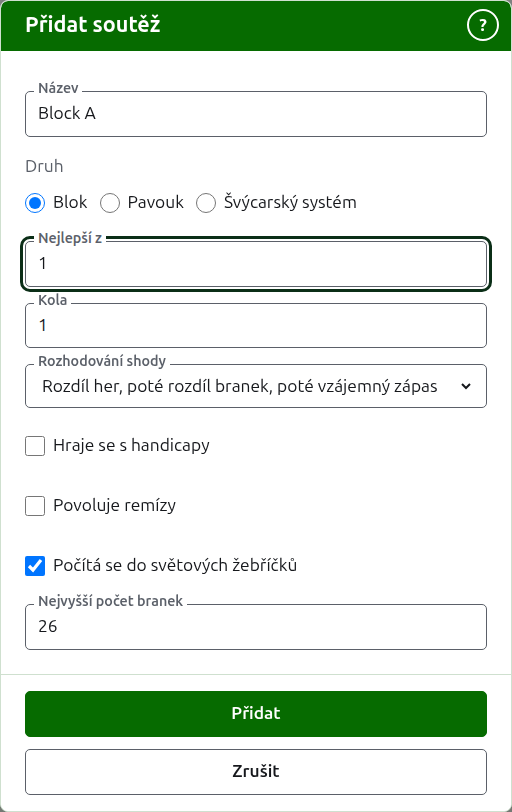
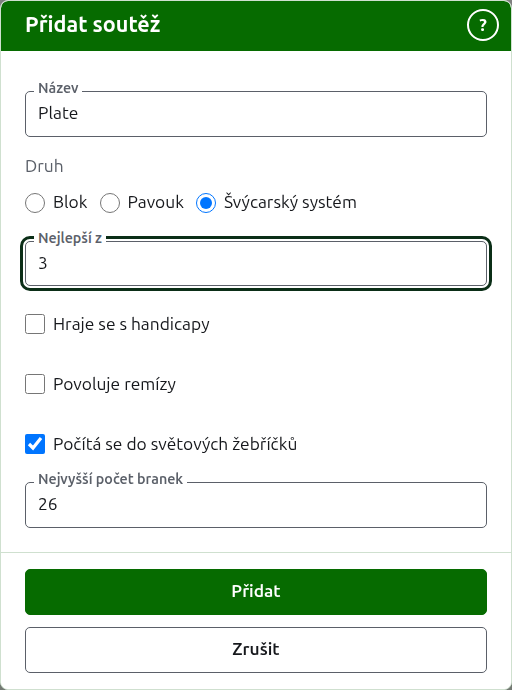
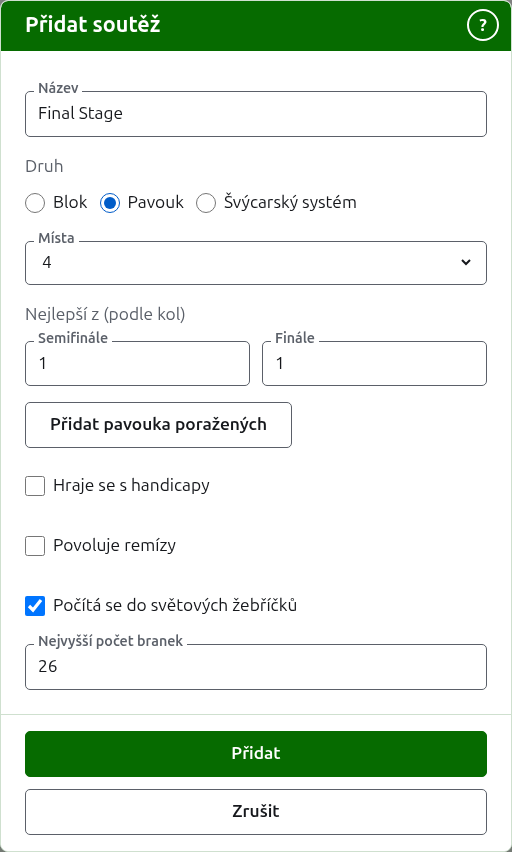

# Soutěže

Karta **Soutěže** na stránce turnaje je místo, kde se soutěže přidávají, řadí a odkládají. Soutěž je blok, pavouk nebo švýcarský systém. Každá má vlastní stránku, kde se zadávají její hráči a zapisuje její skóre.

## Přidání soutěže {#adding-a-competition}

Stiskněte **Přidat soutěž** nad seznamem. Nad stránkou se otevře dialog, který se ptá na název soutěže, její druh a tvar, který její druh má.

**Název** je to, podle čeho hráči na stránce turnaje hledají své hry. Má 1 až 254 znaků a stačí i samotné písmeno, protože blok se často jmenuje jedním. Dvě soutěže v jednom turnaji nemohou mít stejný název.

**Druh** je blok, pavouk nebo švýcarský systém. Dialog začíná na bloku, kterým je většina soutěží.

### Blok

Blok se ptá, z kolika her se každý zápas hraje (**Nejlepší z**), v kolika **kolech** se hraje a čím se rozlišují jeho hráči se stejným počtem vyhraných zápasů (**Rozhodování shody**).

**Nejlepší z** začíná na 1. Nejlepší ze 3 vyhraje ten, kdo vyhraje dvě hry. Může to být sudé číslo, protože v bloku se hráč řadí podle her, které vyhraje, a zápas o dvou hrách rozdělených jedna ku jedné je výsledek jako každý jiný.

**Kola** je, kolikrát se každá dvojice hráčů v bloku potká, s jedním zápasem v každém kole. Začíná na 1 a 1 je téměř vždy to, co blok chce: každý hráč hraje s každým jiným jednou. Zvyšte to jen u bloku, ve kterém se potkávají znovu, jako při dvojitém každý s každým, kde 2 znamená, že každá dvojice odehraje dva zápasy.

**Rozhodování shody** je, jak se rozliší hráči, kteří vyhráli stejný podíl svých zápasů. Jsou tři způsoby a bloky jednoho turnaje mohou používat různé, protože pravidla se liší. **Rozdíl her, poté rozdíl branek, poté vzájemný zápas** je způsob, jakým se bloky řadily vždy, a je to, na čem nový blok začíná: hráči se stejným počtem vyhraných zápasů se rozliší podle rozdílu her, ti, kteří jsou stále shodní, podle rozdílu branek a ti, kteří jsou stále shodní, podle vzájemného zápasu mezi nimi. Kde je každý zápas jednou hrou, rozdíl her se vynechává. **Vzájemný zápas** hledí jen na zápasy, které shodní hráči odehráli mezi sebou. **Jiné** je pro pravidla, která web nezná, a nerozliší nikoho. Hráči, které nelze rozlišit, sdílejí místo, zobrazené jako =2, a stránka pod mřížkou říká, jak se shodní hráči rozlišují.

### Švýcarský systém

Švýcarský systém se ptá jen na to, z kolika her se každý zápas hraje (**Nejlepší z**), což začíná na 1, stejně jako u bloku. Nejlepší ze 3 vyhraje ten, kdo vyhraje dvě hry. Může to být sudé číslo, protože ve švýcarském systému se hráč řadí podle her, které vyhraje, a zápas o dvou hrách rozdělených jedna ku jedné je výsledek jako každý jiný.

### Pavouk

Pavouk se ptá, kolik **míst** má jeho los a z kolika her se hraje každé kolo. Místa se nabízejí jako 2, 4, 8, 16, 32, 64 a 128, protože žádné jiné číslo by se nedalo půlit kolo po kole až k finále, a dialog začíná na 8. Místa, která po zadání hráčů zbydou, se vyplní bye, které se přidávají tam, kde se zadávají hráči.

Los má tolik kol, kolik je třeba k půlení jeho míst na jedno, takže los o 8 místech má tři kola. Dialog se ptá, z kolika her se hraje každé, společně pod **Nejlepší z (podle kol)**, v pořadí, v jakém se hrají. Poslední tři se jmenují tak, jak se o kolech losu mluví, **Čtvrtfinále**, **Semifinále** a **Finále**, a všechna před nimi číslem, 1. kolo jako první. Zvolení více míst přidá kola na začátek losu a zvolení méně je ubere od začátku, takže to, co bylo napsáno pro finále, je stále finálové. Každé kolo je nejlepší z lichého počtu her, protože zápas v pavouku musí mít vítěze.

### Pavouk poražených {#losers-knockout}

Pavouk může poslat ty, kdo prohráli kolo, do vlastního pavouka, pavouka poražených. Pod **Nejlepší z (podle kol)** pavouka stiskněte **Přidat pavouka poražených**. Dialog se ptá na **Poražení z**, kolo, jehož poražení hrají dál, ze všech kol kromě finále, a na **Název pavouka poražených**. Stiskněte **Přidat**, čímž ho zařadíte do seznamu pod tlačítkem, kde ho **Odebrat** zase vyjme. Přidá se spolu s pavoukem, když se přidává ten, a pokud je odmítnut kterýkoli z nich, nepřidá se ani jeden.

Pavouk poražených má místo pro každý zápas daného kola a každé jeho kolo je nejlepší z 1, což lze změnit tlačítkem **Upravit**. Jeho hráči se zařazují, jak se zápasy daného kola rozhodují, v pořadí, v jakém byli nalosováni, takže jeho karta **Hráči** je jen ukazuje. Pokud se hra opraví nebo odloží, poražený se přesune nebo zase odebere, pokud nehrál dál.

Stránka pavouka má třetí kartu, **Poražení**, za kartami Hráči a Skóre, která uvádí pavouky, kteří přebírají jeho poražené, každého s odkazem na jeho stránku. **Přidat pavouka poražených** je i tam a ptá se na stejné dvě věci; tady se pavouk poražených přidá okamžitě. Kartu má jen pavouk a zapisovateli se nenabízí.

U pavouka, který už je přidán, **Upravit** ukazuje stejné tlačítko a pavouk poražených se přidá okamžitě, jako z karty Poražení. Pavouka, jehož poražené přebírá jiný používaný, nelze archivovat ani mu měnit místa: nejprve archivujte pavouka poražených.

### Jak se hraje a počítá

Každý druh se pod svým tvarem ptá na stejné čtyři věci.

**Hraje se s handicapy.** Zaškrtněte u soutěže hrané s handicapy.

**Povoluje remízy.** Zaškrtněte tam, kde hra může skončit tak, že nikdo z hráčů není vítěz. Většina soutěží to nepovoluje. Kde je zaškrtnuto, skóre zadané se stejnými body a bez značky se uloží jako remíza; kde ne, hra se stejnými body musí říct, kdo ji vyhrál, značkou za skóre vítěze, například „6w“. Zápas v pavouku má vždy vítěze, takže remizovaná hra žádný nerozhodne.

**Počítá se do světových žebříčků.** Zjišťuje se jen tam, kde se to dá započítat: soutěž v Asociačním kroketu nebo Golfovém kroketu, která se nehraje s handicapy a nepovoluje remízy. Na začátku je zaškrtnuto, takže u soutěže, která se počítat nemá, odškrtněte.

**Nejvyšší počet branek.** Nejvyšší počet branek, do kolika se hra v soutěži hraje, celé číslo alespoň 1. Začíná na obvyklém pro sport, 26, nebo 13 v Golfovém kroketu, takže změňte u soutěže hrané kratší, například blok her o 14 brankách. Vyprázdněte u soutěže, jejíž hry se nehrají do počtu branek. Soutěž hraná do jiného než obvyklého počtu to říká na své veřejné stránce, jako „Počet branek ve hře: 14“.

### Přidání několika najednou

Stiskněte **Přidat**. Soutěž je přidána, dialog to řekne a název se vyprázdní pro další, přičemž druh a jeho tvar zůstanou, jak byly: soutěže přidávané společně jsou většinou podobné, takže „Blok B“ po „Blok A“ je jen jeho název. Až jsou všechny zadány, stiskněte **Zrušit**, čímž dialog zavřete.

## Změna soutěže {#changing-a-competition}

**Upravit** otevře stejný dialog na soutěži, nazvaný Upravit soutěž, s jejím názvem, tvarem a tím, jak se hraje a počítá, tak jak jsou. Její druh se nezjišťuje, protože blok se změnou nestane pavoukem: soutěž špatného druhu se archivuje a přidá znovu. Stiskněte **Uložit**, čímž se změna uloží a dialog zavře.

Pavouk, který má hru, má v losu umístěné hráče a změna jeho míst by je přesunula, takže je odmítnuta, jakmile byla zadána hra. Nejlepší z jeho kol lze stále měnit.

## Pořadí

Soutěže jsou uvedeny v pořadí turnaje, což je pořadí, v jakém se objevují na veřejných stránkách a v tmavě zelené liště. **Nahoru** a **Dolů** posunou soutěž o jedno místo.

## Přechod do soutěže

Název soutěže nebo **Zobrazit** otevře její stránku, kde se zadávají její hráči a zapisuje její skóre. Tmavě zelená lišta pod záhlavím tam vede také, z kterékoli stránky turnaje.

## Archivace soutěže

**Archivovat** soutěž odloží, ať má hry, nebo ne; ty se uchovají s ní a vrátí se, když se obnoví. Archivovaná soutěž je uvedena pod **Archivované soutěže**, přeškrtnutá, nabízí jen **Obnovit** a není na veřejných stránkách. Archivace se neptá předem, protože obnovení ji vrátí.

Další: [Zařazování hráčů do soutěže](entering-players-in-a-competition.md).
