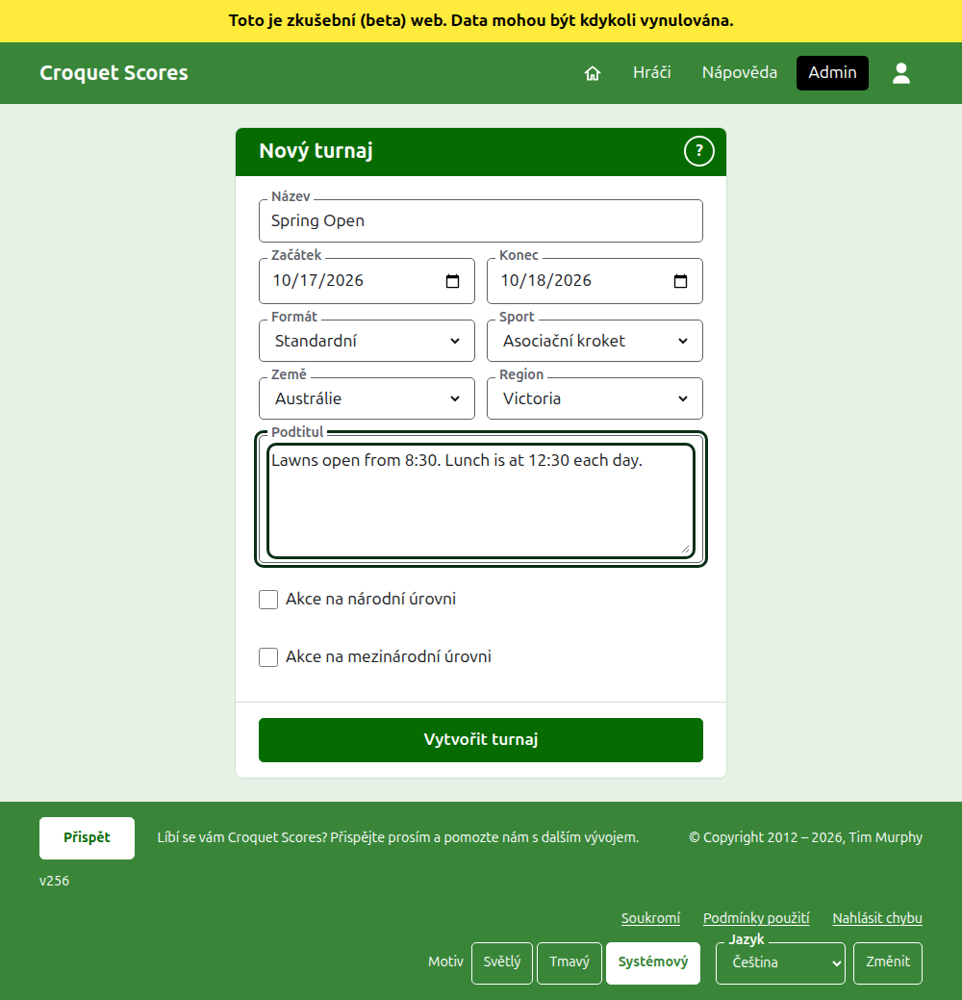

# Vytvoření turnaje

Stiskněte **Nový turnaj** nad seznamem turnajů v adminu. Je nad seznamem, a ne pod ním, aby ho dlouhý seznam nevytlačil z obrazovky telefonu.

Formulář se ptá na všechno, čím turnaj začíná. Turnaj obvyklého druhu je jen o název, dva dny a zemi daleko: všechno ostatní je rozhodnuto za vás a dá se změnit.

## Na co se formulář ptá

**Název.** Podle čeho čtenáři turnaj hledají, například „Spring Open“. Má mít 3 až 254 znaků. Název celý malými písmeny nebo celý velkými je odmítnut, protože by na každé stránce, kde se zobrazí, vypadal jako chyba. Dva turnaje mohou mít stejný název, protože stejný turnaj se hraje každý rok.

**Začátek** a **Konec.** Dny, kdy turnaj trvá. Turnaj nemůže skončit dříve, než začne, a nemůže začít ani skončit později než koncem příštího roku. Turnaj patří do roku, ve kterém začíná, což je také rok v jeho adrese, takže turnaj, který přesahuje přelom roku, je uveden v roce, ve kterém začíná.

**Formát.** Pro turnaj hraný mezi hráči zvolte **Standardní**. Ostatní formáty jsou pro turnaje hrané mezi týmy, které mají vlastní příručku.

**Sport.** Sporty, které web nabízí, v jeho pořadí: na Croquet Scores Asociační kroket, Golfový kroket, Americký kroket (6 branek) a Ricochet. **Sport**, **Země** a **Region** jsou rozbalovací seznamy: vyberte ze seznamu, nebo napište začátek názvu a přeskočíte na něj. Gateball Scores se neptá ani na sport, ani na formát, protože každý tamní turnaj je standardní turnaj gateballu.

**Země** a **Region.** Kde se turnaj hraje. Země, ve kterých se hraje většina turnajů, jsou uvedeny první. Region se zjišťuje jen tam, kde je zvolená země rozdělena na regiony, například australské státy; země, která je sama jedním regionem, se na žádný neptá. Region se nemusí vybrat ani tam, kde se nabízí.

**Podtitul.** Cokoli, co chcete, aby čtenáři věděli a co nemá vlastní pole: kde zaparkovat, kdy je oběd, komu zavolat. Zobrazuje se pod názvem turnaje na každé veřejné stránce. Píše se v Markdownu, takže slovo lze udělat tučným hvězdičkami kolem něj a seznam vytvořit pomlčkou na začátku každého řádku. Může mít až 2000 znaků a může zůstat prázdný.

Jak se jeho soutěže hrají a počítají, zda s handicapy, s remízami a do světových žebříčků, říká každá soutěž při svém přidání.

**Akce na národní úrovni** a **Akce na mezinárodní úrovni.** Turnaj může být jedno, druhé, nebo ani jedno, ale nikdy obojí: zaškrtnutím jednoho se druhé odškrtne. Turnaj zaškrtnutý jako kterýkoli z nich je v seznamech turnajů vysazen tučně po celé délce svého řádku.

## Vytvoření

Stiskněte **Vytvořit turnaj**. Budete přesměrováni na stránku turnaje v adminu, odkud se vede, a jste jeho prvním organizátorem. V adminu je uveden v roce, ve kterém začíná.

Veřejná adresa turnaje se skládá z jeho roku, sportu a názvu, jako `/2026/ac/spring-open`. Zachová si ji, i když se jeho název později opraví, aby ho odkaz, který už byl poslán, stále našel; změní se jen tehdy, když se změní rok jeho začátku nebo jeho sport.

## Když je něco odmítnuto

Co je odmítnuto, se říká pod polem, kterého se to týká, a co jste napsali, zůstává napsáno. Nic se neuloží, dokud není přijato každé pole. Nejčastěji se odmítá název napsaný celý malými písmeny, konec před začátkem a nezvolená země.

Další: [Hráči](players.md).
