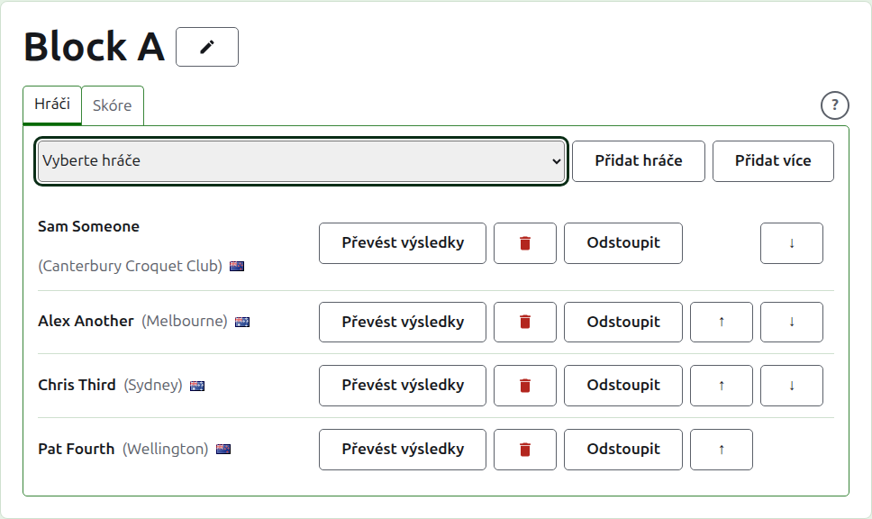
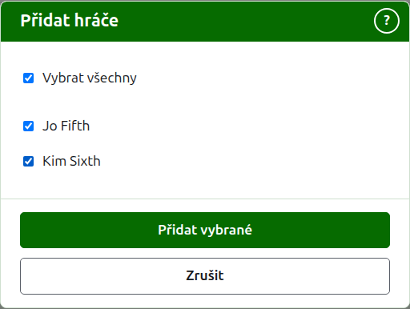
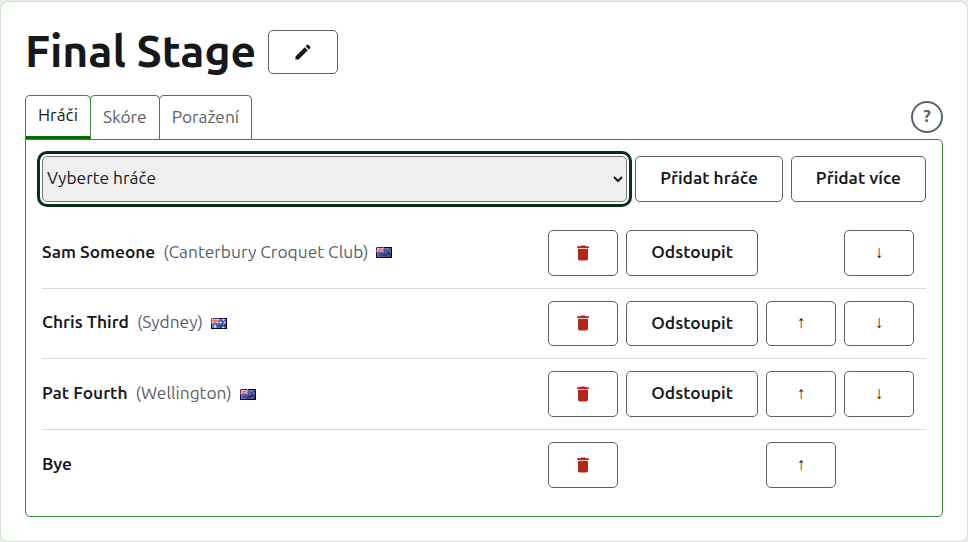
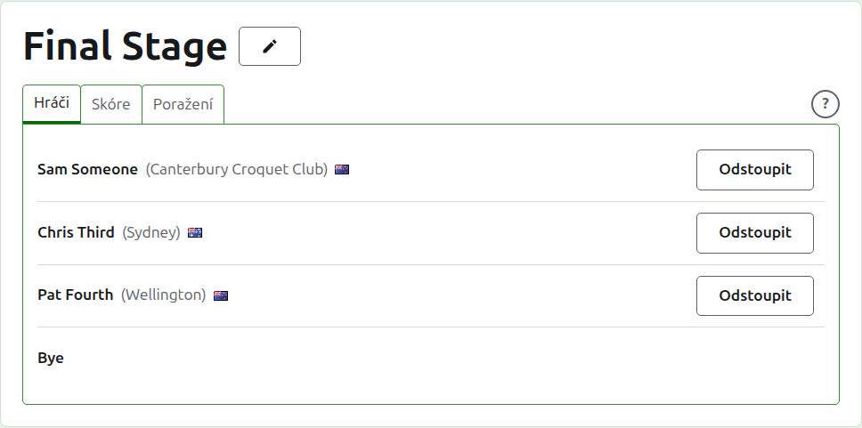
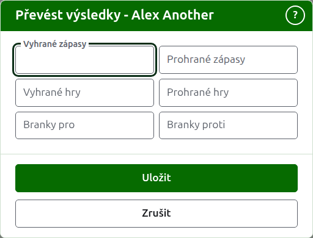
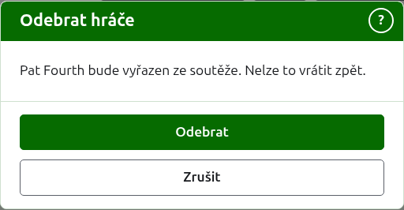
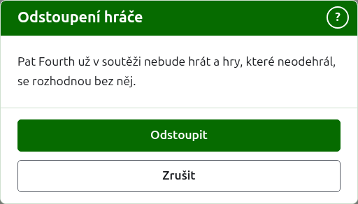
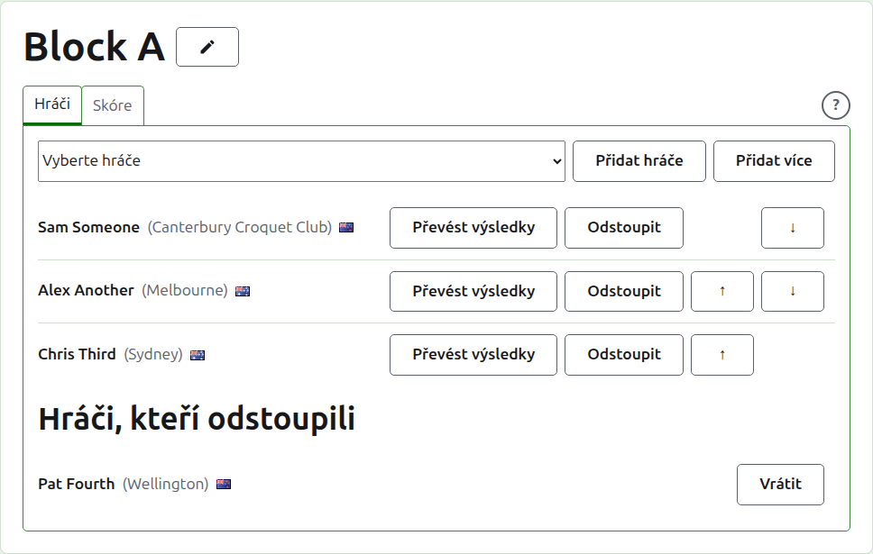

# Přidávání hráčů do soutěže

Stránka soutěže se otevře jejím názvem na kartě Soutěže nebo z tmavě zelené lišty. Nahoře je název soutěže a pod ním dvě karty: **Hráči** a **Skóre**. Pavouk má třetí, **Poražení**, která je popsána v části [Pavouk poražených](competitions.md#losers-knockout). Stránka se otevře na kartě Hráči, protože hráči se přidávají dřív, než se cokoli odehraje.

Hráč v soutěži je jedním z hráčů turnaje, a proto se přidává výběrem, ne psaním. Vše o něm kromě jeho místa v soutěži a toho, co do ní přenáší, se mění na kartě Hráči turnaje.

## Přidání hráče

Nad seznamem je rozbalovací seznam, který nabízí každého hráče turnaje, jenž ještě v soutěži není, v pořadí turnaje. Vyberte jednoho a stiskněte **Přidat hráče**. Hráč se zařadí mezi již přidané podle pořadí turnaje, rozbalovací seznam ho už nenabízí a kurzor se vrátí do seznamu, takže dalšího lze vybrat z klávesnice. Je-li v soutěži každý hráč turnaje, rozbalovací seznam se nezobrazí a karta to řekne.

Archivovaní hráči turnaje se nenabízejí.

## Přidání více hráčů {#adding-several}

Chcete-li soutěž rychle připravit, stiskněte **Přidat více** vedle **Přidat hráče**. Tlačítko se nabízí, jsou-li k výběru dva nebo více hráčů. Otevře dialog, který vypíše každého hráče turnaje, jenž v soutěži není, v pořadí turnaje, u každého s polem k zaškrtnutí. Pole nad seznamem zaškrtne všechny.

Zaškrtněte hráče, které chcete, a stiskněte **Přidat vybrané**. Všichni se přidají najednou a zařadí se podle pořadí turnaje, v jakémkoli pořadí jste je zaškrtli. Stisknutím **Zrušit** dialog zavřete, aniž byste někoho přidali. Stisknutí **Přidat vybrané**, když není nikdo zaškrtnut, nic neudělá.

Někdy zaškrtnutého hráče přidat nelze: někdo jiný ho mohl do soutěže zařadit, zatímco byl dialog otevřený, nebo může mít pavouk méně volných míst, než kolik je zaškrtnutých hráčů. V takovém případě se nepřidá nikdo. Druhý dialog vypíše hráče, které přidat nelze, každého s důvodem, a zeptá se, zda přidat ostatní z těch, které jste zaškrtli. Stisknutím **Přidat ostatní** přidáte ty, které přidat lze, nebo stisknutím **Zrušit** se vrátíte k zaškrtnutým polím, která zůstala tak, jak jste je nechali, a upravíte je. Nelze-li přidat žádného ze zaškrtnutých hráčů, není o čem rozhodovat a důvody se zobrazí nad seznamem.

Bye v pavouku se do tohoto nezahrnují. Přidávají se po jednom z rozbalovacího seznamu, jak popisuje [Bye v pavouku](#byes-in-a-knockout).

## Bye v pavouku {#byes-in-a-knockout}

Pavouk se hraje až tehdy, když je obsazeno každé místo v jeho losu, a místa, která hráči nezaplní, se vyplní bye. V pavouku proto rozbalovací seznam nabízí na prvním místě, před hráči, **Bye** a nabízí ho dál, kolikrát se bye přidá, protože los jich může potřebovat několik.

Bye se do losu zařazuje jako hráč: lze ho posouvat nahoru a dolů a odebrat, ale nemůže odstoupit, protože nehraje nic. Hráč přidaný do pavouka, jehož každé místo je obsazeno, je odmítnut a karta to říká pod rozbalovacím seznamem.

Pořadí hráčů pavouka je jeho los. První dvě místa se potkají v prvním zápase, další dvě v dalším a tak dále. Seřaďte hráče tak, jak se má los hrát, dřív než zadáte jakékoli skóre, protože jakmile má pavouk použitou hru, jeho hráči jsou pevní: nikoho nelze přidat, odebrat ani posunout. Hráč může stále odstoupit.

## Hráči pavouka poražených

Hráči pavouka poražených se nepřidávají ručně. Dosazují se podle toho, jak se rozhodují zápasy, z nichž poražené přebírá, a jeho karta **Hráči** je jen vypisuje a říká proč.

## Pořadí

Hráči jsou vypsáni v pořadí soutěže, podle kterého se losuje pavouk a podle kterého je blok vypsán na své veřejné stránce. **Nahoru** a **Dolů** posunou hráče o jedno místo.

## Převod výsledků {#carry-forward}

**Převést výsledky** říká, co hráč do soutěže přináší z hry, kterou tu nezapsal: výsledky dřívější fáze nebo her odehraných dřív, než se soutěž začala zapisovat zde. Nabízí se v bloku a ve švýcarském systému, které mají tabulku, v níž se to počítá, a v pavouku ne.

Dialog se ptá na šest počtů: vyhrané a prohrané zápasy, vyhrané a prohrané hry a branky pro a proti. Každý počet je nepovinný. Nevyplněný počet nepřenáší nic, což není totéž jako přenést 0, aby ten, kdo ho později změní, viděl, jak byl ponechán. Stisknutím **Uložit** uložíte všech šest.

## Odebrání hráče {#removing-a-player}

**Odebrat** vyřadí hráče přidaného omylem. Zůstává jedním z hráčů turnaje a v rozbalovacím seznamu se nabízí znovu, ale nic z jeho místa v soutěži se neuchová, a proto se Odebrat nejprve ptá.

Hráč, který má v soutěži jakoukoli použitou hru, se odebrat nedá, protože hry by pak byly proti někomu, kdo už tam není, a Odebrat se mu nenabízí. Hráč, jehož hry jsou všechny archivované, odebrat lze a jeho archivovaná skóre odejdou s ním.

## Odstoupení hráče {#withdrawing-a-player}

**Odstoupit** je pro hráče, který už v soutěži nebude hrát. Zůstává v ní se hrami, které odehrál, a je vypsán pod **Hráči, kteří odstoupili** za těmi, kdo ještě hrají. V pavouku jeho soupeř v dosud nerozhodnutém zápase postupuje dál.

Odstoupit se nejprve ptá, protože to mění výsledek soutěže: hry, které hráč neodehrál, se rozhodnou bez něj.

Hráč, který odstoupil, má jen **Vrátit**, které ho bez ptaní zařadí zpět mezi hrající, za ty, kdo zůstali.

Další: [Skóre](scores.md).
