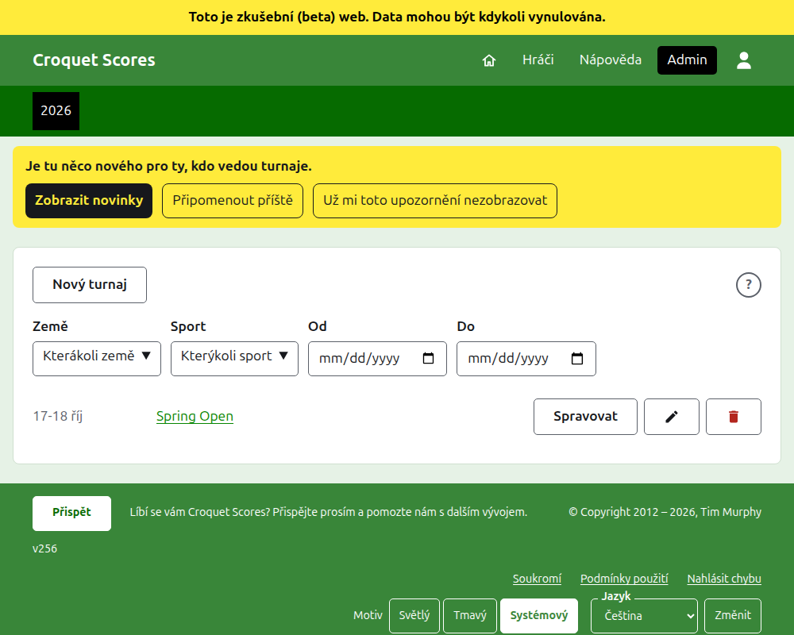
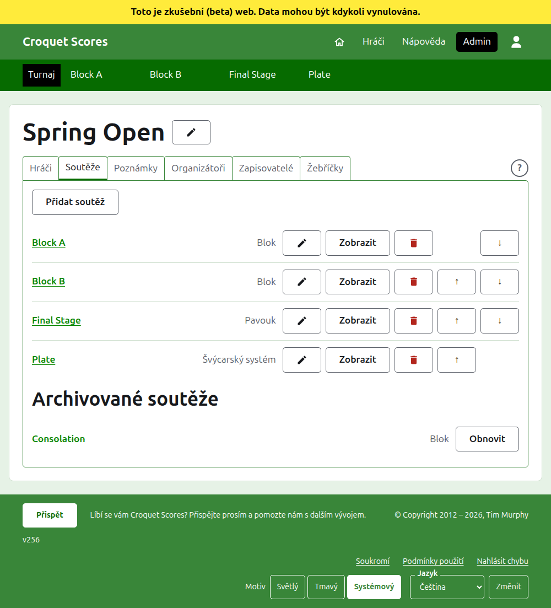

# Vedení standardního turnaje

Standardní turnaj je turnaj hraný mezi hráči zadávanými po jednom: klubový víkend, open, mistrovství. Jeho hráči se zařazují do bloků, pavouků a švýcarských systémů a jeho skóre se objevuje, jak se hraje. Tato příručka provede organizátora od přihlášení až po turnaj, jehož výsledky jsou dostupné veřejnosti.

Stojí sama o sobě. Nic v ní nezávisí na příručce k turnaji hranému týmy, která je napsána zvlášť.

## Než začnete

Potřebujete účet. [Zde](/account/register) se můžete zaregistrovat.

Všechno, co organizátor dělá, se dělá v administrační části webu. Veřejné stránky, kde hráči a diváci turnaj sledují, se kreslí z toho, co admin drží, takže se nic nemusí zveřejňovat: zadané skóre je na veřejných stránkách okamžitě.

## Stránky popořadě

1. [Vytvoření turnaje](creating-a-tournament.md): jeho název, dny, sport, kde se hraje a zda jde o národní, nebo mezinárodní akci.
2. [Hráči](players.md): zadávání hráčů turnaje, jejich oprava a odkládání těch, kteří byli zadáni omylem.
3. [Soutěže](competitions.md): přidávání bloků, pavouků a švýcarských systémů a jejich řazení.
4. [Zařazování hráčů do soutěže](entering-players-in-a-competition.md): kdo hraje v které soutěži, bye v pavouku, převody výsledků, odebírání a odstupování.
5. [Skóre](scores.md): zadávání výsledků, jejich oprava a odkládání těch, která byla zadána omylem.
6. [Poznámky](notes.md): sdělování hráčům, co potřebují vědět, jak turnaj postupuje.
7. [Organizátoři a zapisovatelé](managers-and-scorers.md): sdílení vedení turnaje a umožnění někomu zadávat skóre, aniž by mohl měnit cokoli jiného.
8. [Žebříčky](rankings.md): soubor, který se posílá světovým žebříčkům, a co zbývá doplnit vám.
9. [Změna, archivace a obnovení turnaje](changing-and-archiving.md): oprava údajů o turnaji a odložení turnaje.
10. [Co vidí veřejnost](what-the-public-sees.md): stránky, které sledují vaši hráči, a jak se na nich objevuje to, co zadáváte.

## Jak je admin uspořádán

Úvodní stránka adminu uvádí turnaje, kterých se účastníte, po jednom roce.

Stisknutí názvu turnaje nebo **Spravovat** otevře jeho stránku. Všechno, co se dá vést, je v šesti kartách pod jeho názvem: **Hráči**, **Soutěže**, **Poznámky**, **Organizátoři**, **Zapisovatelé** a **Žebříčky**. Stránka se otevírá na kartě Hráči, protože hráči se zadávají jako první. Na konci řady karet a v záhlaví dialogu je kulaté **?**, které otevře nápovědu k tomu, na co se díváte, v jiné kartě, aby vaše místo zůstalo zachováno. Jedno je i vedle **Nový turnaj**.

Tmavě zelená lišta pod záhlavím slouží k přecházení mezi stránkami. Vede k turnaji, jako **Turnaj**, a ke každé jeho soutěži podle názvu, takže se můžete z turnaje dostat do soutěže a mezi soutěžemi, aniž byste se vraceli přes kartu Soutěže. Stránka, na které jste, je označena černě.

## Co platí všude

**Nic se nemaže natvrdo kromě poznámky.** Hráči, soutěže, skóre i samotný turnaj se archivují, nemažou: odkládají se, přeškrtnou se a uvedou pod vlastním nadpisem, s tlačítkem **Obnovit**, kterým se vrátí. Archivace, obnovení a posouvání nahoru a dolů se nikdy neptají na potvrzení, protože každé se vrací stisknutím opačného. Co vrátit nejde, například odebrání hráče ze soutěže nebo smazání poznámky, se zeptá předem.

**Dialog nad stránkou neuloží nic, dokud nestisknete jeho tlačítko.** Zrušit nebo klávesa Escape ho zavře a všechno zůstane, jak bylo. Dialogy, které něco přidávají, jako Přidat hráče a Přidat skóre, zůstávají po každém přidání otevřené, aby se seznam dal napsat jednu položku po druhé.

**Co je odmítnuto, se říká vedle pole, kterého se to týká.** Nic odmítnutého se neuloží a co jste napsali, zůstává napsáno, aby se to dalo opravit, a nemuselo psát znovu.

**Admin funguje na telefonu.** Každé tlačítko je dost velké na stisknutí palcem a nic není širší než obrazovka.

Další: [Vytvoření turnaje](creating-a-tournament.md).
