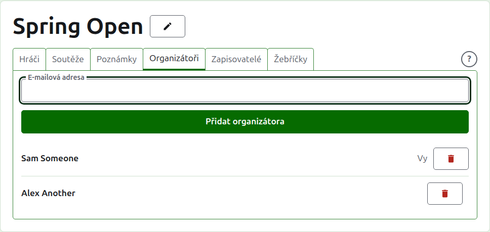
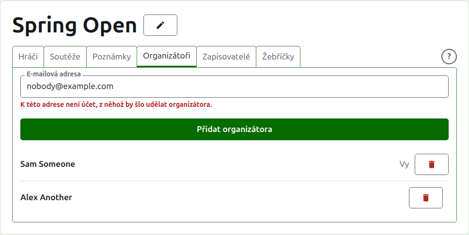
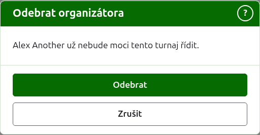
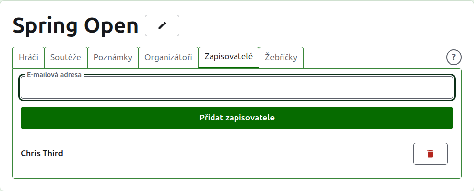
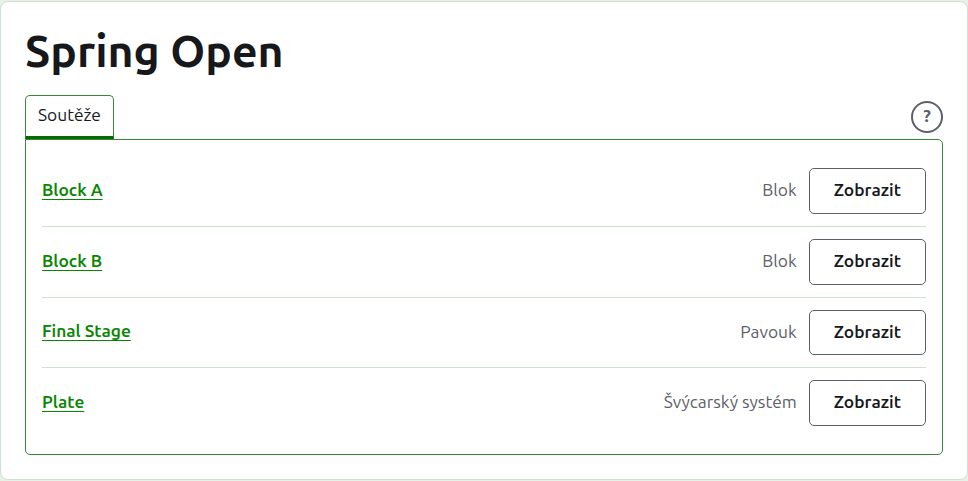

# Organizátoři a zapisovatelé

Turnaj má organizátory, kteří s ním mohou dělat všechno, a může mít zapisovatele, kteří zadávají jeho skóre a nic jiného. Kdo turnaj vytvořil, je jeho prvním organizátorem.

## Organizátoři {#managers}

Karta **Organizátoři** vypisuje, kdo turnaj vede, v pořadí, v jakém jimi byli učiněni, s vaším vlastním jménem označeným jako vaše. Tady se turnaj sdílí nebo předává.

Někdo se stane organizátorem svou e-mailovou adresou. Napište ji do pole nad seznamem a stiskněte **Přidat organizátora**. Adresa musí patřit k účtu, který je zaregistrován a potvrzen; adresa bez něj se odmítne pod polem a web o tom neřekne víc. Zapisovatel, který se stane organizátorem, přestává být zapisovatelem.

**Odebrat** organizátora odebere. O odebraném organizátorovi se nic neuchová, a proto se Odebrat nejprve ptá; chcete-li ho zpět, učiníte ho organizátorem znovu jeho adresou. Turnaj má vždy organizátora, a proto se poslednímu Odebrat nenabízí.

Můžete odebrat sami sebe. Otázka pak říká, co to znamená: ztratíte vlastní cestu zpět k turnaji a nikdo na stránce to za vás nemůže vrátit. Jiný organizátor vás může znovu učinit organizátorem.

## Zapisovatelé {#scorers}

Karta **Zapisovatelé** je karta Organizátoři pro zapisovatele a funguje stejně: nad seznamem e-mailová adresa a **Přidat zapisovatele** a u každého **Odebrat**.

Zapisovatel vidí turnaj ve svém vlastním seznamu v adminu, s tlačítkem **Skóre** místo Spravovat, a nabízejí se mu jen jeho soutěže: žádní hráči, poznámky, organizátoři, zapisovatelé ani žebříčky. Na stránce soutěže vidí jen kartu Skóre, kde může skóre zadávat, opravovat, archivovat a obnovovat jako organizátor. Kdo v soutěži hraje, je věcí organizátorů.

Organizátor se zapisovatelem nestává, protože organizátor už může dělat všechno, co zapisovatel. Turnaj žádného zapisovatele nepotřebuje, a proto lze odebrat každého zapisovatele, i posledního z nich.

Další: [Žebříčky](rankings.md).
