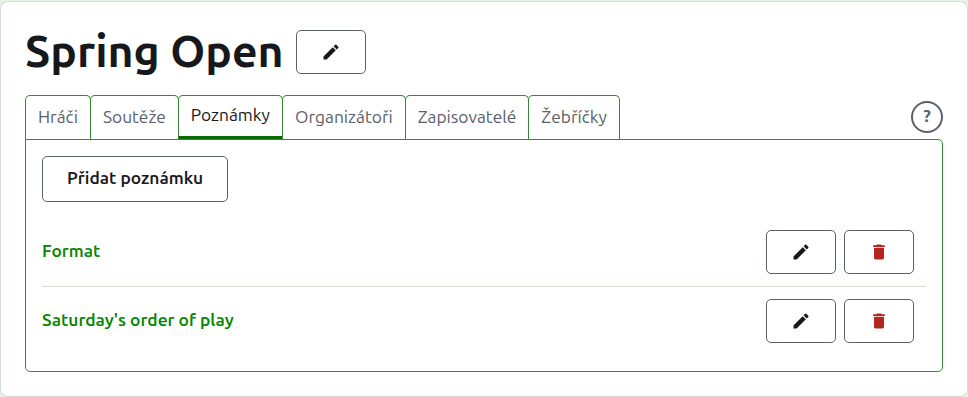
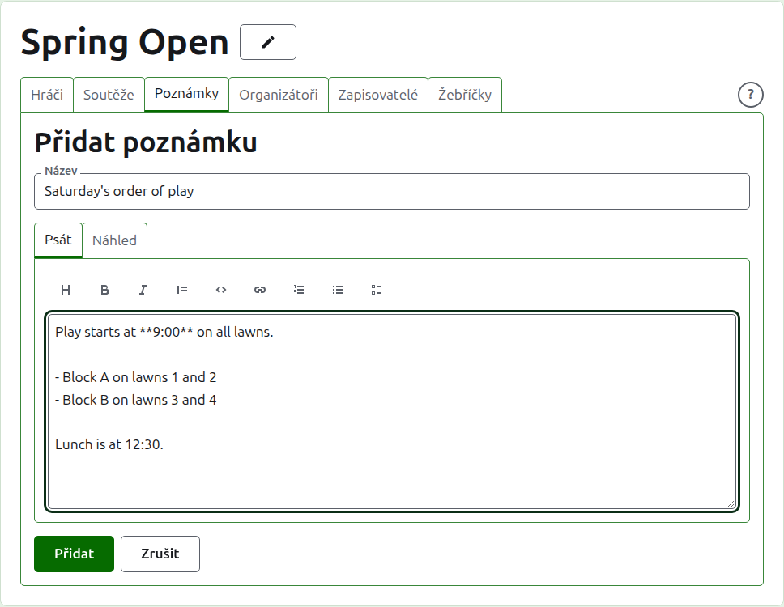
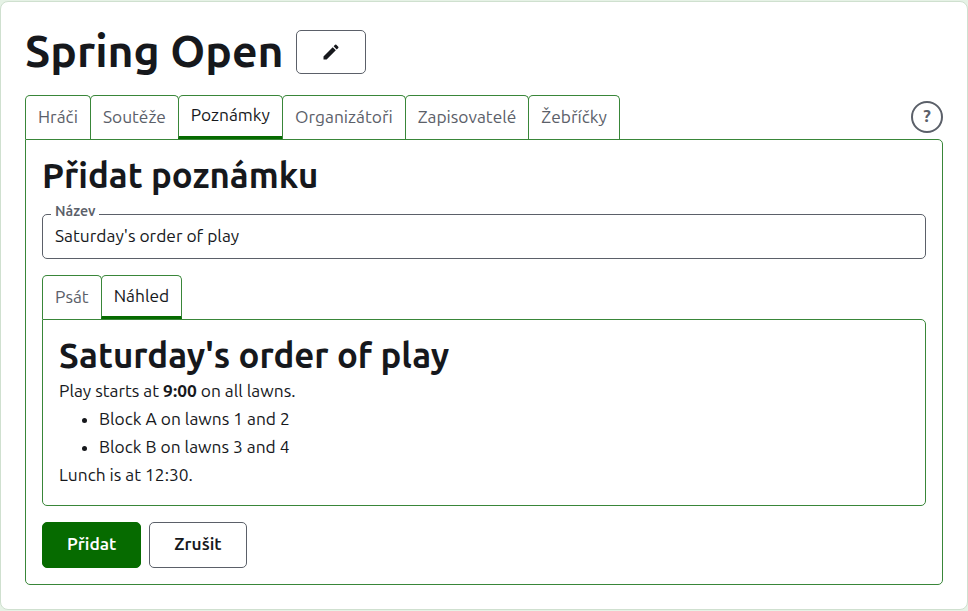
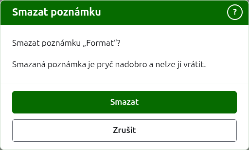

# Poznámky

Na kartě **Poznámky** stránky turnaje organizátoři píšou, co hráči potřebují vědět během turnaje: formát, změnu pořadí hry, čas oběda. Čtenáři je najdou na veřejné stránce Poznámky turnaje, nadepsané Poznámky organizátorů, a poznámka, kterou nepřečetli, je tam označena červenou hvězdičkou, která označuje také oddíl Poznámky na každé stránce turnaje, dokud ji neotevřou.

## Napsání poznámky

Stiskněte **Přidat poznámku** nad seznamem. Místo seznamu se objeví panel, protože poznámka se píše obšírně a potřebuje místo.

**Název** je povinný a podle něj se poznámka vypisuje. Je to prostý text.

**Popis** se píše v Markdownu a lze ho nechat prázdný, kde název říká vše. Nástrojová lišta nad polem píše Markdown za vás: Nadpis, Tučně, Kurzívou, Citace, Kód, Odkaz, Číslovaný seznam, Odrážkový seznam a Seznam úkolů. Každý funguje na vybraný text, nebo na začátek každého vybraného řádku, nebo umístí kurzor tam, kam patří slova.

Prázdný řádek mezi dvěma odstavci je odděluje a čtenář mezi nimi vidí celý prázdný řádek. **Náhled** ukazuje poznámku tak, jak ji čtenář uvidí na její stránce.

Stiskněte **Přidat**. Poznámka se uloží, seznam se vrátí s ní nahoře a na veřejné stránce Poznámky je okamžitě.

## Úprava poznámky

Stiskněte název poznámky nebo její **Upravit** a panel se otevře na této poznámce. Stisknutím **Uložit** změnu uložíte. Poznámka upravená poté, co ji čtenář přečetl, se mu označí znovu.

## Smazání poznámky {#deleting-a-note}

Poznámka, která už neplatí, se smaže. Smazaná poznámka je pryč nadobro, a proto se **Smazat** nejprve ptá.

Další: [Organizátoři a zapisovatelé](managers-and-scorers.md).
