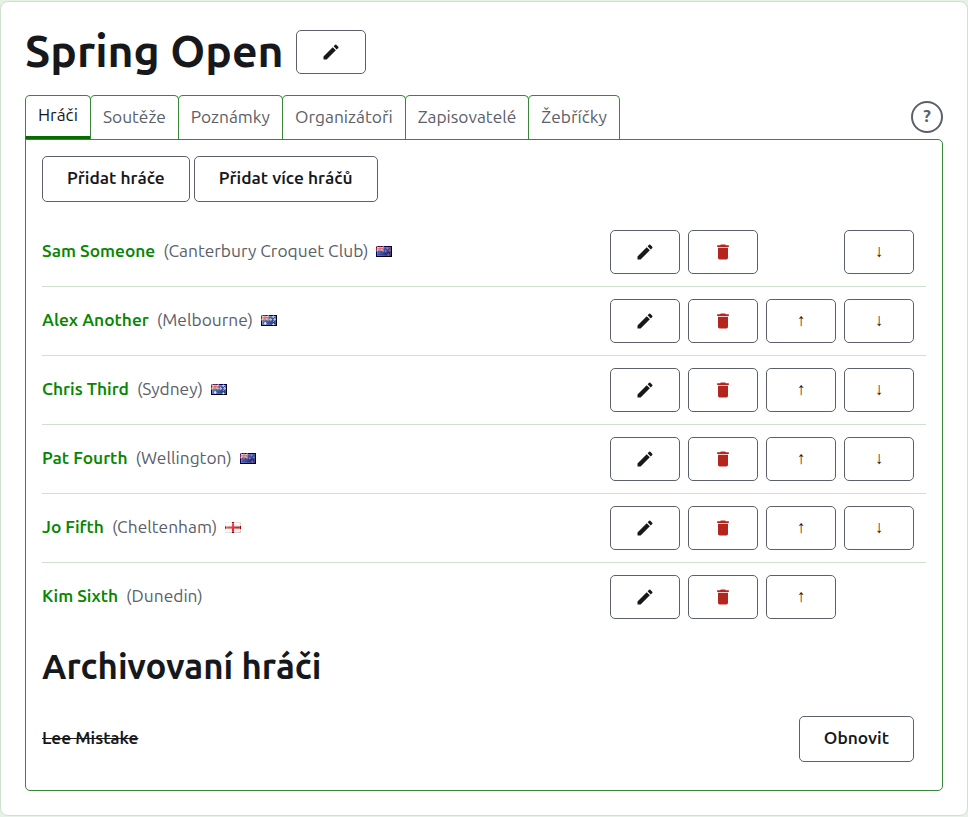
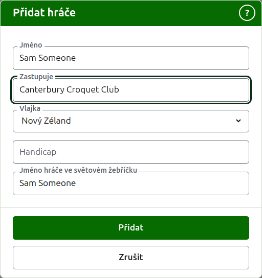
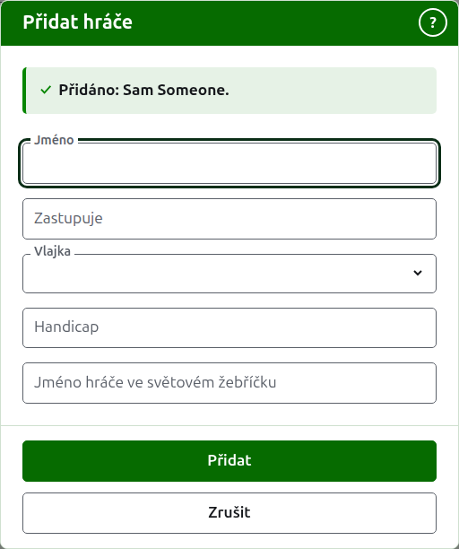
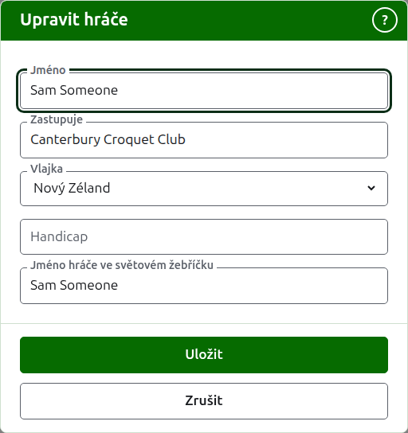
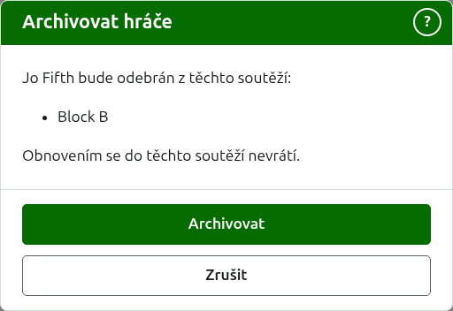

# Hráči

Karta **Hráči** na stránce turnaje je místo, kde se hráči zadávají, opravují, řadí a odkládají. Je to karta, na které se stránka otevírá, protože zadání hráčů je první věc, která se s turnajem dělá.

Hráči se tu zadávají jednou, do turnaje. V kterých soutěžích každý hraje, se vybírá později, na stránce každé soutěže, z hráčů zadaných tady. Viz [Zařazování hráčů do soutěže](entering-players-in-a-competition.md).



## Přidání hráče {#add-a-player}

Stiskněte **Přidat hráče** nad seznamem. Nad stránkou se otevře dialog.



**Jméno** je povinné. Je to jméno hráče, jak se zobrazí na každé stránce, o délce 3 až 254 znaků. Dva hráči v jednom turnaji nemohou mít stejné jméno, ať je napsáno s jakýmikoli velkými písmeny; kde se dva hráči skutečně jmenují stejně, rozlište je v samotném jménu, například „Andrew Hobbs (2)“.

**Zastupuje** je to, za co hráč hraje, napsané tak, jak by to řekl čtenář: klub, region nebo země, například „Canterbury Croquet Club“. Zobrazuje se v závorce za jménem. Může zůstat prázdné. Když píšete, nabízí se, co bylo v kterémkoli turnaji na webu přidáno jako to, co hráči zastupují, tam, kde některé jeho slovo začíná tím, co jste napsali, aby se klub psal tak, jak byl psán dříve; klávesa Tab převezme to, co je zobrazeno za kurzorem.

**Vlajka** je vlajka zobrazená vedle jména hráče. Je to rozbalovací seznam míst podle názvu, nejprve žádná, pak místa, kde se hraje většina turnajů; napište začátek názvu a přeskočíte na něj. Může zůstat na žádné, což je u většiny hráčů. Co hráč zastupuje a kterou vlajku vyvěšuje, se drží zvlášť, protože hráč může hrát za klub v jedné zemi a vyvěšovat vlajku jiné.

**Handicap** je handicap hráče, pokud ho má: znaménko, až dvě číslice a zlomek o jedné číslici, například 4, +4 nebo -1.5. Uchovává se tak, jak ho napíšete, a zobrazuje se v závorce s tím, co hráč zastupuje, před ním. Může zůstat prázdný.

**Jméno hráče ve světovém žebříčku** je jméno, pod kterým hráče znají světové žebříčky. Zjišťuje se jen v turnaji Asociačního kroketu nebo Golfového kroketu, dvou sportů, jejichž hráčů vedou světové žebříčky seznam. Hráče Amerického kroketu (6 branek) znají žebříčky pod jejich vlastními jmény, takže se tam nezjišťuje a jméno každého hráče ve světovém žebříčku je vždy jeho jméno. Když hráče přidáváte, následuje jméno, jak ho píšete, protože většinu hráčů žebříčky znají pod jejich vlastním jménem, a přestane ho následovat, jakmile do něj sami píšete. Zůstane-li prázdné, uchová se jako jméno hráče.

Když píšete jméno, nabízejí se hráči, které světové žebříčky znají a jejichž jména tak začínají, abyste mohli převzít jméno tak, jak ho žebříčky píšou, a nemuseli ho vypisovat. Vedle jména ve světovém žebříčku znamená zatržítko, že žebříčky jméno znají, a otazník, že ne: jméno může být špatně napsané, nebo může být hráč v žebříčcích nový. Je to jen rada. Jméno, které žebříčky neznají, se uloží stejně ochotně jako to, které znají.

Stiskněte **Přidat**. Hráč je přidán, dialog to řekne a jeho pole se vyprázdní pro dalšího hráče, s kurzorem zpět ve jménu. Takto přidejte celý seznam a potom stiskněte **Zrušit**, čímž dialog zavřete. Zrušit neuloží nic, co už nebylo přidáno.



Hráč se nikdy nejmenuje „Bye“. Bye pavouka se přidávají v samotném pavouku, kdekoli se zadávají jeho hráči, takže jméno, které je „Bye“ nebo „Bye“ s číslem, jako „Bye 2“, „Bye-2“ nebo „Bye (2)“, je odmítnuto a dialog vysvětlí proč.

## Přidání více hráčů {#adding-multiple-players}

Chcete-li přidat celý seznam najednou, stiskněte **Přidat více hráčů** vedle **Přidat hráče**. Nad stránkou se otevře dialog s jedním polem, které přijímá několik řádků textu. Seznam můžete zkopírovat z tabulky a vložit do pole.

**První řádek pojmenovává pole** (seznam, jehož první řádek nepojmenovává žádné, je odmítnut s hláškou „First row must be field names“), oddělená čárkami nebo tabulátory: **Name** a kterékoli z **Representing**, **Flag**, **Handicap** a **WorldRankingPlayerName**, v libovolném pořadí. Tyto názvy se píšou anglicky, ať je web v jakémkoli jazyce. **Name** musí být jedním z nich. **Každý řádek po něm je hráč**, s hodnotou pro každé pole ve stejném pořadí, oddělenou stejným způsobem. Hráč, který pro pole nemá nic, ho nechá prázdné, ale ponechá čárku nebo tabulátor. Například s čárkami:

```
Name,Representing,Flag
Sam Someone,Canterbury Croquet Club,Nový Zéland
Alex Another,,Anglie
```

- **Name, Representing a WorldRankingPlayerName** se řídí stejnými pravidly jako při přidávání jednoho hráče (viz [Přidání hráče](players.md#add-a-player)). Jméno má 3 až 254 znaků, v turnaji ještě není, ať je napsáno s jakýmikoli velkými písmeny, a není „Bye“.
- **Flag** je název země nebo místa, ve vašem jazyce, tak jak ho nabízí seznam v dialogu Přidat hráče, například Nový Zéland.
- **Handicap** je znaménko, až dvě číslice a zlomek o jedné číslici, například 4, +4 nebo -1.5.
- Hráč bez **WorldRankingPlayerName** je znám pod svým jménem, jako když se přidává po jednom.
- **Čárky nebo tabulátory.** Buňky zkopírované z tabulky jsou odděleny tabulátory a seznam napsaný ručně je obvykle oddělen čárkami. Funguje obojí. Pokud je v prvním řádku tabulátor, čte se celý seznam s tabulátory, jinak s čárkami.
- Hodnota, která obsahuje oddělovač, se píše v uvozovkách, jak ji píše tabulka: „Smith, John“ v seznamu odděleném čárkami. Uvozovka uvnitř hodnoty se píše dvakrát.
- U každé hodnoty se odstraní mezery na koncích a řádek, na kterém nic není, se přeskočí.
- Seznam má nejvýše 500 hráčů. Zbytek přidejte v jiném seznamu.

Stiskněte **Přidat**. Celý seznam se zkontroluje, než se cokoli uloží, takže seznam s čímkoli špatným nepřidá nikoho. Co je špatně, se říká pod polem, na řádku, na kterém to je, přičemž první řádek je řádek 1. Uvede se každá chyba, ne jen první, a co jste napsali, zůstává, abyste to mohli opravit. Jakmile je seznam uložen, dialog se zavře a karta Hráči uvede nové hráče, v pořadí, v jakém jste je napsali. Na rozdíl od **Přidat hráče**, který zůstává otevřený pro dalšího hráče, tu žádný další není: další byl seznam.

**?** v záhlaví dialogu vede sem. Tento dialog i Přidat hráče zůstávají v okně, ať je stránka posunuta kamkoli.

## Oprava hráče {#correcting-a-player}

Stiskněte jméno hráče nebo jeho **Upravit** a otevře se stejný dialog na tomto hráči, nazvaný Upravit hráče. Změňte, co je špatně, a stiskněte **Uložit**, čímž se změna uloží a dialog zavře. Hráč, jehož jméno se opraví, si ponechá jméno ve světovém žebříčku, které měl, protože ho žebříčky stále znají pod ním. V Americkém kroketu (6 branek) je jméno hráče ve světovém žebříčku vždy jeho jméno, takže oprava jména opraví i toto.



Hráč opravený tady je opraven všude: v každé soutěži, ve které je, i na každé veřejné stránce.

## Řazení hráčů

Hráči jsou uvedeni v pořadí turnaje, což je pořadí, v jakém se nabízejí při zařazování do soutěží, a pořadí, v jakém se losuje pavouk. **Nahoru** a **Dolů**, šipky na konci každého řádku, posunou hráče o jedno místo. Prvnímu hráči se Nahoru nenabízí a poslednímu se nenabízí Dolů.

## Archivace hráče {#archiving-a-player}

**Archivovat** hráče odloží: zadaného omylem nebo odstoupivšího z celého turnaje. Archivovaný hráč je uveden pod **Archivovaní hráči**, přeškrtnutý, za hráči v používání, a nabízí jen **Obnovit**. Archivovaný hráč není v žádné soutěži a nezobrazuje se na žádné veřejné stránce.

Hráče, který odehrál jakoukoli hru, nelze archivovat, protože by pak hry byly proti někomu, kdo tu už není, a proto se takovému hráči Archivovat nenabízí. Hráče, jehož jediné hry jsou archivované, archivovat lze.

Archivace hráče, který není v žádné soutěži, se neptá předem, protože obnovení vrátí všechno. Archivace hráče, který je v některé soutěži, se zeptá předem, protože archivace ho odebere z každé soutěže, ve které je, a obnovení ho nevrátí.



Další: [Soutěže](competitions.md).
