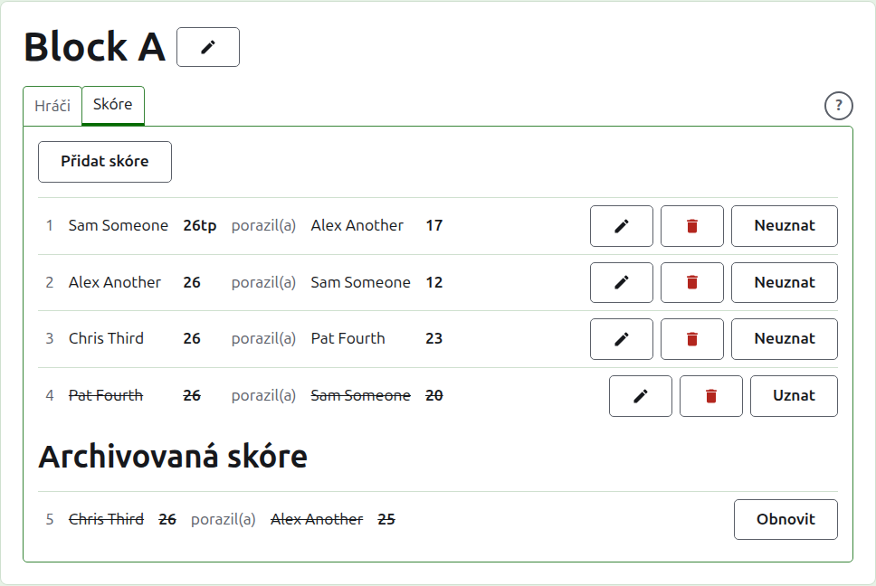
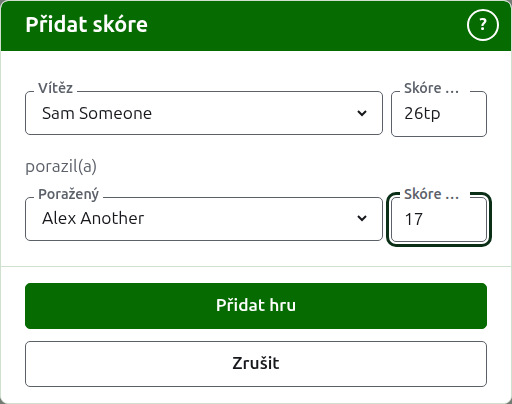
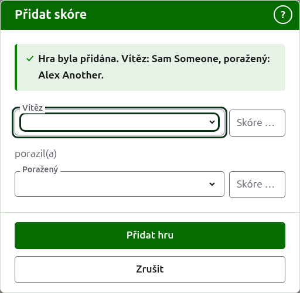
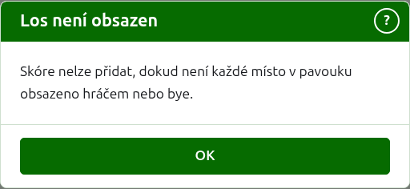
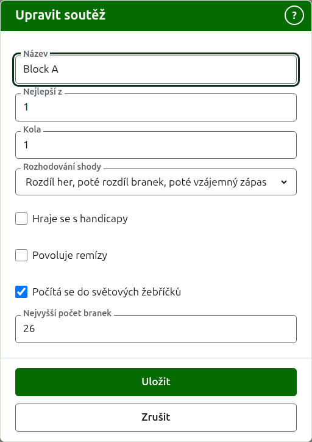

# Skóre

Na kartě **Skóre** stránky soutěže se hry zadávají, opravují a odkládají stranou. Zapisovatel vidí jen tuto kartu a může na ní dělat všechno, co organizátor.

## Zadání skóre {#entering-a-score}

Stiskněte **Přidat skóre** nad seznamem. Dialog se čte tak, jak se výsledek říká nahlas: vítěz a jeho skóre, pak „porazil(a)“, pak poražený a jeho skóre.

Vítěz i poražený se vybírají z hráčů soutěže, kteří hrají, v pořadí soutěže. Na začátku není vybrán nikdo, aby se hra nikdy nezapsala proti hráči, kterého jste nevybrali. V pavouku výběr vítěze vybere jako poraženého toho, s kým je nalosován, kde to vidíte a můžete vybrat jiného.

Skóre se píše tak, jak ho zapisovatel zapsal: počet bodů a cokoli za ním, což se uloží a zobrazí tak, jak je napsáno, například „26tp“ pro 26 branek a trojitý peel. Číslo tvoří číslice, kterými skóre začíná; skóre, které nezačíná číslicí, se odmítne.

Hra vyhraná při stejném počtu bodů, například když ji zastaví čas a rozhodne se jinak, říká, kdo ji vyhrál, značkou za skóre vítěze: „6w“ porazilo „6“. Na Croquet Scores jsou značky „w“, „won“ a „winner“; Gateball Scores bere i „cb“ a „so“. Skóre vítěze musí být vyšší než skóre poraženého, nebo označené, pokud turnaj nepovoluje remízy; tam se stejný počet bodů bez značky uloží jako remíza.

Stiskněte **Přidat hru**. Hra se přidá, dialog řekne kterou a pole se vyprázdní pro další, protože skóre přicházejí po dávkách přečtených z tabule na konci kola. Až jsou všechna zadána, stiskněte **Zrušit**.

Pokud dialog nedokáže načíst hráče soutěže, řekne „Hráče se nepodařilo načíst. Zavřete toto okno a otevřete ho znovu.“ Udělejte to.

Co se odmítne, říká se pod polem, kterého se to týká: nevybraný vítěz nebo poražený, nenapsané skóre nebo skóre nezačínající číslicí, tentýž hráč na obou místech, skóre poraženého označené jako vítězné, nebo skóre vítěze za skórem poraženého. V pavouku se dva hráči, kteří nejsou nalosováni proti sobě, odmítnou nad poli.

## Los pavouka musí být nejdřív obsazen {#draw-filled-first}

Pavouk se hraje až tehdy, když každé místo jeho losu drží hráče nebo bye. Do té doby Přidat skóre místo otevření dialogu vysvětlí, proč se skóre přidat nedá.

## Seznam skóre

Použitá skóre jsou vypsána v pořadí, v jakém byla zadána, nejstarší první, aby se seznam četl tak, jak se soutěž hrála. Seznam je tabulka s řádkem pro každou hru a bez záhlaví sloupců. Řádek říká číslo hry, vítěze a jeho skóre, slovo „porazil(a)“, pak poraženého a jeho skóre a nabízí **Upravit** a **Archivovat**.

Číslo hry je její místo mezi zadanými hrami, první je 1, archivované hry se počítají. Archivace hry nemění číslo žádné jiné, takže mezera v číslech říká, že některá hra byla archivována.

## Oprava skóre {#correcting-a-score}

**Upravit** otevře stejný dialog na tomto skóre, nazvaný Upravit skóre, s vybranými hráči a skóre, jak byla napsána. Stisknutím **Uložit** opravu uložíte a dialog se zavře.

Oprava ponechává výsledek: vyhraná hra zůstává vyhraná a remizovaná hra zůstává remizovaná. Hra, jejíž výsledek byl špatně, se archivuje a zadá znovu.

Kde lze skóre archivovat, lze měnit i jeho hráče, nejen skóre. V pavouku skóre, jehož vítěz už hrál v dalším kole, ponechává své hráče, protože změna, kdo vyhrál, by nechala další hru hrát někoho, kdo se tam nedostal; opravit lze jen jeho skóre.

## Archivace skóre

**Archivovat** odloží skóre stranou, aby se nepočítalo. Je vypsáno pod **Archivovaná skóre**, přeškrtnuté, a nabízí jen **Obnovit**. Ani jedno se nejprve neptá, protože každé z nich druhé vrací.

V pavouku vítěz zápasu postupuje do dalšího kola, a proto se skóre zápasu, jehož vítěz hrál v dalším kole, Archivovat nenabízí. Nejprve se archivuje hra v dalším kole a pak ty před ní. Je-li kolo nejlepší ze 3 nebo 5, drží se tak každá hra zápasu. Blok a švýcarský systém nemají kola, která by na sobě závisela, a proto lze archivovat každé skóre v nich.

## Neuznání skóre

Hráč, který soutěž opustí, obvykle odstoupí na kartě Hráči a tím je vše hotovo: už nehraje a hry, které odehrál, platí, ale jeho hry se už nezapočítávají do výher/proher a branek. Neuznání skóre je pro vzácnější případ, kdy se odehraná hra nemá počítat. V australském President's Eights například výsledky prvního kola platí, když hráč odstoupí, a z počítání se vyřadí jen jeho hry druhého kola: ty hry neuznejte.

V bloku nebo ve švýcarském systému se skóre, které bylo odehráno, ale nemá se počítat, neuzná místo archivace. **Neuznat** ho ponechá mezi použitými skóre, na jeho místě, ale přeškrtnuté a na veřejných stránkách se nepočítá. **Uznat** ho znovu započítá. Ani jedno se nejprve neptá. Skóre pavouka se Neuznat nenabízí, protože tam skóre rozhoduje o víc než o pořadí.

Další: [Poznámky](notes.md).
