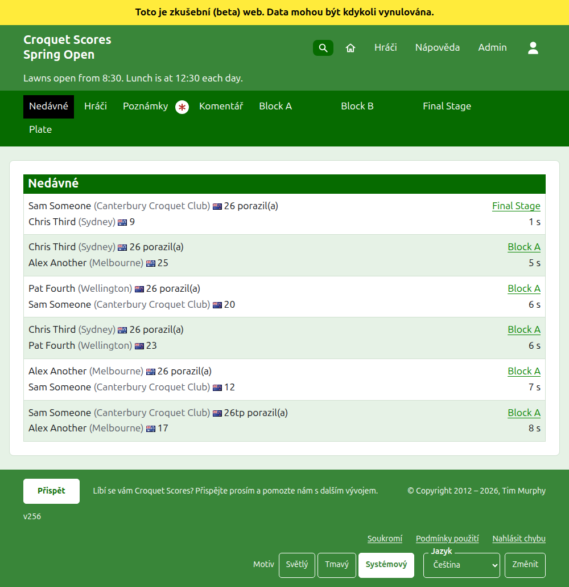
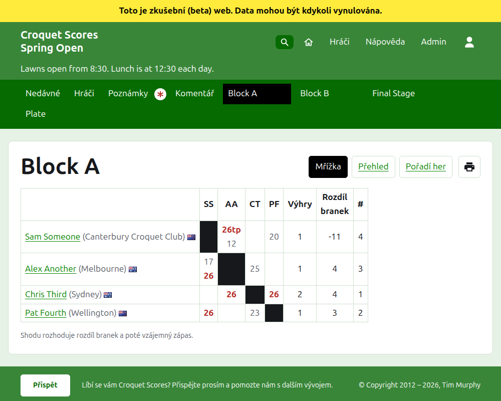
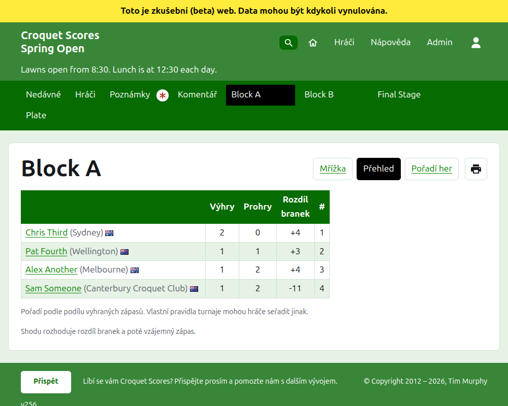
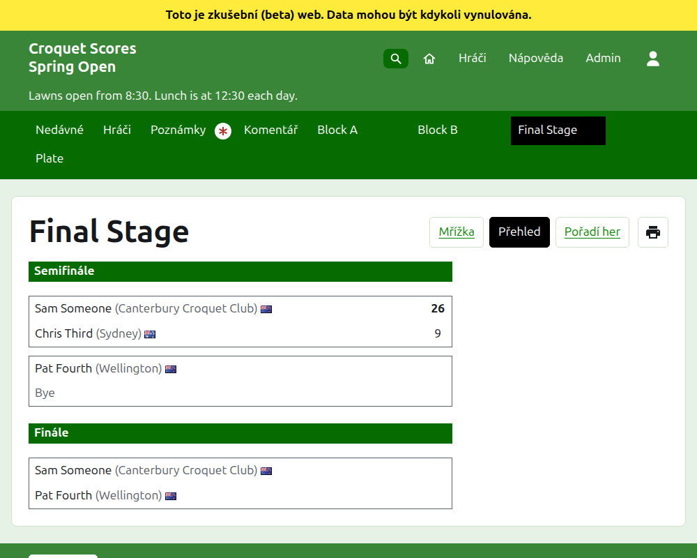
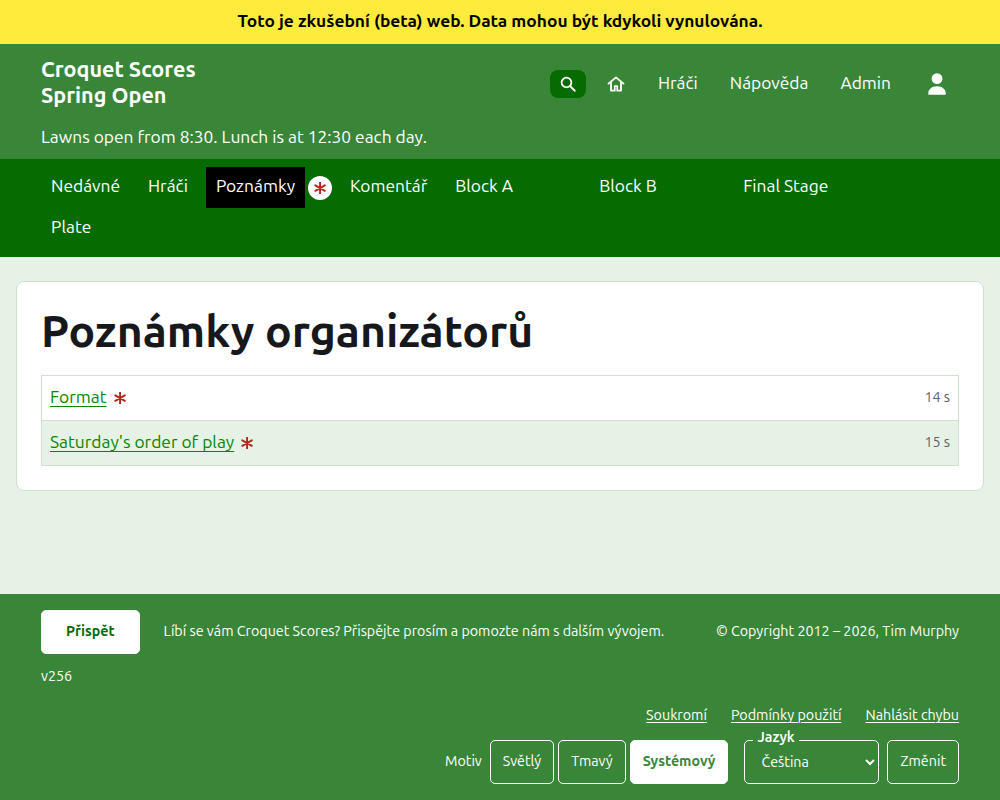

# Co vidí veřejnost

Nic se nepublikuje: veřejné stránky se kreslí z toho, co admin drží, takže zadané skóre je na nich okamžitě. Nepotřebují účet ani skriptování a jsou rozvržené pro telefon.

## Stránka turnaje

Stránka turnaje je na adrese jeho roku, sportu a názvu, například `/2026/ac/spring-open`. Nahoře je název turnaje a pod ním jeho podtitul. Vypisuje každou použitou hru, naposledy přidanou první, aby čtenář, který se vrátí, viděl, co se od té doby stalo. Každá hra říká vítěze, jeho handicap a koho zastupuje, jeho vlajku a skóre, pak poraženého a jeho, se soutěží, ve které se hrála, a jak dávno byla přidána.

Tmavě zelená lišta nabízí oddíly turnaje: **Nedávné**, což je tato stránka, **Hráči**, **Poznámky** a **Komentář**, pak každou používanou soutěž, v pořadí, v jakém je má karta Soutěže. Poznámky jsou označeny červenou hvězdičkou, dokud je poznámka, kterou čtenář nepřečetl.

## Blok

Stránka bloku ukazuje jeho výsledky jako mřížku: řádek a sloupec pro každého hráče v pořadí bloku, s hrami mezi dvěma hráči tam, kde se řádek potkává se sloupcem, každá označená jako vyhraná, prohraná nebo remizovaná z pohledu hráče v řádku. Za sloupci hráčů následují součty každého hráče. Kde je každý zápas jedna hra, jsou to výhry a rozdíl branek; kde je zápas nejlepší z více her, jsou to zápasy, rozdíl her, hry a rozdíl branek. Poslední sloupec, nadepsaný **#**, je místo každého hráče: 1 pro prvního a =2, kde se hráči nedají rozlišit a dělí se o druhé místo. Kde někteří hráči vyhráli stejný podíl zápasů, řádek pod mřížkou říká, jak se rozlišují, podle rozhodování shody bloku (viz Soutěže).

Blok, pavouk a švýcarský systém se ukazují třemi způsoby, nabízenými na řádku s názvem soutěže: **Mřížka**, **Přehled** a **Pořadí her**. Vedle nich je tlačítko tiskárny, které vytiskne název turnaje, název soutěže a její výsledky a nic jiného. Přehled je ten pro telefon: u bloku hráči seřazení s výhrami, prohrami, rozdílem branek a místem; u pavouka zápasy vypsané kolo po kole; u švýcarského systému tabulka mřížky bez výsledků. Pořadí her vypisuje každou hru, nejprve od nejstarší. Je nadepsáno **Hra** a **Datum**: stisknutí **Hra** seřadí hry podle jména vítěze a pak poraženého, stisknutí **Datum** je seřadí od nejstarší nebo od nejnovější a stisknutí záhlaví, podle kterého je seznam seřazen, ho otočí. Způsob, jakým čtenář seřadil, si zařízení pamatuje. Čtenář, který zvolí pohled, ho má u každé soutěže, dokud nezvolí jiný.

Soutěž hraná na jiný než obvyklý počet branek svého sportu to říká pod svým názvem, například „Počet branek ve hře: 14“ (viz [Soutěže](competitions.md#adding-a-competition)).

Řádek hráče, který odstoupil, to říká. Neuznané skóre je zobrazeno přeškrtnuté a nic se nepočítá. Archivované skóre se nezobrazuje.

## Pavouk

Stránka pavouka kreslí jeho los kolo po kole, sloupec pro každé kolo od prvního do finále, s oběma stranami každého zápasu nad sebou a buňkou pro každou hru, z níž je zápas nejlepší. Zápas pozdějšího kola stojí vedle dvou zápasů, jejichž vítězové se v něm střetnou. Na telefonu se los posouvá do stran, se šipkami k finále a zpět.

## Švýcarský systém

Stránka švýcarského systému řadí jeho hráče do tabulky: jejich hry, výhry, procento výher a výsledky, každý řečený jako soupeř a rozdíl, například „+4“ pro hru vyhranou o čtyři.

## Hráči

Stránka Hráči vypisuje každého hráče turnaje, který není archivován, v abecedním pořadí, s jeho handicapem a tím, koho zastupuje, v závorkách, a jeho vlajkou.

## Poznámky

Stránka Poznámky, nadepsaná Poznámky organizátorů, vypisuje poznámky turnaje, naposledy napsanou první, každou vedoucí na její vlastní stránku a s uvedením, jak dávno byla napsána. Poznámka, kterou čtenář nepřečetl, je označena červenou hvězdičkou, dokud ji neotevře. Turnaj bez poznámek říká „Zatím žádné poznámky.“

## Kde je turnaj vypsán

Turnaj je na domovské stránce, dokud se hraje nebo se chystá začít. Stránka jeho roku, například `/2026`, vypisuje měsíce roku, z nichž každý po stisknutí vypíše turnaje, které v něm začínají. Ovládací prvek pod nadpisem, **Zobrazit vše** a poté **Skrýt vše**, otevře nebo zavře každý měsíc. Turnaj označený jako národní nebo mezinárodní je tučně po celé délce svého řádku.

## Adresy, které se přesouvají

Turnaj si ponechává svou adresu, když se jeho název opraví. Kde se přesune, protože se změnil jeho rok nebo sport, jeho stará adresa vede na novou, aby odkaz uchovaný z dřívějška stále fungoval. Stránky archivovaného turnaje nejsou k nalezení, dokud se neobnoví.
