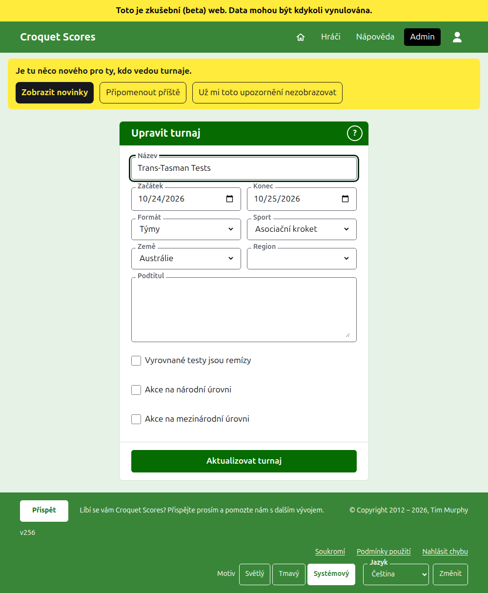
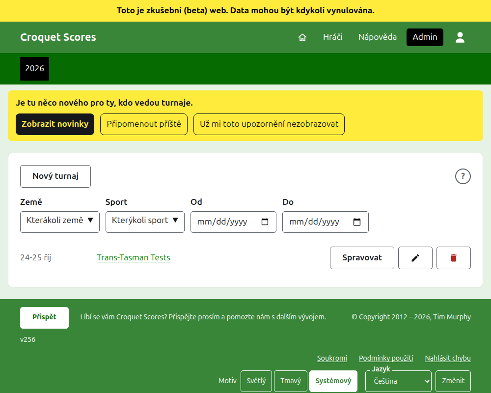

# Změna, archivace a obnovení turnaje

## Změna údajů o turnaji

V seznamu turnajů v adminu stiskněte u turnaje **Upravit**. Formulář je ten, který ho vytvořil, nastavený tak, jak turnaj je. Změňte, co je špatně, a stiskněte **Aktualizovat turnaj**.

Dny turnaje lze tady rozšířit, kde test potřebuje den mimo ně, protože test se hraje v rámci svého turnaje. Jakmile turnaj obsahuje jakýkoli tým nebo test, včetně archivovaných, jeho **Formát** nelze měnit vůbec: ani na standardní formát, který má místo toho hráče a soutěže, ani na jiný formát hraný týmy, protože test může být ve skupině, kterou jiný formát nemá. Formát vyberte při vytváření turnaje.

Turnaj si ponechá svou adresu, když se jeho název opraví, aby ho odkaz, který už někdo poslal, stále našel. Přesune se, jen když se změní rok, ve kterém začíná, nebo jeho sport, a pak jeho stará adresa vede na novou. Uložení vás zavede k turnaji, kdekoli se nyní nachází.

Turnaj může měnit jen organizátor. Zapisovateli ani nikomu jinému se to řekne, místo aby se mu ukázal formulář.

## Seznam turnajů

Admin uvádí vždy jeden rok, počínaje letošním, nejnovější turnaj první. Roky, ve kterých máte turnaj, jsou karty v tmavozelené liště, nejnovější první; kde jich je víc, než se vejde na telefon, nejstarší jsou v rozbalovacím seznamu na konci řady. Rok je v adrese, takže na rok se dá odkazovat. Pod tlačítky lze seznam zúžit podle **Země**, **Region** a **Sport** a podle dní, ve kterých obsahuje turnaje, **Od** a **Do**. Kulaté **?** vedle **Nový turnaj** vede k nápovědě.

## Archivace turnaje

**Archivovat** u turnaje v seznamu ho odloží. Je stále uveden, přeškrtnutý a za používanými turnaji, ale nabízí jen **Obnovit**: jeho stránka v adminu a jeho veřejné stránky jsou zavřené, dokud se neobnoví. Archivace se nejprve neptá, protože obnovení ji vrátí.

Další: [Co vidí veřejnost](what-the-public-sees.md).
