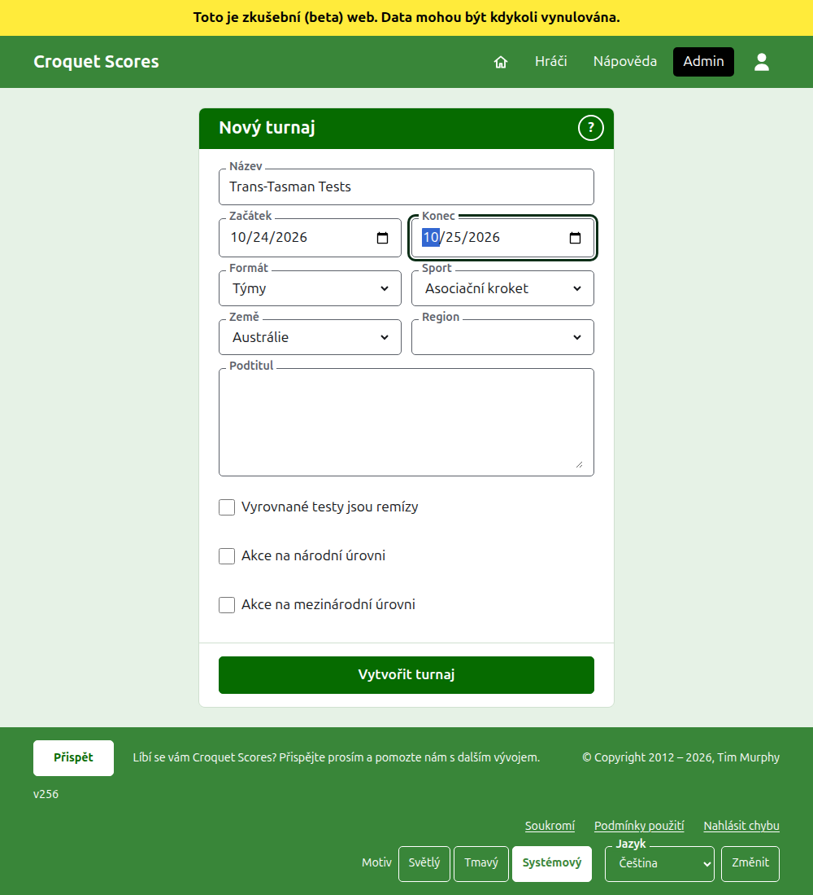
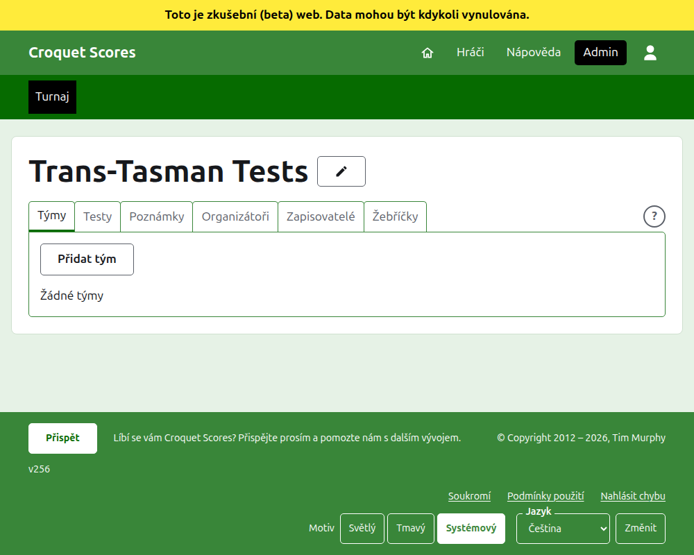

# Vytvoření turnaje

Stiskněte **Nový turnaj** nad seznamem turnajů v adminu. Je nad seznamem, a ne pod ním, aby ho dlouhý seznam nevytlačil z obrazovky telefonu.

Formulář se ptá na všechno, čím turnaj začíná. Nejdůležitější je tu **Formát**, který dělá z turnaje turnaj hraný týmy.

## Na co se formulář ptá

**Název.** Podle čeho čtenáři turnaj hledají, například „Trans-Tasman Tests“. Má 3 až 254 znaků. Název celý malými písmeny nebo celý velkými je odmítnut, protože by na každé stránce, kde se zobrazí, vypadal jako chyba. Dva turnaje mohou mít stejný název, protože se stejný turnaj hraje každý rok.

**Začátek** a **Konec.** Dny, ve kterých turnaj běží. Každý test se hraje v jejich rámci, nastavte je proto tak, aby pokrývaly celou akci. Turnaj nemůže skončit dříve, než začne, a nemůže začít ani skončit později než koncem příštího roku. Turnaj patří do roku, ve kterém začíná, což je také rok v jeho adrese.

**Formát.** Vyberte jeden z formátů hraných týmy:

- **Týmy** je obecný formát pro jakoukoli akci mezi týmy.
- **Eire Cup**, **Interstate Shield** a **Mistrovství světa týmů v golfovém kroketu** jsou konkrétní akce, každá vedená jako vlastní formát, aby se mohla řídit tak, jak se ta akce řídí.

Standardní je jediný formát, který se nehraje týmy, a není to, co tu chcete. Gateball Scores žádný formát nenabízí, protože každý turnaj tam je standardní turnaj v gateballu; turnaj hraný týmy se vytváří na Croquet Scores.

**Sport.** Sporty, které web nabízí, v jeho pořadí: Asociační kroket, Golfový kroket, Americký kroket (6 branek) a Ricochet.

**Země** a **Region.** Kde se turnaj hraje. Region se zjišťuje jen tehdy, když je vybraná země rozdělena na regiony, například australské státy, a ani pak ho není nutné vybrat.

**Podtitul.** Cokoli, co chcete, aby čtenáři věděli, a nemá to vlastní pole: kde parkovat, kdy je oběd, komu zavolat. Zobrazuje se pod názvem turnaje na každé veřejné stránce. Píše se v Markdownu, takže slovo lze zvýraznit tučně hvězdičkami kolem něj a seznam vytvořit pomlčkou na začátku každého řádku. Může mít až 2000 znaků a lze ho nechat prázdný.

Jak se jeho testy hrají a počítají, zda s handicapy, s remízami a do světových žebříčků, říká každý test při přidání.

**Vyrovnané testy jsou remízy.** Zjišťuje se po výběru formátu hraného týmy. Test, jehož týmy vyhrají stejný počet zápasů, se rozhoduje podle rozdílu her, poté podle rozdílu branek. Zaškrtněte to a bude z něj remíza. Na začátku je zaškrtnuto jen pro **Mistrovství světa týmů v golfovém kroketu**, které je vždy remizovalo, a lze to později změnit.

**Akce na národní úrovni** a **Akce na mezinárodní úrovni.** Turnaj může být jedno, druhé, nebo žádné, ale nikdy obojí: zaškrtnutím jednoho se druhé odškrtne.

## Vytvoření

Stiskněte **Vytvořit turnaj**. Přejdete na stránku turnaje v adminu, otevřenou na kartě Týmy, a jste jeho prvním organizátorem. V adminu je uveden pod rokem, ve kterém začíná.

Veřejná adresa turnaje se skládá z jeho roku, sportu a názvu, například `/2026/ac/trans-tasman-tests`. Tuto adresu si ponechá, i když se jeho název později opraví, aby ho už odeslaný odkaz stále našel; přesune se, jen když se změní rok, ve kterém začíná, nebo jeho sport.

## Když je něco odmítnuto

Co je odmítnuto, říká se pod polem, kterého se to týká, a to, co jste napsali, zůstává napsáno. Nic se neuloží, dokud nejsou přijata všechna pole. Nejčastěji se odmítá název napsaný celý malými písmeny, konec před začátkem a nevybraná země.

Další: [Týmy](teams.md).
