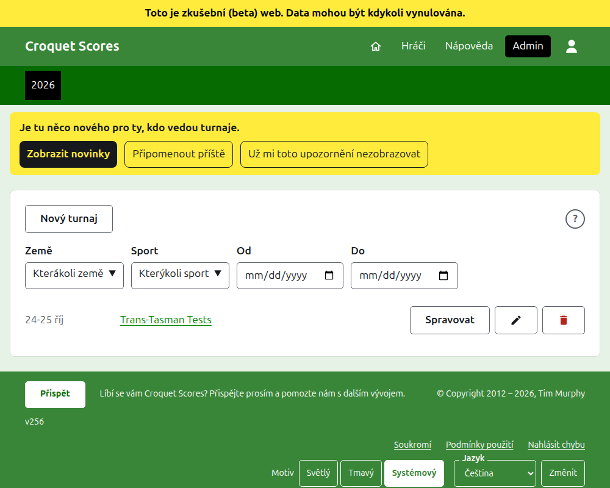
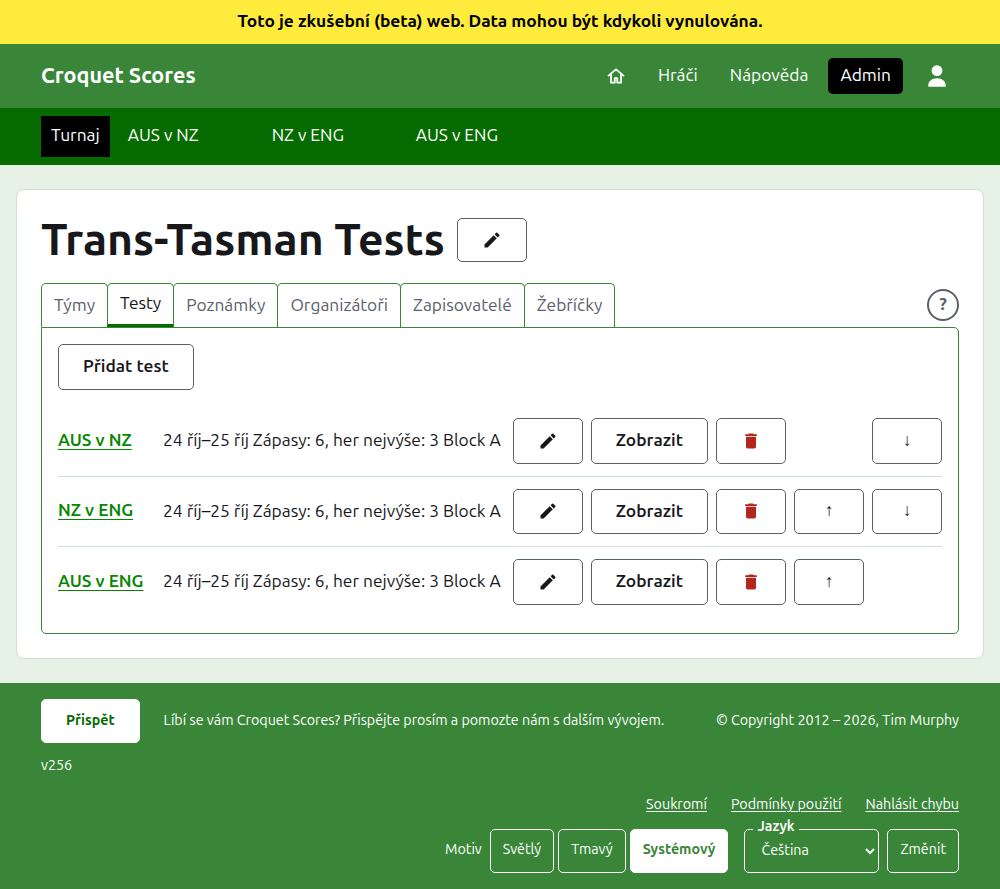

# Vedení turnaje hraného týmy

Turnaj hraný týmy je takový, kde se střetávají celky, a ne hráči zapisovaní jeden po druhém: série testů mezi dvěma zeměmi, interstate shield, mistrovství světa týmů. Nastavíte jeho týmy s jejich hráči, přidáte testy mezi týmy a hry každého testu se zapisují, jak se hrají. Tento průvodce provede organizátora od přihlášení až k turnaji, jehož výsledky jsou dostupné veřejnosti.

Stojí sám o sobě. Nic v něm nezávisí na průvodci standardním turnajem, který je napsán zvlášť.

## Než začnete

Potřebujete účet. [Zde](/account/register) se můžete zaregistrovat.

Vše, co organizátor dělá, se dělá v administrační části webu. Veřejné stránky, kde hráči a diváci turnaj sledují, se kreslí z toho, co drží admin, takže se nemusí nic zveřejňovat: zadané skóre je na veřejných stránkách hned.

## Slova

**Tým** je celek, například Austrálie, s názvem, zkráceným názvem, například „AUS“, a vlajkou. Tým má vlastní **hráče**, kteří hrají za něj a za nikoho jiného. **Test** je souboj dvou týmů, nazývaný jejich zkrácenými názvy, například „AUS v ENG“, složený z určitého počtu **zápasů** mezi hráčem jednoho a hráčem druhého týmu, přičemž každý zápas je nejlepší z určitého počtu **her**. Testy lze řadit do **skupin**, například „Block A“, kde mnoho týmů hraje mezi sebou.

## Stránky popořadě

1. [Vytvoření turnaje](creating-a-tournament.md): jeho název, dny, sport, formát a kde se hraje.
2. [Týmy](teams.md): přidání týmů s jejich zkrácenými názvy a vlajkami.
3. [Hráči týmu](team-players.md): zapisování hráčů každého týmu na stránce týmu.
4. [Testy](tests.md): přidání testů mezi týmy, jejich dny, kolik zápasů každý má a jejich skupiny.
5. [Skóre](scores.md): zadávání her testu, jejich oprava a odkládání těch, které byly zadány omylem.
6. [Poznámky](notes.md): sdělování hráčům, co potřebují vědět, jak turnaj postupuje.
7. [Organizátoři a zapisovatelé](managers-and-scorers.md): sdílení vedení turnaje a umožnění, aby někdo zadával skóre, aniž by mohl měnit cokoli jiného.
8. [Žebříčky](rankings.md): soubor, který se posílá světovým žebříčkům, a co zbývá k vyplnění vám.
9. [Změna, archivace a obnovení turnaje](changing-and-archiving.md): oprava údajů o turnaji a odložení turnaje.
10. [Co vidí veřejnost](what-the-public-sees.md): stránky, které vaši hráči sledují, a jak se na nich zobrazuje to, co zadáte.

## Jak je admin uspořádán

Úvodní stránka adminu uvádí turnaje, na kterých se podílíte, po jednom roce.

Stisknutím názvu turnaje nebo **Spravovat** se otevře jeho stránka. Vše, co se dá vést, je v šesti kartách pod jeho názvem: **Týmy**, **Testy**, **Poznámky**, **Organizátoři**, **Zapisovatelé** a **Žebříčky**. Karta **Žebříčky** je tam jen tehdy, když se turnaj počítá do světových žebříčků. Stránka se otevře na kartě Týmy, protože týmy se nastavují jako první.

Tmavozelená lišta pod záhlavím slouží k přecházení mezi stránkami. Na stránce turnaje a na stránce testu vede k turnaji, jako **Turnaj**, a ke každému testu jeho názvem. Na stránce týmu vede k turnaji a ke každému týmu jeho zkráceným názvem, protože organizátor na stránce jednoho týmu zapisuje hráče tým po týmu. Stránka, na které jste, je označena černě. Když se na kartě Testy testy přidají, změní, přesunou, archivují nebo obnoví, lišta je hned následuje.

## Co platí všude

**Nic se nemaže natvrdo kromě poznámky.** Týmy, hráči, testy, skóre i sám turnaj se archivují, a ne mažou: odloží se, přeškrtnou a uvedou pod vlastním nadpisem, kde je **Obnovit** vrátí. Archivace, obnovení a posun nahoru a dolů se nikdy neptají na potvrzení, protože každé se vrátí stisknutím opačného tlačítka. Co se vrátit nedá, například smazání poznámky nebo odebrání organizátora, se nejprve zeptá.

**Dialog nad stránkou nic neukládá, dokud nestisknete jeho tlačítko.** Zrušit nebo klávesa Escape ho zavře a nechá všechno, jak to bylo. Dialogy, které něco přidávají, například Přidat tým a Přidat skóre, zůstávají po každém přidání otevřené, aby se seznam dal psát jeden záznam za druhým.

**Co je odmítnuto, říká se vedle pole, kterého se to týká.** Nic odmítnutého se neuloží a to, co jste napsali, zůstává napsáno, takže se to dá opravit, a ne psát znovu.

**Nápověda je na jedno stisknutí.** Kulaté **?** je v záhlaví stránky, která turnaj vytváří nebo mění, na konci řady karet, vedle **Nový turnaj** a v každém dialogu. Otevře tu část tohoto průvodce, která je o tom, na co se díváte, na jiné kartě, aby se zachovalo to, co jste dělali.

**Admin funguje na telefonu.** Každé tlačítko je dost velké, aby se dalo stisknout palcem, a nic není širší než obrazovka.

Další: [Vytvoření turnaje](creating-a-tournament.md).
