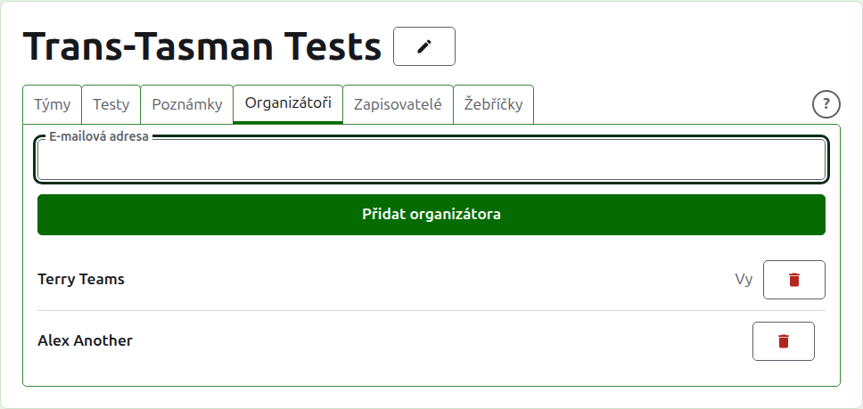
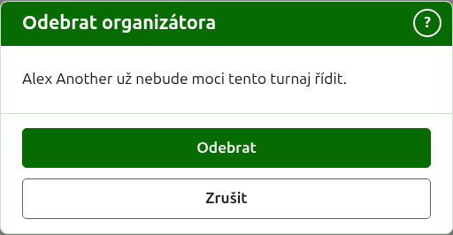
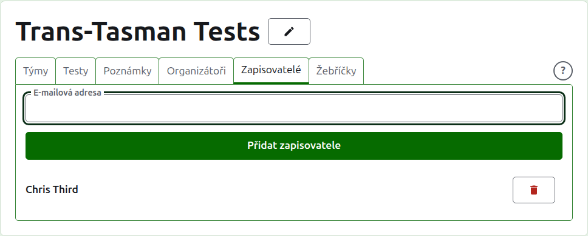
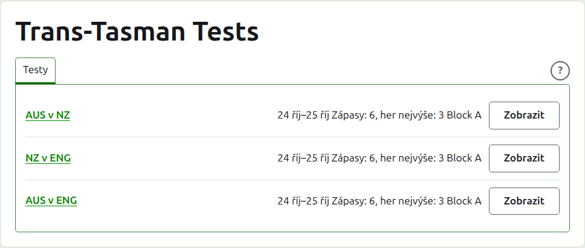

# Organizátoři a zapisovatelé

Turnaj má organizátory, kteří s ním mohou dělat všechno, co se dá, a může mít zapisovatele, kteří zadávají jeho skóre a nic jiného. Kdo turnaj vytvořil, je jeho prvním organizátorem.

## Organizátoři {#managers}

Karta **Organizátoři** uvádí, kdo turnaj vede, v pořadí, v jakém byli určeni, s vaším vlastním jménem označeným jako vaše. Je to místo, kde se turnaj sdílí nebo předává dál.

Někdo se stane organizátorem podle své e-mailové adresy. Napište ji do pole nad seznamem a stiskněte **Přidat organizátora**. Adresa musí patřit k účtu, který je zaregistrován a potvrzen; adresa bez něj je odmítnuta pod polem a web k tomu neříká nic víc. Zapisovatel, který se stane organizátorem, přestává být zapisovatelem.

**Odebrat** organizátora odebere. Z odebraného organizátora se nic neuchovává, takže Odebrat se nejprve zeptá; znovu se jím stane podle své adresy, pokud je zase potřeba. Turnaj má vždy organizátora, takže poslednímu se Odebrat nenabízí.

Můžete odebrat sami sebe. Otázka potom říká, co to znamená: ztratíte vlastní cestu zpět k turnaji a nikdo na stránce to za vás nemůže vrátit. Jiný organizátor vás může znovu učinit organizátorem.

## Zapisovatelé {#scorers}

Karta **Zapisovatelé** je karta Organizátoři pro zapisovatele a funguje stejně: e-mailová adresa a **Přidat zapisovatele** nad seznamem a **Odebrat** u každého.

Zapisovatel vidí turnaj ve svém vlastním seznamu v adminu, s **Skóre** místo Spravovat, a nabízí se mu jen jeho testy: žádné týmy, poznámky, organizátoři, zapisovatelé ani žebříčky. Nemůže otevřít stránku týmu, protože kdo za tým hraje, určují organizátoři. Na stránce testu může skóre zadávat, opravovat, archivovat, obnovovat a přeřazovat jako organizátor.

Organizátor se zapisovatelem nestane, protože organizátor už může dělat všechno, co zapisovatel. Turnaj žádného zapisovatele nepotřebuje, takže každého zapisovatele lze odebrat, i posledního z nich.

Další: [Žebříčky](rankings.md).
