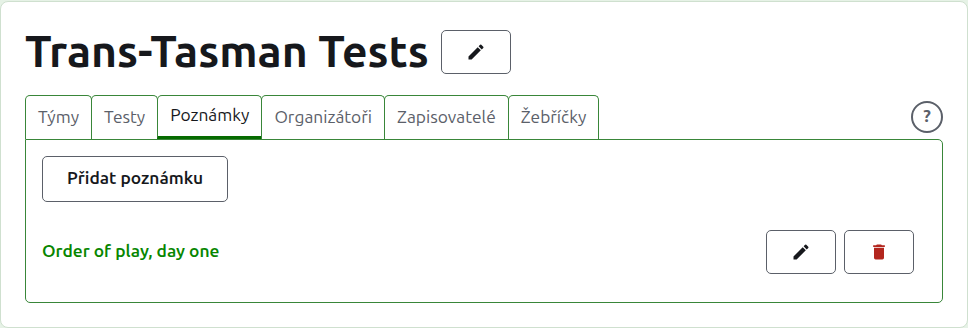
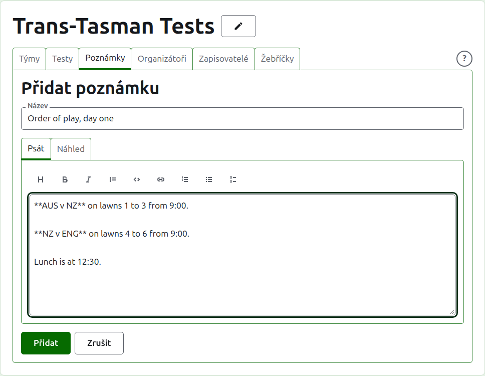
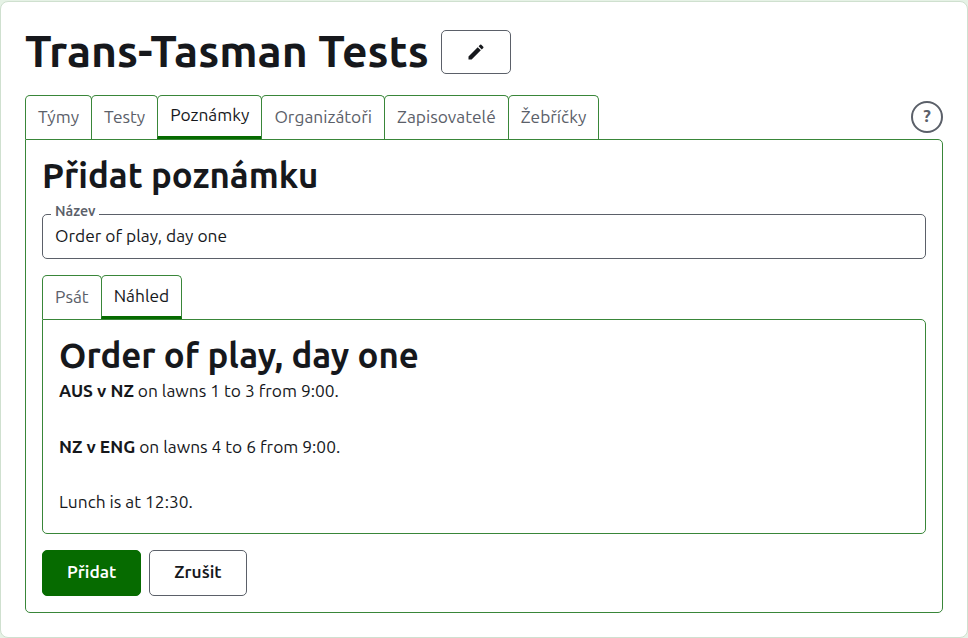
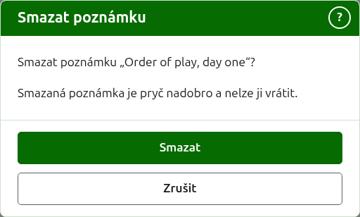

# Poznámky

Karta **Poznámky** na stránce turnaje je místo, kde jeho organizátoři píšou, co hráči potřebují vědět, jak turnaj postupuje: pořadí hry, změnu na trávnících, čas oběda. Čtenáři je najdou na veřejné stránce Poznámky turnaje a poznámka, kterou nečetli, je tam označena červenou hvězdičkou, která také označuje oddíl Poznámky na každé stránce turnaje, dokud ji neotevřou.

## Napsání poznámky

Stiskněte **Přidat poznámku** nad seznamem. Místo seznamu nastoupí panel, protože poznámka se píše obšírně a potřebuje místo.

**Název** je povinný a podle něj se poznámka uvádí. Je to prostý text.

**Popis** se píše v Markdownu a lze ho nechat prázdný, kde název říká vše. Nástrojová lišta nad polem Markdown napíše za vás: Nadpis, Tučně, Kurzívou, Citace, Kód, Odkaz, Číslovaný seznam, Odrážkový seznam a Seznam úkolů. Každý funguje na vybraném textu, nebo na začátku každého vybraného řádku, nebo dá kurzor tam, kam patří slova.

Odstavec se od předchozího odděluje celým prázdným řádkem, aby se poznámka četla jako odstavce.

**Náhled** ukazuje poznámku tak, jak ji uvidí čtenář na její stránce.

Stiskněte **Přidat**. Poznámka je uložena, seznam se vrátí s ní nahoře a na veřejné stránce Poznámky je hned.

## Úprava poznámky

Stiskněte název poznámky nebo její **Upravit** a panel se otevře na této poznámce. Stiskněte **Uložit** a změna se uloží. Poznámka upravená od doby, kdy ji čtenář četl, je pro něj označena znovu.

## Smazání poznámky {#deleting-a-note}

Poznámka, která už neplatí, se smaže. Smazaná poznámka je pryč nadobro, takže **Smazat** se nejprve zeptá.

Další: [Organizátoři a zapisovatelé](managers-and-scorers.md).
