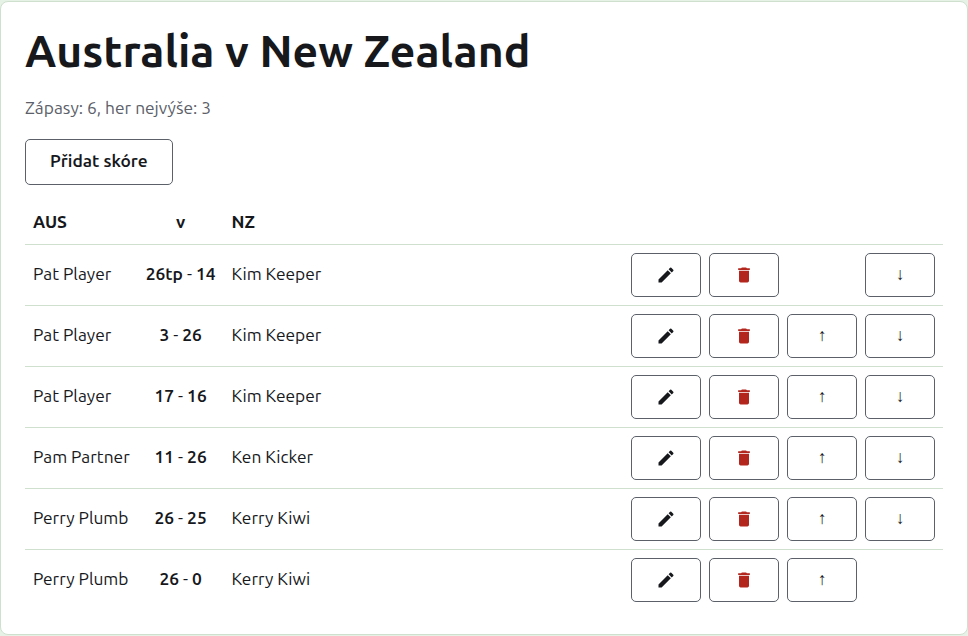
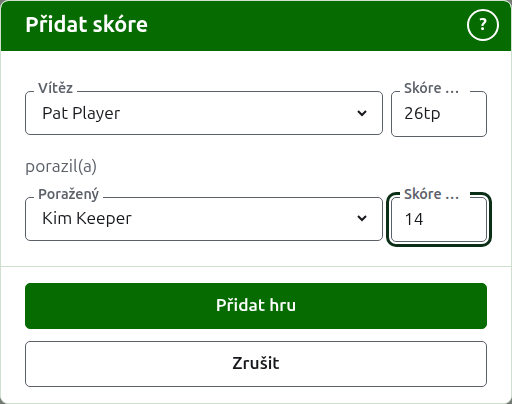

# Skóre

Stránka testu se otevře jeho názvem na kartě Testy nebo z tmavozelené lišty. Nadepisují ji plné názvy jeho týmů, například „Austrálie v Nový Zéland“, a pod nimi, kolik zápasů se u testu očekává a z kolika her je každý nejlepší. Stránkou je jeho skóre, bez karet. Organizátor a zapisovatel vidí stejnou stránku, protože zapisovatel může se skóre dělat všechno, co organizátor.

## Jak je skóre uspořádáno

Skóre je uspořádáno podle týmů, a ne podle toho, kdo vyhrál, v tabulce nadepsané zkráceným názvem prvního týmu, „v“ a zkráceným názvem druhého. Každé skóre je řádek: hráč prvního týmu, potom obě skóre s prvním týmem na prvním místě, například „26tp - 14“, potom hráč druhého týmu, ať z nich vyhrál kdokoli. Archivovaná skóre jsou pod tím uspořádána stejně.

## Zadání skóre {#entering-a-score}

Stiskněte **Přidat skóre** nad seznamem. Dialog se čte tak, jak se výsledek říká nahlas: vítěz a jeho skóre, potom „porazil(a)“, potom poražený a jeho skóre.

Vítěz se vybírá z používaných hráčů obou týmů, pod názvem každého týmu, nejprve hráči prvního týmu a hráči každého týmu v pořadí týmu. Na začátku není vybrán nikdo. Jakmile je vybrán vítěz, poražený se nabízí jen z druhého týmu, protože hra mezi dvěma hráči stejného týmu není hrou mezi týmy. Archivovaný hráč se nenabízí.

Skóre se píše tak, jak ho zapisovatel zapsal: jeho počet bodů a cokoli, co následuje, což se uloží a zobrazí tak, jak je napsáno, například „26tp“ pro 26 branek a trojitý peel. Číslo jsou číslice, kterými skóre začíná; skóre, které nezačíná číslicí, je odmítnuto.

Hra vyhraná při stejném počtu bodů, například když se zastaví časem a rozhodne se jinak, říká, kdo ji vyhrál, značkou za skóre vítěze: „6w“ porazilo „6“. Značky jsou „w“, „won“ a „winner“ (anglicky). Skóre vítěze musí být vyšší než skóre poraženého, nebo označené, pokud turnaj nepovoluje remízy; tehdy se stejný počet bodů bez značky uloží jako remíza.

Pokud se hráči nedají přečíst, dialog to řekne nad poli větou „Hráče se nepodařilo načíst. Zavřete toto okno a otevřete ho znovu.“, místo aby nenabídl nikoho. Udělejte, co říká.

Stiskněte **Přidat hru**. Hra je přidána, dialog řekne která a pole se vyprázdní pro další, protože skóre přicházejí v dávce přečtené z tabule na konci kola. Až budou všechna přidána, stiskněte **Zrušit**.

## Zápasy

Dva hráči, kteří se potkají, hrají zápas o nejlepší z počtu her testu. Hry mezi nimi jsou hrami tohoto zápasu a hra mezi dvěma hráči, jejichž zápas je již rozhodnutý, je odmítnuta: jeden z nich vyhrál víc her, než kolik by druhý ještě mohl vyhrát, nebo se odehrály všechny hry.

Zápas je zahájen, když mají jeho dva hráči používanou hru. Test nezačne víc zápasů, než se u něj očekává: jakmile jich začalo tolik, hra mezi dvěma hráči, kteří se ještě nepotkali, je odmítnuta, zatímco další hra již zahájeného zápasu je přijata. Má-li mít test víc zápasů, změňte ho na kartě Testy, aby je očekával.

## Oprava skóre {#correcting-a-score}

**Upravit** otevře stejný dialog na tomto skóre, nadepsaný Upravit skóre, s vybranými hráči a skóre tak, jak bylo napsáno. Lze měnit hráče i skóre, vybírané jako při přidávání. Stiskněte **Uložit** a oprava se uloží a dialog se zavře. Oprava ponechává výsledek: vyhraná hra zůstává vyhraná a remizovaná hra zůstává remizovaná. Hra, jejíž výsledek byl špatný, se archivuje a zadá znovu.

## Řazení skóre

Skóre přicházejí v pořadí, v jakém se zadají, a proto každé používané skóre nabízí **Nahoru** a **Dolů**, které ho prohodí se sousedním, aby se seznam dal seřadit do pořadí, v jakém se hry hrály.

## Archivace skóre

**Archivovat** skóre odloží, aby se nepočítalo. Je uvedeno pod **Archivovaná skóre**, přeškrtnuté, a nabízí jen **Obnovit**. Ani jedno se neptá, protože každé druhé vrací zpět. Každé skóre v testu lze archivovat, protože test nemá kola, která by na sobě závisela.

Skóre, jehož hráč byl mezitím archivován, se neobnoví, dokud se neobnoví hráč, a stránka to říká.

Další: [Poznámky](notes.md).
