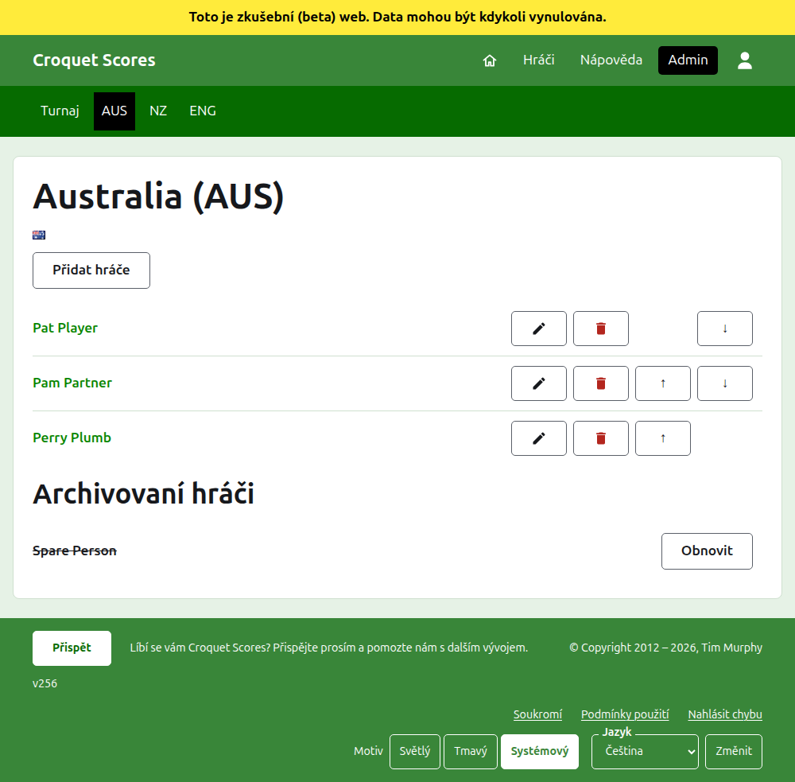
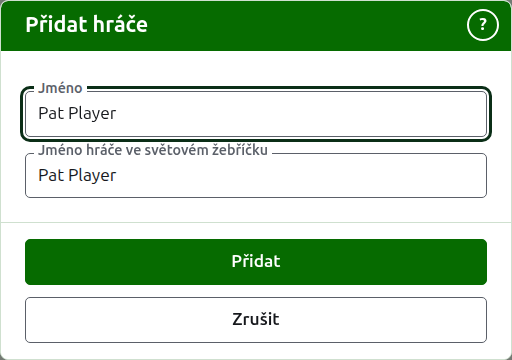

# Hráči týmu

Stránka týmu se otevře jeho názvem nebo jeho **Zobrazit** na kartě Týmy. Nadepisuje ji název týmu se zkráceným názvem v závorce a jeho vlajka, aby organizátor, který se dostal k nesprávnému týmu, to hned viděl. Má co ukázat jedinou věc, hráče týmu, takže seznam je celá stránka.

Tmavozelená lišta na stránce týmu vede k turnaji a ke každému používanému týmu jeho zkráceným názvem, aby se hráči zapisovali tým po týmu, aniž by se bylo nutné vracet na kartu Týmy.

Hráč v týmu patří jen tomuto týmu, zastupuje tým a má vlajku týmu, ne vlastní. Tentýž člověk hrající za dva týmy nebo ve dvou turnajích je hráčem v každém z nich.

## Přidání hráče {#adding-a-player}

Stiskněte **Přidat hráče** nad seznamem. Nad stránkou se otevře dialog.

**Jméno** je povinné, 3 až 254 znaků. Dva hráči v jednom týmu nemohou mít stejné jméno, ať je psáno velkými či malými písmeny; hráč v jiném týmu ho mít může.

**Jméno hráče ve světovém žebříčku** je jméno, pod kterým hráče světové žebříčky znají. Zjišťuje se jen v turnaji v asociačním nebo golfovém kroketu, tedy ve dvou sportech, jejichž hráčů vedou světové žebříčky seznam. Hráči amerického kroketu jsou v žebříčcích znáni pod vlastními jmény, takže se tam nezjišťuje a jméno každého hráče ve světovém žebříčku je vždy jeho jméno. Když hráče přidáváte, sleduje jméno, jak ho píšete, a přestane ho sledovat, jakmile do něj začnete psát. Nechané prázdné se uloží jako jméno hráče. Při psaní se nabízejí hráči, které světové žebříčky znají a jejichž jména tak začínají, a vedle jména ve světovém žebříčku zatržítko říká, že žebříčky jméno znají, a otazník, že ne. Je to jen rada: jméno, které žebříčky neznají, se uloží stejně ochotně jako to, které znají.

Hráč se nikdy nejmenuje „Bye“: jméno, které je „Bye“ nebo „Bye“ s číslem, například „Bye 2“, „Bye-2“ nebo „Bye (2)“, je odmítnuto. Jméno, které tímto slovem jen začíná, jako „Bye / Bassett“, je jménem člověka. Slovo „Bye“ se zde píše anglicky, protože právě to anglické slovo web odmítá.

Stiskněte **Přidat**. Hráč je přidán, dialog to řekne a jeho pole se vyprázdní pro dalšího, s kurzorem zpět ve jménu. Takto přidejte celý tým a potom stisknutím **Zrušit** dialog zavřete.

## Oprava hráče {#correcting-a-player}

Stiskněte jméno hráče nebo jeho **Upravit** a otevře se stejný dialog na tomto hráči, nadepsaný Upravit hráče. Stiskněte **Uložit** a změna se uloží. Hráč, jehož jméno se opraví, si ponechá jméno ve světovém žebříčku, které měl, kromě amerického kroketu, kde je jméno hráče ve světovém žebříčku vždy jeho jméno.

## Pořadí

Hráči jsou uvedeni v pořadí týmu, což je pořadí, v jakém se nabízejí při zadávání skóre testu. **Nahoru** a **Dolů** posunou hráče o jedno místo v rámci týmu.

## Archivace hráče

**Archivovat** hráče odloží: zadaný omylem, nebo už není v týmu. Archivovaný hráč je uveden pod **Archivovaní hráči**, přeškrtnutý, za používanými hráči, a nabízí jen **Obnovit**. Archivace se nikdy neptá, protože hráč v týmu není zapsán nikde jinde a obnovení vrátí všechno.

Hráče, který odehrál jakoukoli používanou hru v testu, nelze archivovat, protože hry by pak byly proti někomu, kdo už neexistuje, a takový hráč proto nenabízí Archivovat. Hráče, jehož jediné hry jsou archivované, archivovat lze.

Další: [Testy](tests.md).
