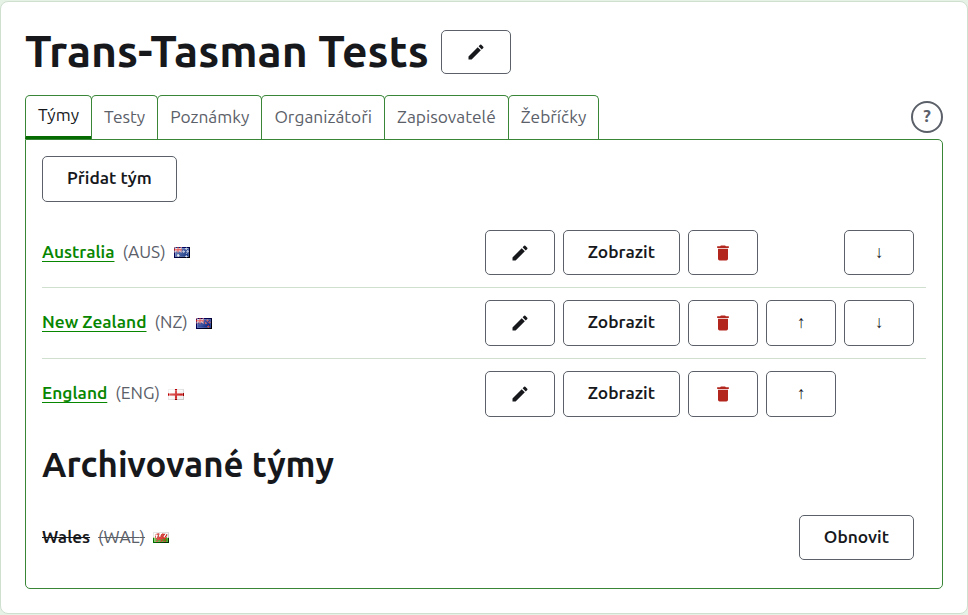
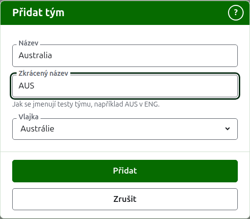
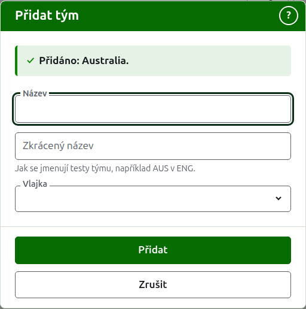
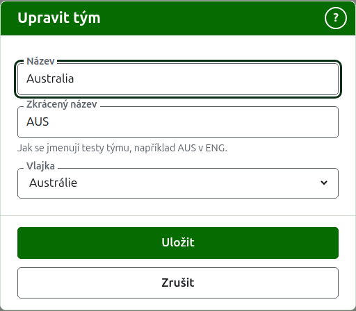

# Týmy

Karta **Týmy** na stránce turnaje je místo, kde se týmy přidávají, opravují, řadí a odkládají. Je to karta, na které se stránka otevře, protože týmy se nastavují jako první. Test je mezi dvěma týmy, takže jsou potřeba alespoň dva, než lze přidat jakýkoli test.

## Přidání týmu {#adding-a-team}

Stiskněte **Přidat tým** nad seznamem. Nad stránkou se otevře dialog.

**Název** je povinný: plný název týmu, například „Austrálie“, který nadepisuje stránku týmu a tabulky veřejných stránek. Dva týmy v jednom turnaji nemohou mít stejný název.

**Zkrácený název** je také povinný: tím se jmenují testy týmu, například „AUS v ENG“, a tak tým nazývá tmavozelená lišta. Má nejvýše 10 znaků a není delší než název, protože zkrácený název delší než název, který zkracuje, jsou ti dva napsaní obráceně. Ani dva týmy nemohou mít stejný zkrácený název.

**Vlajka** se zobrazuje vedle názvu týmu všude, kde se objeví. Lze ji nechat jako žádnou, například u týmu klubu nebo regionu.

Stiskněte **Přidat**. Tým je přidán, dialog to řekne a jeho pole se vyprázdní pro další. Takto přidejte celý seznam a potom stisknutím **Zrušit** dialog zavřete. Zrušit neuloží nic, co už nebylo přidáno.

## Oprava týmu {#correcting-a-team}

Stiskněte **Upravit** u týmu a otevře se stejný dialog na tomto týmu, nadepsaný Upravit tým. Změňte, co je špatně, a stiskněte **Uložit**. Tým, jehož zkrácený název se změní, se všude nazývá novým, takže se s ním přejmenují i jeho testy.

## Pořadí

Týmy jsou uvedeny v pořadí turnaje, což je pořadí, v jakém se nabízejí při přidávání testu, pořadí, v jakém je má tmavozelená lišta, a pořadí, v jakém je uvádí veřejná stránka Hráči. **Nahoru** a **Dolů**, šipky na konci každého řádku, posunou tým o jedno místo.

## Přechod k týmu

Název týmu nebo **Zobrazit** otevře stránku samotného týmu, kde se zapisují jeho hráči. Viz [Hráči týmu](team-players.md).

## Archivace týmu

**Archivovat** tým odloží. Jeho hráči zůstanou u něj a vrátí se, když se obnoví, takže archivace se nejprve neptá. Archivovaný tým je uveden pod **Archivované týmy**, přeškrtnutý, nabízí jen **Obnovit** a jeho stránka je zavřená, dokud se neobnoví.

Tým, který hraje v používaném testu, nelze archivovat, protože test by pak byl proti týmu, který už neexistuje, a takový tým proto nenabízí Archivovat. Tým, jehož testy jsou všechny archivované, archivovat lze.

Další: [Hráči týmu](team-players.md).
