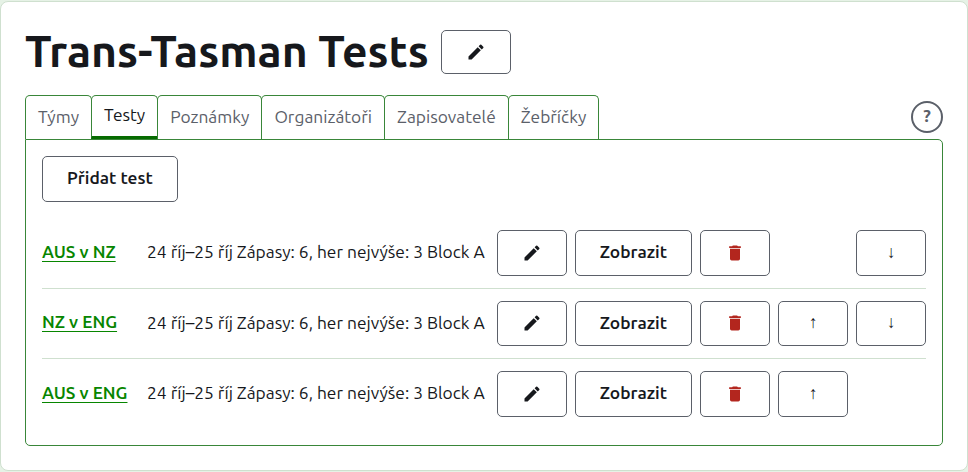
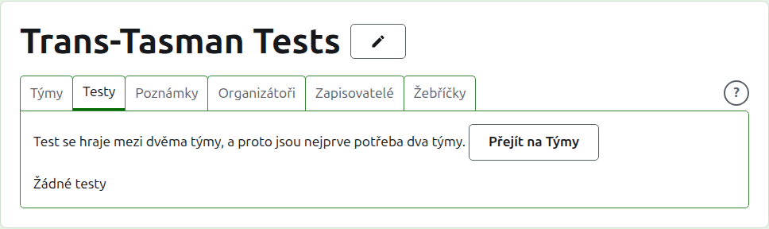
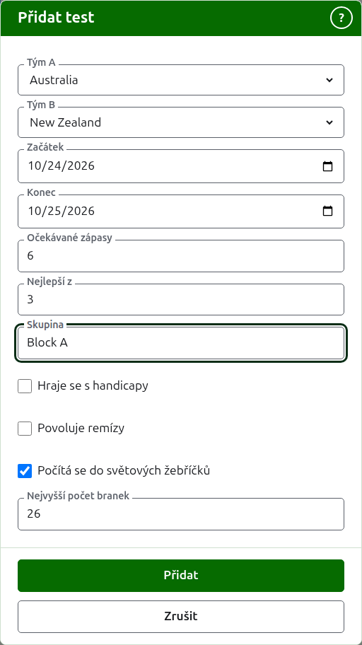
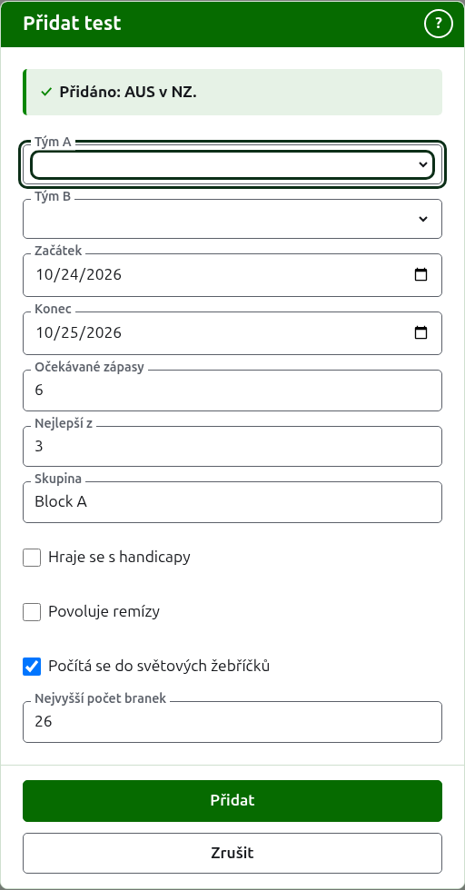
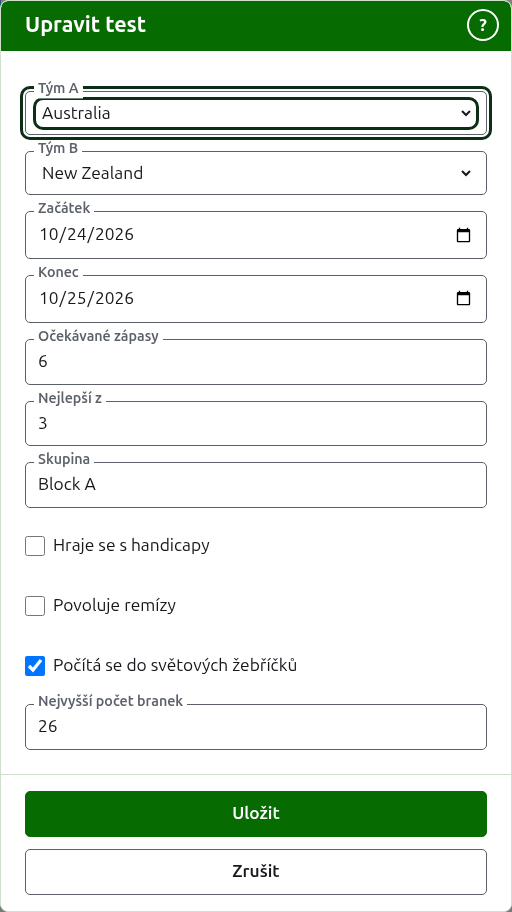

# Testy

Karta **Testy** na stránce turnaje je místo, kde se testy mezi jeho týmy přidávají, mění, řadí a odkládají. Test je jedna ze soutěží turnaje: souboj dvou týmů, nazývaný jejich zkrácenými názvy, například „AUS v NZ“, hraný jako určitý počet zápasů mezi hráčem jednoho a hráčem druhého týmu. Každý test má vlastní stránku, kam se zadává jeho skóre.

Každý test uvádí svůj název, dny, kdy se hraje, kolik zápasů se u něj očekává a z kolika her je každý nejlepší, například „Zápasy: 6, her nejvýše: 3“, a svou skupinu, pokud v nějaké je.

## Nejprve dva týmy

Test je mezi dvěma používanými týmy, a dokud má turnaj méně než dva, karta to říká tam, kde by bylo Přidat test, a odkazuje na kartu Týmy.

## Přidání testu {#adding-a-test}

Stiskněte **Přidat test** nad seznamem. Nad stránkou se otevře dialog, který se čte v pořadí, v jakém se test říká nahlas.

**Tým A** a **Tým B** se vybírají z používaných týmů turnaje, podle názvu, v pořadí turnaje. Na začátku není vybrán žádný, aby se test nikdy nepřidal mezi týmy, které jste nevybrali. Tým B nabízí každý tým kromě toho, který je vybrán jako Tým A, protože tým nehraje test sám proti sobě. Tým A je první tým: jeho hráči jsou vlevo na stránce testu i na veřejné stránce. Test nemá vlastní název, který by se psal; nazývá se zkrácenými názvy svých týmů.

**Začátek** a **Konec** jsou dny, kdy se test hraje, které začínají prvním dnem turnaje. Test se hraje v rámci svého turnaje, takže dny před začátkem turnaje nebo po jeho konci jsou odmítnuty.

**Očekávané zápasy** je, kolik zápasů má test mít, určené akcí před jejím začátkem, aby kdo čte jeho skóre, viděl, jak daleko test je. Je to celé číslo od 1 výše. Je to také limit: jakmile začalo tolik zápasů, kolik se u testu očekává, hra, která by začala další, je odmítnuta, zatímco již započaté zápasy se dohrají. Test, který má mít víc, se změní, aby je očekával.

**Nejlepší z** je, z kolika her je každý zápas nejlepší. Může být sudé, protože zápas se může rozdělit.

**Hraje se s handicapy**, **Povoluje remízy** a **Počítá se do světových žebříčků** se zjišťují jako u kterékoli soutěže. Poslední se zjišťuje jen tam, kde se dá započítat: test v asociačním nebo golfovém kroketu, který se nehraje s handicapy ani nepovoluje remízy. Na začátku je zaškrtnuto.

**Nejvyšší počet branek** je nejvyšší počet branek, do kterých se hra v testu hraje. Začíná na obvyklé hodnotě pro sport, 26, nebo 13 v golfovém kroketu. Vyprázdněte ho pro hru, která se nehraje do počtu branek. Musí to být celé číslo alespoň 1.

**Skupina** je skupina, ve které test je, kde se akce hraje po skupinách, například „Block A“. Je volitelná: nechaná prázdná znamená, že test není v žádné. Testy ve skupině mají na veřejném webu vlastní stránku, která ukazuje, jak týmy skupiny stojí. **Eire Cup** a **Interstate Shield** skupiny nemají, takže se tam dialog na žádnou neptá.

Stiskněte **Přidat**. Test je přidán, dialog řekne který jeho názvem a týmy se vyprázdní pro další, přičemž dny, očekávané zápasy, počet her a skupina zůstanou, jak byly: testy se přidávají po kolech, mezi týmy, které se setkají ve stejný den, takže další test kola jsou jen jeho dva týmy. Až budou všechny přidány, stiskněte **Zrušit**.

## Změna testu {#changing-a-test}

**Upravit** otevře stejný dialog na testu, nadepsaný Upravit test, nastavený tak, jak test je. Stiskněte **Uložit** a změna se uloží.

Test s používanými hrami si ponechá své týmy: dialog je ukazuje, ale nelze je změnit. Zbytek změnit lze, v mezích toho, co se odehrálo: očekávané zápasy v menším počtu, než kolik zápasů už začalo, jsou odmítnuty, a stejně tak počet her menší než nejvíc her, které odehráli kterýkoli dva hráči.

## Pořadí

Testy jsou uvedeny v pořadí turnaje, což je pořadí, v jakém se objevují na veřejných stránkách a v tmavozelené liště. **Nahoru** a **Dolů** posunou test o jedno místo.

## Přechod k testu

Název testu nebo **Zobrazit** otevře jeho stránku, kam se zadává jeho skóre. Vede tam i tmavozelená lišta, ze stránky turnaje nebo z jakéhokoli jiného testu.

## Archivace testu

**Archivovat** test odloží a **Obnovit** to vrátí, takže se ani jedno neptá. Archivovaný test je uveden pod **Archivované testy**, přeškrtnutý, nabízí jen Obnovit a není na veřejných stránkách.

Test s používanými hrami byl odehrán a nelze ho archivovat, dokud se nearchivují jeho hry. Test, jehož hry jsou všechny archivované, archivovat lze, protože archivovaná hra se nepočítá. Test, jehož tým byl mezitím archivován, se neobnoví, dokud se neobnoví tým, a karta to říká.

Další: [Skóre](scores.md).
